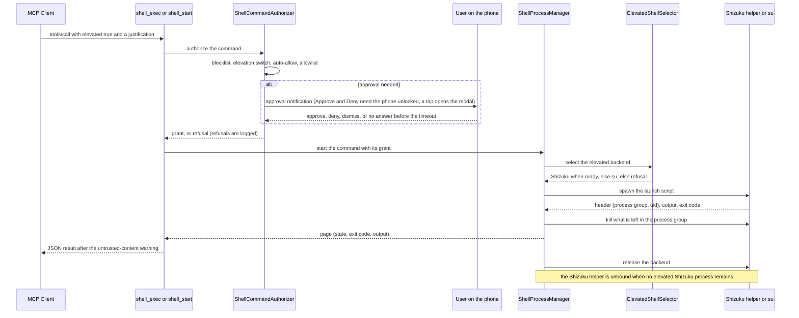

<!-- SACRED DOCUMENT — DO NOT MODIFY except for checkmarks ([ ] → [x]) and review findings. -->
<!-- You MUST NEVER alter, revert, or delete files outside the scope of this plan. -->
<!-- Plans in docs/plans/ are PERMANENT artifacts. There are ZERO exceptions. -->

# Plan 68 — Shell tools with opt-in, per-command elevation (Shizuku, su)

Adds five MCP shell tools modeled on the shell tools of coding-agent harnesses (one command per call, no persistent shell,
no PTY, stdin closed) and lets the agent ask for elevation on a single command. Elevated commands run through Shizuku
(adb shell user, uid 2000, or root when Shizuku runs as root) or, when Shizuku is not usable, through `su`; elevation
is off by default and controlled entirely by the user (auto-allow, blocklist, allowlist, on-device approval).

**Attribution (agreed):** the idea comes from GitHub user **louietyj** (issue #191, fork branch
`louietyj/android-remote-control-mcp:shizuku-shell-upstream`,
https://github.com/danielealbano/android-remote-control-mcp/compare/main...louietyj:android-remote-control-mcp:shizuku-shell-upstream).
The PR body MUST contain `The idea comes from louietyj (issue #191), see their branch shizuku-shell-upstream:` followed
by that compare URL. No fork code is ported.

**Plan document handling:** commit this file as a standalone `docs: add plan 68` commit on the feature branch (User Story 0).

## Agreed decisions (owner, 2026-10-28/29) — NOT derivable from code

| Topic | Decision |
|---|---|
| Tools | `shell_exec` (waits, auto-backgrounds), `shell_start` (background), `shell_output`, `shell_kill`, `shell_list`. Prefix as every tool (`android_`). |
| Tools default | The five shell tools are on by default like every MCP tool (the shell itself is not dangerous); only elevation is off by default. |
| Shell model | No persistent shell, no PTY, stdin closed. `workdir` REQUIRED on every call (never remembered). `envs` JSON object of environment variables, never filtered. |
| Foreground cap | `shell_exec` waits at most the foreground cap (default 90 s, range 10-90 s); the approval wait counts toward it; a command still running at the cap keeps running in the background and the call returns its `process_id`. |
| Output | stdout+stderr combined; per process a buffer keeping the start and the end (default 1 MiB); each call returns at most the per-call cap (default 64 KiB) with `next_offset` paging. |
| Limits | All configurable (UI, ADB, debug e2e receiver): running 16 (1-64), finished kept 32 (0-256), background timeout default 30 min (1 min up to the max), background timeout max 120 min (1-1440 min), approval 60 s (10-85 s), foreground 90 s (10-90 s), output per call 64 KiB (4-256 KiB), buffer 1024 KiB (64-16384 KiB). |
| Settings apply | Shell settings are tool SETTINGS: read on every call (live), like the storage settings. The five tool on/off switches keep the existing restart rule. |
| Elevation | Off by default. Per single command (`elevated: true` + required `justification`). Backend priority: Shizuku when usable, else `su` when found, else the call fails telling the agent why. Elevation is dropped after the command: the Shizuku helper process is stopped when no elevated Shizuku process remains. |
| Permission model | Blocklist (always wins, applies to ALL commands, `*` matches anything). If auto-allow is off: allowlist (`*` never crosses `; & | \` $ ( ) < >` or a newline), otherwise an approval notification (Approve/Deny actions requiring the phone unlocked) or a modal opened by tapping it, showing the justification and the command (truncated at 500 chars). Approval timeout default 60 s. Notifications unavailable → fail at once. No "add to allowlist" button. `envs` are NOT considered by the allowlist. |
| Auth | No authentication requirement for shell or elevation (user's choice). |
| Normal-command identity | Normal commands run as the app's own user: they can read and change the app's settings file and use any `su` grant or Shizuku permission the app holds. By design; documented, not sandboxed. |
| Self-approval | An agent can approve its own elevation request (notification tools, tapping Approve through accessibility while it drives the phone, or sending the approval broadcast with `android_send_intent`). Left as is; documented. |
| `su` and app death | If the app process dies while elevated commands run through `su`, a root manager that starts the root shell from its own daemon (for example Magisk) can keep them running: no timeout, unknown to the next server start. No watchdog; documented. |
| Privacy Mode | Shell tools are outside Privacy Mode: no placeholder substitution, no redaction. The untrusted-content warning still prefixes every result (CLAUDE.md rule). |
| Scratch folder | `<app external cache>/shell`, wiped at every server start, no size cap, NOT exposed to the file tools. Normal commands run with `umask 0007` so elevated commands (group `ext_data_rw`) can enter folders they create. It is mounted `noexec`; binaries run from `/data/local/tmp` via elevated commands. Tool descriptions say so. |
| Shizuku | `dev.rikka.shizuku:api`/`provider` 13.1.5 (latest, MIT) in the main source set. `ShizukuProvider` declared `android:enabled="false"`, enabled only while elevation is on; `ShizukuProvider.disableAutomaticSuiInitialization()` before any provider starts; Sui unsupported. UserService non-daemon, `debuggable(false)`. |
| su | No library: plain `su -c <script>`. |
| Audit | Every elevated command is written to the server log (new `SHELL` type) with command, justification and decision, and its end with state and exit code. |
| e2e | Shizuku on redroid is CORE: not installed, installed not running, running not allowed, running and allowed (uid 2000 and root mode), plus the whole permission model; a setuid test `su` built with the NDK tests the `su` wiring. |
| Out of scope | PTY/stdin input, persistent sessions, Sui, libsu, add-to-allowlist button, Privacy Mode coverage, auth enforcement. |

## Choices confirmed by the owner (2026-10-29)

1. When a command exits, its process group is killed (anything it left running in the background stops), for every backend; with `su` this costs one extra `su -c kill` call per command (accepted).
2. `workdir` must be an absolute path.
3. Every shell setting (elevation, Shizuku status and "Grant access", `su` status and "Test", auto-allow, both pattern lists, limits) lives in its own Settings → Shell section; the five tool on/off switches stay in Settings → MCP Tools.
4. The approval notification is ongoing; dismissing it (Android 14+ allows swiping ongoing notifications) counts as Deny.
5. New Compose files carry `@file:Suppress("FunctionNaming")` like every existing Compose file.
6. The e2e test `su` has no capabilities, so uids reported through it are not asserted (wiring only).

## Verified facts the implementation relies on (2026-10-28/29)

- Realme T70 (Android 16) and redroid 14: app uid and uid 2000 (`u:r:shell:s0`, group 1078 `ext_data_rw`) read/write/delete each other's files under `Android/data/<pkg>/cache`; the app's `sh` has umask 077 (dirs 0700, unreachable for uid 2000), `umask 0007` fixes it; `/storage/emulated` is `noexec`; the app cannot list `/data/local/tmp`, uid 2000 can run binaries from it. A real Shizuku UserService (13.6.0) ran as uid 2000 with group 1078 and passed the same checks on both.
- Shizuku in redroid: adb is root (`ro.secure=0`); `su 2000,2000,1004,1007,1011,1015,1028,1078,1079,3001,3002,3003,3006,3009,3011,3012 <lib/x86_64/libshizuku.so>` starts it as uid 2000; running the starter directly starts it as root.
- `pm grant <pkg> moe.shizuku.manager.permission.API_V23` makes the app allowed only after a Shizuku server restart (the server syncs the runtime permission into its config at start); `pm revoke` + restart reverts it.
- Shizuku pushes its binder through the app's `ShizukuProvider` when the server starts and once per app process and per uid start (`BinderSender` keeps `PID_LIST`/`UID_LIST`, cleared only when the process or uid dies). A disabled provider is skipped (no force-stop), but the pid stays recorded, so a provider enabled later receives nothing until Shizuku restarts or the app gets a new process.
- Stock redroid `su` is not reachable by an app process; a setuid+setgid test `su` (`sh -p`) gives uid 0 without capabilities and passes exit codes through. App processes there have `NoNewPrivs: 0`, `CapBnd: 0`.
- detekt 2.0.0-alpha.5 plain `detekt` task: `LongParameterList` does not fire; active limits used here: LongMethod 60, LargeClass 600, TooManyFunctions 11, ReturnCount 2, ThrowsCount 2, CyclomaticComplexMethod 14, NestedBlockDepth 4, MaxLineLength 120, MagicNumber (only constants/properties), TooGenericExceptionCaught.
- `androidx.core` 1.19.0 `NotificationCompat.Action.Builder.setAuthenticationRequired(boolean)` exists; minSdk is 33.
- Shizuku APK v13.6.0 `https://github.com/RikkaApps/Shizuku/releases/download/v13.6.0/shizuku-v13.6.0.r1086.2650830c-release.apk`, SHA-256 `6e273ab0e991c4e79bc8b1bbb9b9dd739ccac1a8712a541a214078886b7b790f` (ships `lib/x86_64/libshizuku.so`).
- Redroid 14: the stock `su` is `/system/xbin/su` (no `/system/bin/su`); `adb push` as root writes `/system/bin` (overlay root filesystem).
- Shizuku 13.1.5 client: `unbindUserService(args, conn, true)` only removes the server-side service; the cached `ShizukuServiceConnection` (keyed by tag) keeps the old connection and, when the destroyed helper dies, posts `onServiceDisconnected` to it and drops the cache entry. A rebind with the same tag before that can be swallowed. Hence a fresh `tag` per binding and identity-checked callbacks. `bindUserService`/`unbindUserService` throw `IllegalStateException` (no binder) or `RuntimeException` (wrapped `RemoteException`).
- Shizuku server (Shizuku-API `server-shared`, `UserServiceRecord.ConnectionList.onCallbackDied` → `removeSelf()` → `UserServiceManager.removeUserServiceLocked` → `UserServiceRecord.destroy()`): when the last connection of a non-daemon UserService dies (the app process died), the record is removed and the service receives the one-way `destroy` call (AIDL id 16777114, transaction code 16777115 = `FIRST_CALL_TRANSACTION` + 16777114, Shizuku's `USER_SERVICE_TRANSACTION_destroy`).
- Shizuku servers before v13 start a UserService with its no-argument constructor only (`ServiceStarter`, `serviceClass.newInstance()`); the `Context` constructor `ShellUserService` needs came with v13 (Shizuku-API `UserService` `getConstructor(Context.class)`), so 13 is the minimum.
- Shizuku 13.1.5 client: `bindUserService` updates the `ShizukuServiceConnections` cache on the calling thread while `ShizukuServiceConnection.died()` iterates it on the main thread, so the app binds from the main thread.
- `NotificationProviderImpl.executeAction` fires an action's `PendingIntent` directly, so `setAuthenticationRequired` does not stop the notification tools, and `IntentDispatcherImpl` sends broadcasts from the app's own uid, so `android_send_intent` reaches the non-exported `ElevationApprovalReceiver` (both documented, see Self-approval).
- `ParcelFileDescriptor.AutoCloseInputStream(pfd)` cannot be constructed on the JVM test host (stub `FileInputStream(null)`); the backend takes the stream factory as a parameter.

## Conventions for the implementer

- Code blocks in this plan carry NO comments (owner rule); do not add comments or KDoc beyond what is shown.
- `.../` = `app/src/main/kotlin/com/danielealbano/androidremotecontrolmcp/`; `test/.../` = `app/src/test/kotlin/com/danielealbano/androidremotecontrolmcp/`; `e2e/.../` = `e2e-tests/src/test/kotlin/com/danielealbano/androidremotecontrolmcp/e2e/`.
- Every new user-visible string goes to `app/src/main/res/values/strings.xml`; each task adds the strings it uses (listed in the task), appended right before `</resources>` unless the task names another anchor.
- Lint/tests run only in User Story 11.
- New Compose files start with `@file:Suppress("FunctionNaming")`, the same file-level suppression every existing Compose file in the repo carries (detekt `FunctionNaming` pattern `[a-z]…` vs the CLAUDE.md PascalCase rule for composables). Approved by the owner on 2026-10-29; no other suppression is allowed.
- Tests that start real processes on the JVM host (`/bin/sh`, `setsid`, `kill`, `ps`) are annotated `@EnabledOnOs(OS.LINUX)` (CI and development are Linux).
- At the end of every user story commit that story's files (staged by name, never `git add -A`/`.`) in the TOOLS.md format `<type>: <short description>` (`feat: …` for US1 to US8 with their tests, `test: …` for US9, `docs: …` for US10), with no `Co-Authored-By`, `Generated with` or any other AI attribution line, then `git push origin feat/shell-tools-elevation`. The checkmarks ticked in this plan file for that story go into the same commit. Every later fix (gates, manual QA, review findings) is committed the same way (`fix: …`, `test: …` or `docs: …`) with the files it touches and pushed.

---

## User Story 0 — Feature branch

**Why:** every user story is committed and pushed on its own branch as it is finished (CLAUDE.md).

**Acceptance criteria:**
- [ ] `feat/shell-tools-elevation` exists from the latest `main`, holds the `docs: add plan 68` commit and is pushed.

### Task 0.1 — Branch and plan commit

- Run `git status` and `git diff --stat`, show the result to the owner and ask how to handle every uncommitted change,
  this plan file included (CLAUDE.md uncommitted-work rule); only with the owner's explicit consent run
  `git checkout main && git pull origin main` and `git checkout -b feat/shell-tools-elevation`.
- `git add docs/plans/68_shell_tools_elevation_20261029114445.md`, commit `docs: add plan 68`,
  `git push -u origin feat/shell-tools-elevation`.

**Definition of Done:**
- [ ] Branch created from the latest `main`; the plan commit pushed.

---

## User Story 1 — Shell settings model, persistence and the Shizuku dependency

**Why:** every other story reads the shell settings live from `ServerConfig`; the Shizuku provider must exist (disabled)
before anything can switch it.

**Acceptance criteria:**
- [ ] `ServerConfig.shellConfig` exposes elevation, auto-allow, both pattern lists and the eight limits with the agreed defaults and ranges.
- [ ] `SettingsRepository` extends `ShellSettings`; out-of-range limits, a background default above the max and a max below the default are refused.
- [ ] Turning elevation on/off enables/disables `rikka.shizuku.ShizukuProvider`; the app re-applies the state at startup.
- [ ] Shizuku 13.1.5 libraries are dependencies of both flavors; the provider is declared disabled; Sui auto-initialization is disabled before providers start.

### Task 1.1 — Dependencies, AIDL build feature, manifest provider, Sui opt-out

**Action 1 — modify** `gradle/libs.versions.toml`: in `[versions]` add after `datastore = "1.2.1"`:

```toml
shizuku = "13.1.5"
```

and in `[libraries]` add after the `datastore-preferences` line:

```toml
shizuku-api = { group = "dev.rikka.shizuku", name = "api", version.ref = "shizuku" }
shizuku-provider = { group = "dev.rikka.shizuku", name = "provider", version.ref = "shizuku" }
```

**Action 2 — modify** `app/build.gradle.kts`: `buildFeatures` becomes:

```kotlin
    buildFeatures {
        aidl = true
        buildConfig = true
        compose = true
    }
```

and add after `implementation(libs.kotlinx.coroutines.android)`:

```kotlin
    implementation(libs.shizuku.api)
    implementation(libs.shizuku.provider)
```

**Action 3 — modify** `app/src/main/AndroidManifest.xml`: add inside `<application>`, right before the comment
`<!-- Remove WorkManager's default on-startup initializer: …` that precedes the `androidx.startup.InitializationProvider`
`<provider>`:

```xml
        <provider
            android:name="rikka.shizuku.ShizukuProvider"
            android:authorities="${applicationId}.shizuku"
            android:enabled="false"
            android:exported="true"
            android:multiprocess="false"
            android:permission="android.permission.INTERACT_ACROSS_USERS_FULL" />
```

**Action 4 — modify** `.../McpApplication.kt`: add the import `rikka.shizuku.ShizukuProvider` and `android.content.Context`,
and add as the first member function of the class (before `onCreate`):

```kotlin
    override fun attachBaseContext(base: Context) {
        ShizukuProvider.disableAutomaticSuiInitialization()
        super.attachBaseContext(base)
    }
```

**Definition of Done:**
- [ ] Dependencies, `aidl = true` and the provider declared exactly as above.
- [ ] `attachBaseContext` added exactly as above.

### Task 1.2 — `ShellLimit` / `ShellConfig`

**Action 1 — create** `.../data/model/ShellConfig.kt`:

```kotlin
package com.danielealbano.androidremotecontrolmcp.data.model

private const val DEFAULT_MAX_RUNNING = 16
private const val UPPER_MAX_RUNNING = 64
private const val DEFAULT_MAX_FINISHED = 32
private const val UPPER_MAX_FINISHED = 256
private const val DEFAULT_BACKGROUND_DEFAULT_MINUTES = 30
private const val DEFAULT_BACKGROUND_MAX_MINUTES = 120
private const val UPPER_BACKGROUND_MINUTES = 1440
private const val DEFAULT_APPROVAL_SECONDS = 60
private const val LOWER_APPROVAL_SECONDS = 10
private const val UPPER_APPROVAL_SECONDS = 85
private const val DEFAULT_FOREGROUND_SECONDS = 90
private const val LOWER_FOREGROUND_SECONDS = 10
private const val UPPER_FOREGROUND_SECONDS = 90
private const val DEFAULT_OUTPUT_PER_CALL_KIB = 64
private const val LOWER_OUTPUT_PER_CALL_KIB = 4
private const val UPPER_OUTPUT_PER_CALL_KIB = 256
private const val DEFAULT_OUTPUT_BUFFER_KIB = 1024
private const val LOWER_OUTPUT_BUFFER_KIB = 64
private const val UPPER_OUTPUT_BUFFER_KIB = 16384

enum class ShellLimit(
    val key: String,
    val defaultValue: Int,
    val min: Int,
    val max: Int,
) {
    MAX_RUNNING_PROCESSES("shell_max_running_processes", DEFAULT_MAX_RUNNING, 1, UPPER_MAX_RUNNING),
    MAX_FINISHED_PROCESSES("shell_max_finished_processes", DEFAULT_MAX_FINISHED, 0, UPPER_MAX_FINISHED),
    BACKGROUND_TIMEOUT_DEFAULT_MINUTES(
        "shell_background_timeout_default_minutes",
        DEFAULT_BACKGROUND_DEFAULT_MINUTES,
        1,
        UPPER_BACKGROUND_MINUTES,
    ),
    BACKGROUND_TIMEOUT_MAX_MINUTES(
        "shell_background_timeout_max_minutes",
        DEFAULT_BACKGROUND_MAX_MINUTES,
        1,
        UPPER_BACKGROUND_MINUTES,
    ),
    APPROVAL_TIMEOUT_SECONDS(
        "shell_approval_timeout_seconds",
        DEFAULT_APPROVAL_SECONDS,
        LOWER_APPROVAL_SECONDS,
        UPPER_APPROVAL_SECONDS,
    ),
    FOREGROUND_WAIT_SECONDS(
        "shell_foreground_wait_seconds",
        DEFAULT_FOREGROUND_SECONDS,
        LOWER_FOREGROUND_SECONDS,
        UPPER_FOREGROUND_SECONDS,
    ),
    OUTPUT_PER_CALL_KIB(
        "shell_output_per_call_kib",
        DEFAULT_OUTPUT_PER_CALL_KIB,
        LOWER_OUTPUT_PER_CALL_KIB,
        UPPER_OUTPUT_PER_CALL_KIB,
    ),
    OUTPUT_BUFFER_KIB(
        "shell_output_buffer_kib",
        DEFAULT_OUTPUT_BUFFER_KIB,
        LOWER_OUTPUT_BUFFER_KIB,
        UPPER_OUTPUT_BUFFER_KIB,
    ),
    ;

    fun isValid(value: Int): Boolean = value in min..max
}

enum class ShellPatternKind {
    BLOCKLIST,
    ALLOWLIST,
}

data class ShellConfig(
    val elevationEnabled: Boolean = false,
    val autoAllowElevation: Boolean = false,
    val blocklist: List<String> = emptyList(),
    val allowlist: List<String> = emptyList(),
    val limits: Map<ShellLimit, Int> = emptyMap(),
) {
    fun limit(limit: ShellLimit): Int = limits[limit] ?: limit.defaultValue

    val backgroundTimeoutDefaultMinutes: Int
        get() =
            minOf(
                limit(ShellLimit.BACKGROUND_TIMEOUT_DEFAULT_MINUTES),
                limit(ShellLimit.BACKGROUND_TIMEOUT_MAX_MINUTES),
            )
}
```

**Action 2 — modify** `.../data/model/ServerConfig.kt`: add the constructor property after `hideFromRecents`:

```kotlin
    val hideFromRecents: Boolean = false,
    val shellConfig: ShellConfig = ShellConfig(),
) {
```

**Definition of Done:**
- [ ] Enum keys, defaults and ranges exactly as above; `ServerConfig.shellConfig` added.

### Task 1.3 — `ShizukuProviderSwitch`

**Action 1 — create** `.../services/shell/ShizukuProviderSwitch.kt`:

```kotlin
package com.danielealbano.androidremotecontrolmcp.services.shell

import android.content.ComponentName
import android.content.Context
import android.content.pm.PackageManager
import dagger.hilt.android.qualifiers.ApplicationContext
import rikka.shizuku.ShizukuProvider
import javax.inject.Inject

interface ShizukuProviderSwitch {
    fun setEnabled(enabled: Boolean)
}

class ShizukuProviderSwitchImpl internal constructor(
    private val packageManager: PackageManager,
    private val provider: ComponentName,
) : ShizukuProviderSwitch {
    @Inject
    constructor(
        @ApplicationContext context: Context,
    ) : this(context.packageManager, ComponentName(context, ShizukuProvider::class.java))

    override fun setEnabled(enabled: Boolean) {
        val state =
            if (enabled) {
                PackageManager.COMPONENT_ENABLED_STATE_ENABLED
            } else {
                PackageManager.COMPONENT_ENABLED_STATE_DISABLED
            }
        packageManager.setComponentEnabledSetting(provider, state, PackageManager.DONT_KILL_APP)
    }
}
```

**Definition of Done:**
- [ ] File created exactly as above.

### Task 1.4 — `ShellSettings` and `ShellSettingsImpl`

**Action 1 — create** `.../data/repository/ShellSettings.kt`:

```kotlin
package com.danielealbano.androidremotecontrolmcp.data.repository

import com.danielealbano.androidremotecontrolmcp.data.model.ShellLimit
import com.danielealbano.androidremotecontrolmcp.data.model.ShellPatternKind

interface ShellSettings {
    suspend fun updateShellElevationEnabled(enabled: Boolean)

    suspend fun updateShellAutoAllowElevation(enabled: Boolean)

    suspend fun updateShellBlocklist(patterns: List<String>)

    suspend fun updateShellAllowlist(patterns: List<String>)

    suspend fun editShellPatterns(
        kind: ShellPatternKind,
        change: (List<String>) -> List<String>,
    )

    suspend fun updateShellLimit(
        limit: ShellLimit,
        value: Int,
    ): Result<Int>

    suspend fun syncShizukuProvider()
}
```

**Action 2 — create** `.../data/repository/ShellSettingsImpl.kt`:

```kotlin
package com.danielealbano.androidremotecontrolmcp.data.repository

import androidx.datastore.core.DataStore
import androidx.datastore.preferences.core.MutablePreferences
import androidx.datastore.preferences.core.Preferences
import androidx.datastore.preferences.core.booleanPreferencesKey
import androidx.datastore.preferences.core.edit
import androidx.datastore.preferences.core.intPreferencesKey
import androidx.datastore.preferences.core.stringPreferencesKey
import com.danielealbano.androidremotecontrolmcp.data.model.ShellConfig
import com.danielealbano.androidremotecontrolmcp.data.model.ShellLimit
import com.danielealbano.androidremotecontrolmcp.data.model.ShellPatternKind
import com.danielealbano.androidremotecontrolmcp.services.shell.ShizukuProviderSwitch
import kotlinx.serialization.builtins.ListSerializer
import kotlinx.serialization.builtins.serializer
import kotlinx.serialization.json.Json
import javax.inject.Inject

internal val SHELL_ELEVATION_ENABLED_KEY = booleanPreferencesKey("shell_elevation_enabled")
internal val SHELL_AUTO_ALLOW_ELEVATION_KEY = booleanPreferencesKey("shell_auto_allow_elevation")
internal val SHELL_BLOCKLIST_KEY = stringPreferencesKey("shell_blocklist")
internal val SHELL_ALLOWLIST_KEY = stringPreferencesKey("shell_allowlist")

private val SHELL_PATTERNS_SERIALIZER = ListSerializer(String.serializer())

internal fun shellLimitKey(limit: ShellLimit): Preferences.Key<Int> = intPreferencesKey(limit.key)

internal fun parseShellPatternsOrNull(json: String): List<String>? =
    runCatching { Json.decodeFromString(SHELL_PATTERNS_SERIALIZER, json) }.getOrNull()

internal fun normalizeShellPatterns(patterns: List<String>): List<String> =
    patterns
        .map { it.trim() }
        .filter { it.isNotEmpty() }
        .distinct()

internal fun mapShellConfig(prefs: Preferences): ShellConfig =
    ShellConfig(
        elevationEnabled = prefs[SHELL_ELEVATION_ENABLED_KEY] ?: false,
        autoAllowElevation = prefs[SHELL_AUTO_ALLOW_ELEVATION_KEY] ?: false,
        blocklist = prefs[SHELL_BLOCKLIST_KEY]?.let(::parseShellPatternsOrNull).orEmpty(),
        allowlist = prefs[SHELL_ALLOWLIST_KEY]?.let(::parseShellPatternsOrNull).orEmpty(),
        limits =
            ShellLimit.entries
                .mapNotNull { limit -> prefs[shellLimitKey(limit)]?.takeIf(limit::isValid)?.let { limit to it } }
                .toMap(),
    )

internal fun crossLimitError(
    current: ShellConfig,
    limit: ShellLimit,
    value: Int,
): String? {
    val defaultMinutes = current.limit(ShellLimit.BACKGROUND_TIMEOUT_DEFAULT_MINUTES)
    val maxMinutes = current.limit(ShellLimit.BACKGROUND_TIMEOUT_MAX_MINUTES)
    val exceedsMax = limit == ShellLimit.BACKGROUND_TIMEOUT_DEFAULT_MINUTES && value > maxMinutes
    val belowDefault = limit == ShellLimit.BACKGROUND_TIMEOUT_MAX_MINUTES && value < defaultMinutes
    return when {
        exceedsMax -> "Must not exceed the maximum background timeout ($maxMinutes)"
        belowDefault -> "Must not be below the default background timeout ($defaultMinutes)"
        else -> null
    }
}

class ShellSettingsImpl
    @Inject
    constructor(
        private val dataStore: DataStore<Preferences>,
        private val settingsChangeLogger: SettingsChangeLogger,
        private val shizukuProviderSwitch: ShizukuProviderSwitch,
    ) : ShellSettings {
        override suspend fun updateShellElevationEnabled(enabled: Boolean) {
            dataStore.edit { prefs ->
                val old = prefs[SHELL_ELEVATION_ENABLED_KEY] ?: false
                prefs[SHELL_ELEVATION_ENABLED_KEY] = enabled
                settingsChangeLogger.submitToggle(
                    SHELL_ELEVATION_ENABLED_KEY.name,
                    old,
                    enabled,
                    "Elevated shell commands",
                    "allowed",
                    "disallowed",
                )
                shizukuProviderSwitch.setEnabled(enabled)
            }
        }

        override suspend fun syncShizukuProvider() {
            dataStore.edit { prefs -> shizukuProviderSwitch.setEnabled(prefs[SHELL_ELEVATION_ENABLED_KEY] ?: false) }
        }

        override suspend fun updateShellAutoAllowElevation(enabled: Boolean) {
            dataStore.edit { prefs ->
                val old = prefs[SHELL_AUTO_ALLOW_ELEVATION_KEY] ?: false
                prefs[SHELL_AUTO_ALLOW_ELEVATION_KEY] = enabled
                settingsChangeLogger.submitToggle(
                    SHELL_AUTO_ALLOW_ELEVATION_KEY.name,
                    old,
                    enabled,
                    "Auto-allow of elevated shell commands",
                )
            }
        }

        override suspend fun updateShellBlocklist(patterns: List<String>) {
            editShellPatterns(ShellPatternKind.BLOCKLIST) { patterns }
        }

        override suspend fun updateShellAllowlist(patterns: List<String>) {
            editShellPatterns(ShellPatternKind.ALLOWLIST) { patterns }
        }

        override suspend fun editShellPatterns(
            kind: ShellPatternKind,
            change: (List<String>) -> List<String>,
        ) {
            val key = if (kind == ShellPatternKind.BLOCKLIST) SHELL_BLOCKLIST_KEY else SHELL_ALLOWLIST_KEY
            val subject = if (kind == ShellPatternKind.BLOCKLIST) "Shell blocklist" else "Shell allowlist"
            dataStore.edit { prefs ->
                val old = prefs[key]?.let(::parseShellPatternsOrNull).orEmpty()
                val normalized = normalizeShellPatterns(change(old))
                prefs[key] = Json.encodeToString(SHELL_PATTERNS_SERIALIZER, normalized)
                settingsChangeLogger.submit(key.name, old.joinToString("\n"), normalized.joinToString("\n")) { _, _ ->
                    "$subject updated (${normalized.size} patterns)"
                }
            }
        }

        override suspend fun updateShellLimit(
            limit: ShellLimit,
            value: Int,
        ): Result<Int> {
            if (!limit.isValid(value)) {
                return Result.failure(IllegalArgumentException("Must be between ${limit.min} and ${limit.max}"))
            }
            var result = Result.success(value)
            dataStore.edit { prefs -> result = applyLimit(prefs, limit, value) }
            return result
        }

        private fun applyLimit(
            prefs: MutablePreferences,
            limit: ShellLimit,
            value: Int,
        ): Result<Int> {
            val current = mapShellConfig(prefs)
            val error = crossLimitError(current, limit, value)
            if (error != null) return Result.failure(IllegalArgumentException(error))
            val old = current.limit(limit)
            prefs[shellLimitKey(limit)] = value
            settingsChangeLogger.submit(limit.key, old.toString(), value.toString()) { o, n ->
                "Shell setting ${limit.key} changed from $o to $n"
            }
            return Result.success(value)
        }
    }
```

**Action 3 — modify** `.../data/repository/SettingsRepository.kt`: the interface header becomes:

```kotlin
interface SettingsRepository :
    EventChannelSettings,
    ArcTunnelSettings,
    DownloadSettings,
    ShellSettings {
```

**Action 4 — modify** `.../data/repository/SettingsRepositoryImpl.kt`: in `mapPreferencesToServerConfig` add after
`hideFromRecents = prefs[HIDE_FROM_RECENTS_KEY] ?: false,`:

```kotlin
        shellConfig = mapShellConfig(prefs),
```

and the class header becomes:

```kotlin
class SettingsRepositoryImpl
    @Inject
    constructor(
        private val dataStore: DataStore<Preferences>,
        private val settingsChangeLogger: SettingsChangeLogger,
        eventChannelSettings: EventChannelSettings,
        arcTunnelSettings: ArcTunnelSettings,
        downloadSettings: DownloadSettings,
        shellSettings: ShellSettings,
    ) : SettingsRepository,
        EventChannelSettings by eventChannelSettings,
        ArcTunnelSettings by arcTunnelSettings,
        DownloadSettings by downloadSettings,
        ShellSettings by shellSettings {
```

**Action 5 — create** `.../di/ShellModule.kt`:

```kotlin
package com.danielealbano.androidremotecontrolmcp.di

import com.danielealbano.androidremotecontrolmcp.data.repository.ShellSettings
import com.danielealbano.androidremotecontrolmcp.data.repository.ShellSettingsImpl
import com.danielealbano.androidremotecontrolmcp.services.shell.ShizukuProviderSwitch
import com.danielealbano.androidremotecontrolmcp.services.shell.ShizukuProviderSwitchImpl
import dagger.Binds
import dagger.Module
import dagger.hilt.InstallIn
import dagger.hilt.components.SingletonComponent
import javax.inject.Singleton

@Module
@InstallIn(SingletonComponent::class)
abstract class ShellModule {
    @Binds
    @Singleton
    abstract fun bindShellSettings(impl: ShellSettingsImpl): ShellSettings

    @Binds
    @Singleton
    abstract fun bindShizukuProviderSwitch(impl: ShizukuProviderSwitchImpl): ShizukuProviderSwitch
}
```

**Action 6 — modify** `.../McpApplication.kt`: re-apply the stored state at startup (inside a DataStore edit, so it
cannot interleave with a toggle). Replace the line
`CoroutineScope(Dispatchers.IO).launch { settingsRepository.ensureAuthModelMigrated() }` with:

```kotlin
        CoroutineScope(Dispatchers.IO).launch {
            settingsRepository.ensureAuthModelMigrated()
            settingsRepository.syncShizukuProvider()
        }
```

**Action 7 — modify** the six test files that construct `SettingsRepositoryImpl(...)`, adding a new last argument:
- `test/.../data/repository/SettingsRepositoryImplTest.kt`, `SettingsRepositoryUpdateCheckTest.kt`,
  `SettingsRepositoryLoggingTest.kt`, `SettingsRepositoryServerRunningTest.kt` and
  `app/src/testGms/kotlin/com/danielealbano/androidremotecontrolmcp/data/repository/GeofenceConfigRepositoryTest.kt`:
  after `DownloadSettingsImpl(dataStore, changeLogger),` add (matching the surrounding indentation)

```kotlin
                ShellSettingsImpl(dataStore, changeLogger, mockk(relaxed = true)),
```

  (import `io.mockk.mockk` where missing);
- `test/.../data/repository/EventChannelSettingsTest.kt`: after `io.mockk.mockk<DownloadSettings>(relaxed = true),` add

```kotlin
                io.mockk.mockk<ShellSettings>(relaxed = true),
```

**Definition of Done:**
- [ ] Files created/modified exactly as above.

### Task 1.5 — Tests

**File:** `test/.../data/repository/ShellSettingsImplTest.kt`

**Setup:** copy `SettingsRepositoryImplTest`'s setup (Preferences DataStore in `@TempDir` on `testScope.backgroundScope`, `SettingsChangeLogger(log, testDispatcher, SettingsChangeLogger.COALESCE_WINDOW_MS)` with a `RecordingServerLogRepository` kept as `log`; advance virtual time past the window before asserting log entries); `switch` = `mockk<ShizukuProviderSwitch>(relaxed = true)`.

| Test | Verifies |
|------|----------|
| `defaults when nothing is stored` | `mapShellConfig(emptyPreferences())` has elevation/auto-allow off, empty lists, every `limit(..)` == `defaultValue`, `backgroundTimeoutDefaultMinutes` == 30 |
| `syncShizukuProvider applies the stored elevation switch` | stored on → `switch.setEnabled(true)`; stored off or absent → `setEnabled(false)` |
| `elevation toggle persists and switches the provider` | `updateShellElevationEnabled(true)` stores true and calls `switch.setEnabled(true)`; then false → `setEnabled(false)` |
| `auto-allow toggle persists` | stored value read back through `mapShellConfig` |
| `patterns are trimmed, blanks dropped, duplicates removed` | input `[" ls -* ", "", "ls -*", "*reboot*"]` → `["ls -*", "*reboot*"]` for both lists |
| `editShellPatterns changes the stored list in one edit` | stored `["a"]`, `editShellPatterns(BLOCKLIST) { it + "b" }` → `["a", "b"]`; two concurrent edits adding `c` and `d` (launched together) → both present |
| `invalid stored pattern JSON reads as empty` | write `"not json"` under the key directly → empty list |
| `every limit accepts min and max and refuses outside` | parameterized over `ShellLimit.entries`; for BACKGROUND_TIMEOUT_DEFAULT_MINUTES set the max to 1440 first, for BACKGROUND_TIMEOUT_MAX_MINUTES set the default to 1 first |
| `background default above the max is refused` | max 60, default 61 → failure "Must not exceed the maximum background timeout (60)", stored default unchanged |
| `max below the default is refused` | default 30, max 20 → failure "Must not be below the default background timeout (30)", stored max unchanged |
| `out-of-range stored limit falls back to the default` | write 0 for `shell_max_running_processes` directly → `limit(..)` == 16 |
| `changes are logged` | toggles and a limit produce SETTINGS log entries with the expected texts |

**File:** `test/.../data/repository/SettingsRepositoryImplTest.kt` (modify)

| Test | Verifies |
|------|----------|
| `serverConfig exposes the shell config` | after `updateShellAutoAllowElevation(true)` and `updateShellLimit(OUTPUT_PER_CALL_KIB, 8)`, `getServerConfig().shellConfig` reflects both |

**File:** `test/.../services/shell/ShizukuProviderSwitchTest.kt`

**Setup:** switch built with the internal constructor from a relaxed `PackageManager` mock and a `ComponentName` mock
(`unitTests.isReturnDefaultValues` makes a real `ComponentName` empty on the JVM; the class name is covered by the
manifest test below and the e2e provider test).

| Test | Verifies |
|------|----------|
| `enable sets the provider enabled without killing the app` | `setComponentEnabledSetting(<the same ComponentName>, COMPONENT_ENABLED_STATE_ENABLED, DONT_KILL_APP)` |
| `disable sets it disabled` | `COMPONENT_ENABLED_STATE_DISABLED` |

**File:** `test/.../McpApplicationShizukuTest.kt`

**Setup:** `mockkStatic(ShizukuProvider::class)` with `disableAutomaticSuiInitialization()` stubbed; `McpApplication()`
instance; `attachBaseContext` is protected, so the test calls it through
`ContextWrapper::class.java.getDeclaredMethod("attachBaseContext", Context::class.java)` with `isAccessible = true`
(the android.jar stub of `ContextWrapper.attachBaseContext` does nothing under `isReturnDefaultValues`).

| Test | Verifies |
|------|----------|
| `attachBaseContext disables Sui auto-initialization` | `ShizukuProvider.disableAutomaticSuiInitialization()` called exactly once |

**File:** `test/.../manifest/ExportedComponentsManifestTest.kt` (modify)

| Test | Verifies |
|------|----------|
| `the Shizuku provider ships disabled and gated` | main manifest declares `rikka.shizuku.ShizukuProvider` with `android:enabled="false"`, `android:exported="true"`, `android:permission="android.permission.INTERACT_ACROSS_USERS_FULL"` (read the `enabled` attribute in this test's own parser) |

**Definition of Done:**
- [ ] Tests written as listed (not run yet).

---

## User Story 2 — Pure building blocks: command patterns, launch script, output buffer

**Why:** the permission model, the uniform launch across three backends (app, Shizuku, su) and bounded output paging
are pure logic, tested on the JVM host with real `/bin/sh`.

**Acceptance criteria:**
- [ ] Blocklist `*` matches anything (including separators and newlines); allowlist `*` never matches `; & | \` $ ( ) < >`, `\r` or `\n`; whole-command, case-sensitive matching on the trimmed command; blank patterns never match.
- [ ] The launch script quotes command, workdir and env values safely, prints `<pgid> <uid>` first (calling `id` by absolute path, so `envs` cannot hide it), runs with `umask 0007` in a new session via `setsid -w`, exits 126 when the workdir cannot be entered, and closes the command's stdin.
- [ ] The output buffer keeps the first half and the last half of its capacity, grows lazily, pages by absolute offset (a page may span the head/tail join when nothing was dropped), reports dropped bytes, never ends a page inside a UTF-8 sequence while more data follows in the same stretch or the process is still running, and, with page sizes of at least 4 bytes (the smallest per-call limit is 4 KiB), never returns an empty page that would stop paging.

### Task 2.1 — `CommandPatterns`

**Action 1 — create** `.../services/shell/CommandPatterns.kt`:

```kotlin
package com.danielealbano.androidremotecontrolmcp.services.shell

object CommandPatterns {
    private const val WILDCARD = '*'
    private const val ALLOWLIST_WILDCARD_EXCLUDED = ";&|`\$()<>\r\n"

    fun firstBlocklistMatch(
        patterns: List<String>,
        command: String,
    ): String? = patterns.firstOrNull { matches(it, command) { true } }

    fun firstAllowlistMatch(
        patterns: List<String>,
        command: String,
    ): String? = patterns.firstOrNull { matches(it, command) { char -> char !in ALLOWLIST_WILDCARD_EXCLUDED } }

    private fun matches(
        pattern: String,
        command: String,
        wildcardAllows: (Char) -> Boolean,
    ): Boolean {
        val trimmed = pattern.trim()
        val text = command.trim()
        val parts = trimmed.split(WILDCARD)
        return when {
            trimmed.isEmpty() -> false
            parts.size == 1 -> text == trimmed
            else -> matchesParts(parts, text, wildcardAllows)
        }
    }

    private fun matchesParts(
        parts: List<String>,
        text: String,
        wildcardAllows: (Char) -> Boolean,
    ): Boolean {
        val first = parts.first()
        val last = parts.last()
        val end = text.length - last.length
        if (end < first.length || !text.startsWith(first) || !text.endsWith(last)) return false
        var position = first.length
        var matched = true
        for (part in parts.subList(1, parts.size - 1)) {
            val found = text.indexOf(part, position)
            matched = found >= 0 && found + part.length <= end && gapAllowed(text, position, found, wildcardAllows)
            if (!matched) break
            position = found + part.length
        }
        return matched && gapAllowed(text, position, end, wildcardAllows)
    }

    private fun gapAllowed(
        text: String,
        from: Int,
        until: Int,
        wildcardAllows: (Char) -> Boolean,
    ): Boolean = (from until until).all { wildcardAllows(text[it]) }
}
```

Matching takes linear time for any number of `*`: each literal part is found with `indexOf` at its earliest position
after the previous one (the earliest one leaves the smallest wildcard stretch, so if that stretch holds an excluded
character, every later one does too), and the last part must end the command.

**Definition of Done:**
- [ ] File created exactly as above.

### Task 2.2 — `ShellScriptBuilder` and the header line

**Action 1 — create** `.../services/shell/ShellScript.kt`:

```kotlin
package com.danielealbano.androidremotecontrolmcp.services.shell

import java.io.ByteArrayOutputStream
import java.io.InputStream

private const val NEWLINE = '\n'.code
private const val HEADER_MAX_BYTES = 32
private const val EXIT_CANNOT_ENTER_WORKDIR = 126
private const val NUL = '\u0000'

data class ShellHeader(
    val pgid: Int,
    val uid: Int,
) {
    fun line(): ByteArray = "$pgid $uid\n".toByteArray(Charsets.US_ASCII)
}

class ShellHeaderRead(
    val header: ShellHeader?,
    val leftover: ByteArray,
)

class ShellScriptBuilder(
    private val shellPath: String = ANDROID_SHELL_PATH,
    private val setsidPath: String = ANDROID_SETSID_PATH,
    private val idPath: String = ANDROID_ID_PATH,
) {
    fun build(
        command: String,
        workdir: String,
        envs: Map<String, String>,
    ): String {
        val inner =
            "echo \"\$\$ \$($idPath -u)\"; umask 0007; cd -- \"\$1\" || exit $EXIT_CANNOT_ENTER_WORKDIR; " +
                "exec $shellPath -c \"\$2\" </dev/null"
        val exports = envs.entries.joinToString("") { (name, value) -> "export $name=${quoteForShell(value)}\n" }
        return exports +
            "exec $setsidPath -w $shellPath -c ${quoteForShell(inner)} sh " +
            "${quoteForShell(workdir)} ${quoteForShell(command)}\n"
    }

    companion object {
        const val ANDROID_SHELL_PATH = "/system/bin/sh"
        const val ANDROID_SETSID_PATH = "/system/bin/setsid"
        const val ANDROID_ID_PATH = "/system/bin/id"
        private val ENV_NAME = Regex("[A-Za-z_][A-Za-z0-9_]*")

        fun isValidEnvName(name: String): Boolean = ENV_NAME.matches(name)

        fun hasNul(value: String): Boolean = value.contains(NUL)

        fun quoteForShell(value: String): String = "'" + value.replace("'", "'\\''") + "'"

        fun readHeader(input: InputStream): ShellHeaderRead {
            val consumed = ByteArrayOutputStream()
            var next = input.read()
            while (next != -1 && next != NEWLINE && consumed.size() < HEADER_MAX_BYTES) {
                consumed.write(next)
                next = input.read()
            }
            val header = if (next == NEWLINE) parseHeader(String(consumed.toByteArray(), Charsets.US_ASCII)) else null
            if (header == null && next != -1) consumed.write(next)
            return ShellHeaderRead(header, if (header == null) consumed.toByteArray() else ByteArray(0))
        }

        private fun parseHeader(line: String): ShellHeader? {
            val parts = line.trim().split(' ')
            val pgid = parts.getOrNull(0)?.toIntOrNull()
            val uid = parts.getOrNull(1)?.toIntOrNull()
            return if (parts.size == 2 && pgid != null && uid != null) ShellHeader(pgid, uid) else null
        }
    }
}
```

**Definition of Done:**
- [ ] File created exactly as above.

### Task 2.3 — `ShellOutputBuffer`

**Action 1 — create** `.../services/shell/ShellOutputBuffer.kt`:

```kotlin
package com.danielealbano.androidremotecontrolmcp.services.shell

private const val BYTE_MASK = 0xFF
private const val CONTINUATION_MASK = 0xC0
private const val CONTINUATION_BITS = 0x80
private const val TWO_BYTE_MASK = 0xE0
private const val TWO_BYTE_LEAD = 0xC0
private const val THREE_BYTE_MASK = 0xF0
private const val THREE_BYTE_LEAD = 0xE0
private const val FOUR_BYTE_MASK = 0xF8
private const val FOUR_BYTE_LEAD = 0xF0
private const val THREE_BYTES = 3
private const val FOUR_BYTES = 4

data class ShellOutputChunk(
    val text: String,
    val startOffset: Long,
    val nextOffset: Long,
    val droppedBytes: Long,
    val totalBytes: Long,
)

class ShellOutputBuffer(
    capacityBytes: Int,
) {
    private val headCapacity = capacityBytes / 2
    private val tailCapacity = capacityBytes - headCapacity
    private var head = ByteArray(0)
    private var headLength = 0
    private var tail = ByteArray(0)
    private var tailStart = 0
    private var tailLength = 0
    private var total = 0L

    @Synchronized
    fun append(
        bytes: ByteArray,
        offset: Int,
        length: Int,
    ) {
        val toHead = minOf(length, headCapacity - headLength)
        if (toHead > 0) {
            head = grow(head, headLength + toHead, headCapacity)
            System.arraycopy(bytes, offset, head, headLength, toHead)
            headLength += toHead
        }
        appendTail(bytes, offset + toHead, offset + length)
        total += length
    }

    @Synchronized
    fun totalBytes(): Long = total

    @Synchronized
    fun read(
        fromOffset: Long,
        maxBytes: Int,
        growing: Boolean,
    ): ShellOutputChunk {
        require(fromOffset in 0..total) { "offset $fromOffset is outside 0..$total" }
        val tailFirst = total - tailLength
        val gap = tailFirst > headLength
        val start = if (gap && fromOffset >= headLength && fromOffset < tailFirst) tailFirst else fromOffset
        val regionEnd = if (gap && start < headLength) headLength.toLong() else total
        val end = minOf(regionEnd, start + maxBytes)
        val bytes = copyRange(start, end)
        val trim = end < regionEnd || (end == total && growing)
        val size = if (trim) completeUtf8Prefix(bytes) else bytes.size
        return ShellOutputChunk(String(bytes, 0, size, Charsets.UTF_8), start, start + size, start - fromOffset, total)
    }

    private fun appendTail(
        bytes: ByteArray,
        from: Int,
        until: Int,
    ) {
        var index = from
        while (index < until) {
            if (tailLength < tailCapacity) {
                tail = grow(tail, minOf(tailCapacity, tailLength + (until - index)), tailCapacity)
            }
            val writeIndex = (tailStart + tailLength) % tailCapacity
            val count = minOf(until - index, tailCapacity - writeIndex)
            System.arraycopy(bytes, index, tail, writeIndex, count)
            val overflow = maxOf(0, tailLength + count - tailCapacity)
            tailLength = minOf(tailCapacity, tailLength + count)
            tailStart = (tailStart + overflow) % tailCapacity
            index += count
        }
    }

    private fun grow(
        array: ByteArray,
        required: Int,
        cap: Int,
    ): ByteArray = if (array.size >= required) array else array.copyOf(minOf(cap, maxOf(required, array.size * 2)))

    private fun copyRange(
        start: Long,
        end: Long,
    ): ByteArray {
        val out = ByteArray((end - start).toInt())
        val fromHead = (minOf(end, headLength.toLong()) - start).coerceAtLeast(0).toInt()
        if (fromHead > 0) System.arraycopy(head, start.toInt(), out, 0, fromHead)
        if (fromHead < out.size) copyFromTail(maxOf(start, headLength.toLong()), out, fromHead)
        return out
    }

    private fun copyFromTail(
        offset: Long,
        out: ByteArray,
        at: Int,
    ) {
        val first = ((tailStart + (offset - (total - tailLength))) % tailCapacity).toInt()
        val count = out.size - at
        val firstPart = minOf(count, tailCapacity - first)
        System.arraycopy(tail, first, out, at, firstPart)
        System.arraycopy(tail, 0, out, at + firstPart, count - firstPart)
    }

    private fun completeUtf8Prefix(bytes: ByteArray): Int {
        var lead = bytes.size - 1
        while (lead >= 0 && bytes.size - lead < FOUR_BYTES && isContinuation(bytes[lead])) lead--
        if (lead < 0) return bytes.size
        return if (lead + sequenceLength(bytes[lead]) > bytes.size) lead else bytes.size
    }

    private fun isContinuation(byte: Byte): Boolean = (byte.toInt() and CONTINUATION_MASK) == CONTINUATION_BITS

    private fun sequenceLength(byte: Byte): Int {
        val value = byte.toInt() and BYTE_MASK
        return when {
            (value and TWO_BYTE_MASK) == TWO_BYTE_LEAD -> 2
            (value and THREE_BYTE_MASK) == THREE_BYTE_LEAD -> THREE_BYTES
            (value and FOUR_BYTE_MASK) == FOUR_BYTE_LEAD -> FOUR_BYTES
            else -> 1
        }
    }
}
```

A page is trimmed back to a whole UTF-8 sequence only when more data follows in the same stretch (`end < regionEnd`) or when
it ends at the current end of a still running process (`growing`); in the second case it may be empty, and the caller
asks again later. At the head end before a gap nothing is trimmed (the next page starts after the gap), so paging can
never repeat the same offset forever.

**Definition of Done:**
- [ ] File created exactly as above.

### Task 2.4 — Tests

**File:** `test/.../services/shell/CommandPatternsTest.kt` (no mocks)

| Test | Verifies |
|------|----------|
| `blocklist star matches anywhere` | `*reboot*` matches `reboot`, `id; reboot`, `echo x\nreboot now` |
| `blocklist is whole-command and case-sensitive` | `reboot` matches `  reboot  ` but not `reboot -p` nor `REBOOT` |
| `allowlist prefix pattern` | `ls -* /dev` matches `ls -la /dev`, not `ls -la /data` |
| `allowlist star never crosses separators` | `ls -* /dev` does not match `ls -la; reboot; ls - /dev`, nor with `&&`, `|`, `` ` ``, `$(`, `<`, `>`, `\r`, `\n` |
| `allowlist literal special characters in the pattern are matched literally` | pattern `echo a;b` matches `echo a;b` |
| `regex metacharacters are literal` | pattern `a.b` matches `a.b`, not `axb`; pattern `ls [x]` matches `ls [x]`, not `ls x` |
| `blank patterns never match` | `""`, `"  "` match nothing |
| `first matching pattern is returned` | list `["id*", "*"]` returns `id*` for `id -u` |
| `literal parts never overlap` | `ab*ba` does not match `aba`; `a*a` matches `aa`; `**` matches anything like `*` |
| `large commands match in linear time` | a 100 000-character command against `*a*b*c*d*e*` (blocklist and allowlist) and against `*x*y*` without a match returns within 1 s |

**File:** `test/.../services/shell/ShellScriptBuilderTest.kt`

**Setup:** `ShellScriptBuilder("/bin/sh", "/usr/bin/setsid", "/usr/bin/id")` (absolute paths, as on Android); run the built script with `ProcessBuilder("/bin/sh", "-c", script).redirectErrorStream(true)`, read all output unless the test says otherwise; `@TempDir` as workdir.

| Test | Verifies |
|------|----------|
| `first line is pgid and uid` | command `sleep 5`: read only the first line while it runs; it parses; its pgid equals the group of that process (`ps -o pgid= -p <pgid>` prints the same number) and its uid equals the host uid (`id -u`); then destroy the process |
| `header survives a PATH override` | envs `PATH` = `/nonexistent` → the first line still parses as `<pgid> <uid>`, then the command fails with "not found" (the header uses the absolute `id`) |
| `command with quotes, dollars, backticks and newlines runs verbatim` | command `printf '%s\n' "it's" '$HOME' '\`x\`'` prints the three literals; a two-line command runs both lines |
| `workdir with spaces and quotes is entered` | workdir `@TempDir/a 'b'` → `pwd` prints it |
| `missing workdir exits 126 after the header` | exit code 126, header present |
| `env values are exported verbatim` | envs `FOO` = `a b'c$d` → `printf %s "$FOO"` prints it |
| `umask 0007 applies to the command` | `umask` prints `0007` |
| `stdin is closed` | `cat` exits immediately with empty output |
| `isValidEnvName` | accepts `A`, `_x1`; rejects `1A`, `A-B`, empty |
| `readHeader on a non-header first line keeps the bytes` | stream `hello\nrest` → header null, leftover `hello\n` |
| `readHeader on a too long first line keeps the bytes` | 40 `x` without newline → header null, leftover 33 bytes |
| `readHeader on EOF` | empty stream → header null, leftover empty |

**File:** `test/.../services/shell/ShellOutputBufferTest.kt` (no mocks)

| Test | Verifies |
|------|----------|
| `small output reads back whole` | 10 bytes in a 64 KiB buffer, `growing` false → one chunk, `nextOffset` 10, no drop |
| `paging by offset` | 100 KiB with 1 MiB buffer read in 64 KiB pages → contiguous offsets, total 100 KiB |
| `a page spans the head/tail join when nothing was dropped` | capacity 64 KiB, 40 KiB written → `read(30 KiB, 8 KiB)` returns bytes 30-38 KiB intact across the 32 KiB join |
| `keeps head and tail and reports the gap` | capacity 64 KiB, 200 KiB of distinct bytes → `read(0)` returns at most the 32 KiB head; `read(32 KiB)` starts at `total - 32 KiB` with `droppedBytes` equal to the gap; tail bytes equal the last 32 KiB written |
| `ring wraps correctly across many small appends` | 1-byte appends of a counter pattern past 3× capacity → tail content equals the last half written |
| `offset beyond total is refused` | `read(total + 1, ..)` throws `IllegalArgumentException` |
| `does not split a UTF-8 sequence inside a stretch` | `"aé€😀"` repeated; page sizes 5, 6 and 7 bytes (at least 4, cutting inside each sequence) end before it; concatenated pages decode to the original |
| `head end before a gap is not trimmed and paging advances` | capacity 64 KiB filled with `€` past 200 KiB: reading from 0 in 32 KiB pages always advances `nextOffset`, jumps the gap once, ends at `total` (regression for the infinite loop) |
| `a running process page keeps an incomplete last sequence for later` | `growing` true and the last 2 of 3 bytes missing → page ends before the lead byte; after appending the rest the next page starts with the whole character |
| `a finished process returns everything` | `growing` false with a trailing incomplete sequence → whole remainder returned (with U+FFFD) and `nextOffset == total` |
| `memory grows lazily` | 1000 buffers of 16 MiB capacity with 10 bytes each are created and read back without `OutOfMemoryError` (eager allocation would need 16 GB) |

**Definition of Done:**
- [ ] Tests written as listed (not run yet).

---

## User Story 3 — Execution backends: app shell, su, Shizuku UserService

**Why:** the same launch script runs as the app (normal), through a Shizuku UserService (adb user / root) or through
`su`; the Shizuku helper is bound only while elevated Shizuku processes exist ("downgrade" after the job).

**Acceptance criteria:**
- [ ] `AppShellBackend` runs `/system/bin/sh -c <script>` as the app; kill sends SIGKILL to the process group.
- [ ] `SuShellBackend` (behind the `SuShell` interface) finds `su` in `PATH` plus fallback directories, runs `su -c <script>`, kills via `su -c 'kill -9 -<pgid>'` (a form every `sh` accepts, `dash` included), and can probe `su -c 'id -u'` (15 s timeout).
- [ ] `ShizukuStatusProvider` (interface, `ShizukuStatusProviderImpl`) distinguishes not installed / not running / outdated (< 13: older servers cannot construct a UserService with a `Context`) / not granted / ready(uid), checking the binder first.
- [ ] `ShellUserService` runs in a helper process (`<application id>:shell`) that Shizuku starts as its own user, accepts `start`/`kill` only from the app's uid (`destroy` is Shizuku's own teardown call), streams combined output through a pipe, reports exits through a one-way callback, kills the process group at exit and kills everything on `destroy()` (which Shizuku sends when the app's connection dies, the service being non-daemon), when an exit cannot be delivered to the app and on JVM shutdown; a kill requested before the header waits for it, so the whole group is killed.
- [ ] `ShizukuShellBackend` binds the non-daemon UserService on demand with a fresh tag per binding (10 s timeout), unbinds it (remove = true) once the manager has released every Shizuku process (an exit callback alone never releases it, so output still draining is not cut off), ignores callbacks from bindings it already dropped, fails pending processes with "Shizuku stopped" when its current binding is lost (disconnect, or a dead binder found before the disconnect arrives), and never lets a Shizuku API exception escape.
- [ ] `ElevatedShellSelector` picks Shizuku when ready, else `su` when found, else fails with the reason.

### Task 3.1 — Backend contract and the app backend

**Action 1 — create** `.../services/shell/ShellBackend.kt`:

```kotlin
package com.danielealbano.androidremotecontrolmcp.services.shell

import android.system.ErrnoException
import android.system.Os
import android.system.OsConstants
import android.util.Log
import kotlinx.coroutines.CompletableDeferred
import kotlinx.coroutines.Deferred
import java.io.InputStream
import kotlin.concurrent.thread

private const val TAG = "MCP:ShellBackend"

enum class ShellBackendKind(
    val wireName: String,
) {
    APP("app"),
    SHIZUKU("shizuku"),
    SU("su"),
}

data class ShellExit(
    val code: Int?,
    val reason: String? = null,
)

class SpawnedShell(
    val output: InputStream,
    val exit: Deferred<ShellExit>,
    val kill: (pgid: Int?) -> Unit,
)

interface ShellBackend {
    val kind: ShellBackendKind

    suspend fun spawn(
        processId: Int,
        script: String,
    ): SpawnedShell

    suspend fun release(processId: Int)

    fun releaseAll()
}

internal fun spawnProcess(
    argv: List<String>,
    killGroup: (Int) -> Unit,
): SpawnedShell {
    val process = ProcessBuilder(argv).redirectErrorStream(true).start()
    process.outputStream.close()
    val exit = CompletableDeferred<ShellExit>()
    thread(isDaemon = true, name = "shell-wait") { exit.complete(ShellExit(process.waitFor())) }
    return SpawnedShell(process.inputStream, exit) { pgid ->
        if (pgid != null) killGroup(pgid) else process.destroyForcibly()
    }
}

internal fun killProcessGroup(pgid: Int) {
    try {
        Os.kill(-pgid, OsConstants.SIGKILL)
    } catch (e: ErrnoException) {
        Log.d(TAG, "Process group $pgid not killed", e)
    }
}
```

**Action 2 — create** `.../services/shell/AppShellBackend.kt`:

```kotlin
package com.danielealbano.androidremotecontrolmcp.services.shell

import kotlinx.coroutines.Dispatchers
import kotlinx.coroutines.withContext
import javax.inject.Inject

class AppShellBackend internal constructor(
    private val shellPath: String,
    private val killGroup: (Int) -> Unit,
) : ShellBackend {
    @Inject
    constructor() : this(ShellScriptBuilder.ANDROID_SHELL_PATH, ::killProcessGroup)

    override val kind = ShellBackendKind.APP

    override suspend fun spawn(
        processId: Int,
        script: String,
    ): SpawnedShell = withContext(Dispatchers.IO) { spawnProcess(listOf(shellPath, "-c", script), killGroup) }

    override suspend fun release(processId: Int) = Unit

    override fun releaseAll() = Unit
}
```

**Definition of Done:**
- [ ] Files created exactly as above.

### Task 3.2 — `SuShellBackend`

**Action 1 — create** `.../services/shell/SuShellBackend.kt`:

```kotlin
package com.danielealbano.androidremotecontrolmcp.services.shell

import android.util.Log
import kotlinx.coroutines.Dispatchers
import kotlinx.coroutines.withContext
import java.io.File
import java.io.IOException
import java.util.concurrent.TimeUnit
import javax.inject.Inject
import javax.inject.Singleton
import kotlin.concurrent.thread

private const val TAG = "MCP:SuShellBackend"
private const val SU_BINARY = "su"
private const val SU_PROBE_TIMEOUT_SECONDS = 15L
private const val SU_KILL_TIMEOUT_SECONDS = 15L
private const val ROOT_UID = "0"
private val FALLBACK_SU_DIRECTORIES = listOf("/system/bin", "/system/xbin", "/sbin", "/su/bin", "/debug_ramdisk")

sealed interface SuProbeResult {
    data object Works : SuProbeResult

    data class Fails(
        val reason: String,
    ) : SuProbeResult
}

interface SuShell : ShellBackend {
    fun locate(): String?

    suspend fun probe(): SuProbeResult
}

@Singleton
class SuShellBackend internal constructor(
    private val searchDirectories: () -> List<String>,
    private val probeTimeoutSeconds: Long,
) : SuShell {
    @Inject
    constructor() : this(::defaultSuDirectories, SU_PROBE_TIMEOUT_SECONDS)

    override val kind = ShellBackendKind.SU

    override fun locate(): String? =
        searchDirectories()
            .map { File(it, SU_BINARY) }
            .firstOrNull { it.isFile && it.canExecute() }
            ?.absolutePath

    override suspend fun spawn(
        processId: Int,
        script: String,
    ): SpawnedShell =
        withContext(Dispatchers.IO) {
            val su = locate() ?: throw IllegalStateException("su was not found")
            spawnProcess(listOf(su, "-c", script)) { pgid -> killAsRoot(su, pgid) }
        }

    override suspend fun probe(): SuProbeResult =
        withContext(Dispatchers.IO) {
            val su = locate()
            if (su == null) SuProbeResult.Fails("su was not found") else runProbe(su)
        }

    override suspend fun release(processId: Int) = Unit

    override fun releaseAll() = Unit

    private fun runProbe(su: String): SuProbeResult =
        try {
            val process = ProcessBuilder(su, "-c", "id -u").redirectErrorStream(true).start()
            process.outputStream.close()
            if (!process.waitFor(probeTimeoutSeconds, TimeUnit.SECONDS)) {
                process.destroyForcibly()
                SuProbeResult.Fails("su did not answer within $probeTimeoutSeconds seconds")
            } else {
                val output =
                    process
                        .inputStream
                        .bufferedReader()
                        .readText()
                        .trim()
                if (process.exitValue() == 0 && output == ROOT_UID) {
                    SuProbeResult.Works
                } else {
                    SuProbeResult.Fails("su exited with ${process.exitValue()}: ${output.ifEmpty { "no output" }}")
                }
            }
        } catch (e: IOException) {
            SuProbeResult.Fails(e.message ?: "su could not start")
        }
}

internal fun defaultSuDirectories(): List<String> {
    val path =
        System
            .getenv("PATH")
            .orEmpty()
            .split(':')
            .filter { it.isNotEmpty() }
    return (path + FALLBACK_SU_DIRECTORIES).distinct()
}

private fun killAsRoot(
    su: String,
    pgid: Int,
) {
    thread(isDaemon = true, name = "shell-su-kill") {
        try {
            val process = ProcessBuilder(su, "-c", "kill -9 -$pgid").redirectErrorStream(true).start()
            process.outputStream.close()
            if (!process.waitFor(SU_KILL_TIMEOUT_SECONDS, TimeUnit.SECONDS)) process.destroyForcibly()
        } catch (e: IOException) {
            Log.w(TAG, "su could not kill process group $pgid", e)
        }
    }
}
```

**Action 2 — modify** `.../di/ShellModule.kt`: add the binding (imports
`com.danielealbano.androidremotecontrolmcp.services.shell.SuShell` and
`com.danielealbano.androidremotecontrolmcp.services.shell.SuShellBackend`):

```kotlin
    @Binds
    @Singleton
    abstract fun bindSuShell(impl: SuShellBackend): SuShell
```

**Definition of Done:**
- [ ] Files created/modified exactly as above.

### Task 3.3 — Shizuku API wrapper and status

**Action 1 — create** `.../services/shell/ShizukuApi.kt`:

```kotlin
package com.danielealbano.androidremotecontrolmcp.services.shell

import android.content.ServiceConnection
import android.content.pm.PackageManager
import kotlinx.coroutines.Dispatchers
import kotlinx.coroutines.withContext
import rikka.shizuku.Shizuku
import javax.inject.Inject

interface ShizukuApi {
    fun pingBinder(): Boolean

    fun version(): Int

    fun uid(): Int

    fun isPermissionGranted(): Boolean

    fun requestPermission(requestCode: Int)

    fun addPermissionResultListener(listener: Shizuku.OnRequestPermissionResultListener)

    fun removePermissionResultListener(listener: Shizuku.OnRequestPermissionResultListener)

    suspend fun bindUserService(
        args: Shizuku.UserServiceArgs,
        connection: ServiceConnection,
    )

    fun unbindUserService(
        args: Shizuku.UserServiceArgs,
        connection: ServiceConnection,
    )
}

class ShizukuApiImpl
    @Inject
    constructor() : ShizukuApi {
        override fun pingBinder(): Boolean = Shizuku.pingBinder()

        override fun version(): Int = Shizuku.getVersion()

        override fun uid(): Int = Shizuku.getUid()

        override fun isPermissionGranted(): Boolean = Shizuku.checkSelfPermission() == PackageManager.PERMISSION_GRANTED

        override fun requestPermission(requestCode: Int) = Shizuku.requestPermission(requestCode)

        override fun addPermissionResultListener(listener: Shizuku.OnRequestPermissionResultListener) =
            Shizuku.addRequestPermissionResultListener(listener)

        override fun removePermissionResultListener(listener: Shizuku.OnRequestPermissionResultListener) {
            Shizuku.removeRequestPermissionResultListener(listener)
        }

        override suspend fun bindUserService(
            args: Shizuku.UserServiceArgs,
            connection: ServiceConnection,
        ) {
            withContext(Dispatchers.Main) { Shizuku.bindUserService(args, connection) }
        }

        override fun unbindUserService(
            args: Shizuku.UserServiceArgs,
            connection: ServiceConnection,
        ) = Shizuku.unbindUserService(args, connection, true)
    }
```

**Action 2 — create** `.../services/shell/ShizukuStatus.kt`:

```kotlin
package com.danielealbano.androidremotecontrolmcp.services.shell

import android.content.Context
import android.content.pm.PackageManager
import dagger.hilt.android.qualifiers.ApplicationContext
import rikka.shizuku.ShizukuProvider
import javax.inject.Inject

private const val MIN_SHIZUKU_VERSION = 13
private const val NOT_RUNNING_REASON =
    "Shizuku is not running, or has not connected to the app yet (it connects when Shizuku starts and when the app " +
        "process starts; if Shizuku was already running when elevation was turned on, force-stop and reopen the app " +
        "or restart Shizuku)"

sealed interface ShizukuState {
    data object NotInstalled : ShizukuState

    data object NotRunning : ShizukuState

    data object Outdated : ShizukuState

    data object NotGranted : ShizukuState

    data class Ready(
        val uid: Int,
    ) : ShizukuState
}

interface ShizukuStatusProvider {
    fun state(): ShizukuState
}

class ShizukuStatusProviderImpl
    @Inject
    constructor(
        @param:ApplicationContext private val context: Context,
        private val api: ShizukuApi,
    ) : ShizukuStatusProvider {
        override fun state(): ShizukuState {
            val alive = runCatching { api.pingBinder() }.getOrDefault(false)
            return when {
                alive -> connectedState()
                isInstalled() -> ShizukuState.NotRunning
                else -> ShizukuState.NotInstalled
            }
        }

        private fun connectedState(): ShizukuState =
            runCatching {
                when {
                    api.version() < MIN_SHIZUKU_VERSION -> ShizukuState.Outdated
                    !api.isPermissionGranted() -> ShizukuState.NotGranted
                    else -> ShizukuState.Ready(api.uid())
                }
            }.getOrDefault(ShizukuState.NotRunning)

        private fun isInstalled(): Boolean =
            runCatching {
                context.packageManager.getPackageInfo(
                    ShizukuProvider.MANAGER_APPLICATION_ID,
                    PackageManager.PackageInfoFlags.of(0),
                )
            }.isSuccess
    }

internal fun shizukuUnavailableReason(state: ShizukuState): String =
    when (state) {
        ShizukuState.NotInstalled -> "Shizuku is not installed"
        ShizukuState.NotRunning -> NOT_RUNNING_REASON
        ShizukuState.Outdated -> "Shizuku is older than version 13 and must be updated"
        ShizukuState.NotGranted -> "Shizuku has not granted access to the app (grant it in the app's Shell settings)"
        is ShizukuState.Ready -> "Shizuku is ready"
    }
```

**Action 3 — modify** `.../di/ShellModule.kt`: add the bindings (imports
`com.danielealbano.androidremotecontrolmcp.services.shell.ShizukuApi`, `…services.shell.ShizukuApiImpl`,
`…services.shell.ShizukuStatusProvider`, `…services.shell.ShizukuStatusProviderImpl`):

```kotlin
    @Binds
    @Singleton
    abstract fun bindShizukuApi(impl: ShizukuApiImpl): ShizukuApi

    @Binds
    abstract fun bindShizukuStatusProvider(impl: ShizukuStatusProviderImpl): ShizukuStatusProvider
```

**Definition of Done:**
- [ ] Files created/modified exactly as above.

### Task 3.4 — UserService (runs in the helper process Shizuku starts)

**Action 1 — create** `app/src/main/aidl/com/danielealbano/androidremotecontrolmcp/services/shell/IShellProcessCallback.aidl`:

```aidl
package com.danielealbano.androidremotecontrolmcp.services.shell;

oneway interface IShellProcessCallback {
    void onExit(int processId, int exitCode) = 1;
}
```

**Action 2 — create** `app/src/main/aidl/com/danielealbano/androidremotecontrolmcp/services/shell/IShellService.aidl`
(`destroy()` MUST keep AIDL id 16777114, i.e. transaction code 16777115, Shizuku's UserService teardown code):

```aidl
package com.danielealbano.androidremotecontrolmcp.services.shell;

import android.os.ParcelFileDescriptor;
import com.danielealbano.androidremotecontrolmcp.services.shell.IShellProcessCallback;

interface IShellService {
    ParcelFileDescriptor start(int processId, String script, IShellProcessCallback callback) = 1;
    void kill(int processId) = 2;
    void destroy() = 16777114;
}
```

**Action 3 — create** `.../services/shell/ShellProcessHost.kt`:

```kotlin
package com.danielealbano.androidremotecontrolmcp.services.shell

import android.util.Log
import java.io.IOException
import java.io.OutputStream
import java.util.concurrent.ConcurrentHashMap
import java.util.concurrent.CountDownLatch
import java.util.concurrent.TimeUnit
import kotlin.concurrent.thread

private const val TAG = "MCP:ShellProcessHost"
private const val HEADER_WAIT_MS = 2_000L

class ShellProcessHost(
    private val shellPath: String,
    private val killGroup: (Int) -> Unit,
) {
    private class Hosted(
        val process: Process,
        private val killGroup: (Int) -> Unit,
    ) {
        val headerRead = CountDownLatch(1)
        private var headerSeen = false
        private var stopRequested = false
        private var pgid: Int? = null

        @Synchronized
        fun kill() {
            if (headerSeen) {
                killNow()
            } else {
                stopRequested = true
            }
        }

        @Synchronized
        fun killBeforeExit() {
            if (headerSeen) killNow() else process.destroyForcibly()
        }

        @Synchronized
        fun headerArrived(group: Int?) {
            if (headerSeen) return
            headerSeen = true
            pgid = group
            headerRead.countDown()
            if (stopRequested) killNow()
        }

        private fun killNow() {
            val group = pgid
            if (group != null) killGroup(group) else process.destroyForcibly()
        }
    }

    private val processes = ConcurrentHashMap<Int, Hosted>()

    fun start(
        processId: Int,
        script: String,
        output: OutputStream,
        onExit: (Int) -> Boolean,
    ) {
        val process = ProcessBuilder(shellPath, "-c", script).redirectErrorStream(true).start()
        process.outputStream.close()
        val hosted = Hosted(process, killGroup)
        processes[processId] = hosted
        thread(isDaemon = true, name = "shell-host-output") { forward(hosted, output) }
        thread(isDaemon = true, name = "shell-host-wait") {
            val code = process.waitFor()
            hosted.headerRead.await(HEADER_WAIT_MS, TimeUnit.MILLISECONDS)
            hosted.kill()
            processes.remove(processId)
            if (!onExit(code)) killAll()
        }
    }

    fun kill(processId: Int) {
        processes[processId]?.kill()
    }

    fun killAll() {
        processes.values.forEach { it.killBeforeExit() }
    }

    private fun forward(
        hosted: Hosted,
        output: OutputStream,
    ) {
        try {
            output.use { out ->
                val read = ShellScriptBuilder.readHeader(hosted.process.inputStream)
                hosted.headerArrived(read.header?.pgid)
                read.header?.let { out.write(it.line()) }
                out.write(read.leftover)
                out.flush()
                hosted.process.inputStream.copyTo(out)
            }
        } catch (e: IOException) {
            Log.w(TAG, "The output reader is gone; stopping the process", e)
            hosted.kill()
        } finally {
            hosted.headerArrived(null)
        }
    }
}
```

**Action 4 — create** `.../services/shell/ShellUserService.kt`:

```kotlin
package com.danielealbano.androidremotecontrolmcp.services.shell

import android.content.Context
import android.content.pm.PackageManager
import android.os.Binder
import android.os.ParcelFileDescriptor
import android.os.RemoteException
import android.util.Log
import java.io.IOException
import kotlin.system.exitProcess

private const val TAG = "MCP:ShellUserService"

class ShellUserService(
    context: Context,
) : IShellService.Stub() {
    private val appUid =
        context.packageManager.getPackageUid(context.packageName, PackageManager.PackageInfoFlags.of(0))
    private val host = ShellProcessHost(ShellScriptBuilder.ANDROID_SHELL_PATH, ::killProcessGroup)

    init {
        Runtime.getRuntime().addShutdownHook(Thread { host.killAll() })
    }

    override fun start(
        processId: Int,
        script: String,
        callback: IShellProcessCallback,
    ): ParcelFileDescriptor {
        enforceCaller()
        val pipe = ParcelFileDescriptor.createPipe()
        try {
            host.start(processId, script, ParcelFileDescriptor.AutoCloseOutputStream(pipe[1])) { code ->
                deliverExit(callback, processId, code)
            }
        } catch (e: IOException) {
            pipe.forEach { it.close() }
            throw IllegalStateException("Could not start sh: ${e.message}", e)
        }
        return pipe[0]
    }

    override fun kill(processId: Int) {
        enforceCaller()
        host.kill(processId)
    }

    override fun destroy() {
        host.killAll()
        exitProcess(0)
    }

    private fun enforceCaller() {
        val caller = Binder.getCallingUid()
        if (caller != appUid) throw SecurityException("Caller uid $caller is not the app")
    }

    internal fun deliverExit(
        callback: IShellProcessCallback,
        processId: Int,
        code: Int,
    ): Boolean =
        try {
            callback.onExit(processId, code)
            true
        } catch (e: RemoteException) {
            Log.w(TAG, "The app is gone; stopping its processes", e)
            false
        }
}
```

**Definition of Done:**
- [ ] AIDL files and both classes created exactly as above.

### Task 3.5 — `ShizukuShellBackend` and `ElevatedShellSelector`

**Action 1 — create** `.../services/shell/ShizukuShellBackend.kt`:

```kotlin
package com.danielealbano.androidremotecontrolmcp.services.shell

import android.content.ComponentName
import android.content.Context
import android.content.ServiceConnection
import android.os.IBinder
import android.os.ParcelFileDescriptor
import android.os.RemoteException
import android.util.Log
import com.danielealbano.androidremotecontrolmcp.BuildConfig
import dagger.hilt.android.qualifiers.ApplicationContext
import kotlinx.coroutines.CompletableDeferred
import kotlinx.coroutines.Dispatchers
import kotlinx.coroutines.sync.Mutex
import kotlinx.coroutines.sync.withLock
import kotlinx.coroutines.withContext
import kotlinx.coroutines.withTimeoutOrNull
import rikka.shizuku.Shizuku
import java.io.InputStream
import java.util.concurrent.ConcurrentHashMap
import javax.inject.Inject
import javax.inject.Singleton
import kotlin.time.Duration
import kotlin.time.Duration.Companion.seconds

private const val TAG = "MCP:ShizukuShellBackend"
private const val PROCESS_SUFFIX = "shell"
private const val SERVICE_TAG = "shell"
private val BIND_TIMEOUT = 10.seconds

internal class ShellServiceBinding(
    val args: Shizuku.UserServiceArgs,
    private val onLost: (ShellServiceBinding) -> Unit,
) : ServiceConnection {
    val connected = CompletableDeferred<IShellService>()

    @Volatile
    var service: IShellService? = null

    override fun onServiceConnected(
        name: ComponentName?,
        binder: IBinder?,
    ) {
        val bound = binder?.takeIf { it.pingBinder() }?.let(IShellService.Stub::asInterface) ?: return
        service = bound
        connected.complete(bound)
    }

    override fun onServiceDisconnected(name: ComponentName?) {
        service = null
        onLost(this)
    }
}

private inline fun useShizuku(
    action: String,
    block: () -> Unit,
): Boolean = runCatching(block).onFailure { Log.w(TAG, "Shizuku $action failed", it) }.isSuccess

internal class ShellExitCallback(
    private val exits: ConcurrentHashMap<Int, CompletableDeferred<ShellExit>>,
) : IShellProcessCallback.Stub() {
    override fun onExit(
        processId: Int,
        exitCode: Int,
    ) {
        exits[processId]?.complete(ShellExit(exitCode))
    }
}

@Singleton
class ShizukuShellBackend internal constructor(
    private val packageName: String,
    private val api: ShizukuApi,
    private val openOutput: (ParcelFileDescriptor) -> InputStream,
    private val bindTimeout: Duration,
) : ShellBackend {
    @Inject
    constructor(
        @ApplicationContext context: Context,
        api: ShizukuApi,
    ) : this(context.packageName, api, { ParcelFileDescriptor.AutoCloseInputStream(it) }, BIND_TIMEOUT)

    override val kind = ShellBackendKind.SHIZUKU

    private val lock = Mutex()
    private val exits = ConcurrentHashMap<Int, CompletableDeferred<ShellExit>>()
    private val callback = ShellExitCallback(exits)
    private var generation = 0

    @Volatile
    private var binding: ShellServiceBinding? = null

    override suspend fun spawn(
        processId: Int,
        script: String,
    ): SpawnedShell =
        lock.withLock {
            val service = bound()
            val exit = CompletableDeferred<ShellExit>()
            exits[processId] = exit
            check(binding?.service === service) { "The shell helper was stopped" }
            val descriptor = startOn(service, processId, script)
            SpawnedShell(openOutput(descriptor), exit) { _ -> killQuietly(service, processId) }
        }

    override suspend fun release(processId: Int) {
        lock.withLock {
            exits.remove(processId)
            if (exits.isEmpty()) binding?.let(::drop)
        }
    }

    override fun releaseAll() {
        binding?.let(::drop)
        failPending("The server stopped")
    }

    private suspend fun bound(): IShellService {
        binding?.service?.takeIf { it.asBinder().pingBinder() }?.let { return it }
        binding?.let { stale ->
            onLost(stale)
            drop(stale)
        }
        val fresh = ShellServiceBinding(newArgs(), ::onLost)
        binding = fresh
        if (!useShizuku("bind") { api.bindUserService(fresh.args, fresh) }) {
            binding = null
            throw IllegalStateException("Shizuku could not start the shell helper")
        }
        val service = withTimeoutOrNull(bindTimeout) { fresh.connected.await() }
        if (service == null || binding !== fresh) {
            drop(fresh)
            val reason =
                if (service == null) {
                    "Shizuku did not start the shell helper within ${bindTimeout.inWholeSeconds} seconds"
                } else {
                    "The shell helper was stopped while it was starting"
                }
            throw IllegalStateException(reason)
        }
        return service
    }

    private fun newArgs(): Shizuku.UserServiceArgs {
        generation += 1
        return Shizuku
            .UserServiceArgs(ComponentName(packageName, ShellUserService::class.java.name))
            .daemon(false)
            .processNameSuffix(PROCESS_SUFFIX)
            .tag("$SERVICE_TAG-$generation")
            .version(BuildConfig.VERSION_CODE)
            .debuggable(false)
    }

    private fun onLost(lost: ShellServiceBinding) {
        if (binding !== lost) return
        binding = null
        failPending("Shizuku stopped")
    }

    private fun drop(stale: ShellServiceBinding) {
        if (binding === stale) binding = null
        useShizuku("unbind") { api.unbindUserService(stale.args, stale) }
    }

    private suspend fun startOn(
        service: IShellService,
        processId: Int,
        script: String,
    ): ParcelFileDescriptor =
        withContext(Dispatchers.IO) {
            try {
                service.start(processId, script, callback)
            } catch (e: RemoteException) {
                throw IllegalStateException("Shizuku could not start the command: ${e.message}", e)
            }
        } ?: throw IllegalStateException("Shizuku returned no output stream")

    private fun killQuietly(
        service: IShellService,
        processId: Int,
    ) {
        try {
            service.kill(processId)
        } catch (e: RemoteException) {
            Log.w(TAG, "Shizuku could not stop process $processId", e)
        }
    }

    private fun failPending(reason: String) {
        val pending = exits.values.toList()
        exits.clear()
        pending.forEach { it.complete(ShellExit(null, reason)) }
    }
}
```

Each binding gets its own `tag` (`shell-1`, `shell-2`, …), so a helper being destroyed after `release` never shares
Shizuku's cached connection with the next binding, and `onLost` ignores every binding that is no longer current. A
binding dropped by `releaseAll` while it was still connecting is unbound as soon as it connects, and its spawn fails.

**Action 2 — create** `.../services/shell/ElevatedShellSelector.kt`:

```kotlin
package com.danielealbano.androidremotecontrolmcp.services.shell

import com.danielealbano.androidremotecontrolmcp.mcp.McpToolException
import javax.inject.Inject

class ElevatedShellSelector
    @Inject
    constructor(
        private val shizukuStatus: ShizukuStatusProvider,
        private val shizuku: ShizukuShellBackend,
        private val su: SuShell,
    ) {
        val backends: List<ShellBackend>
            get() = listOf(shizuku, su)

        fun select(): ShellBackend {
            val state = shizukuStatus.state()
            return when {
                state is ShizukuState.Ready -> shizuku
                su.locate() != null -> su
                else -> throw McpToolException.PermissionDenied(noBackendMessage(state))
            }
        }
    }

private fun noBackendMessage(state: ShizukuState): String =
    "Elevated commands cannot run: ${shizukuUnavailableReason(state)}, and su was not found."
```

**Definition of Done:**
- [ ] Files created/modified exactly as above.

### Task 3.6 — Tests

**File:** `test/.../services/shell/AppShellBackendTest.kt`

**Setup:** `AppShellBackend("/bin/sh") { pgid -> ProcessBuilder("kill", "-9", "--", "-$pgid").start().waitFor() }`; scripts from `ShellScriptBuilder("/bin/sh", "/usr/bin/setsid", "/usr/bin/id")`; read `SpawnedShell.output` fully on an IO thread.

| Test | Verifies |
|------|----------|
| `runs the script and reports the exit code` | `exit 3` → header line then `ShellExit(3)` |
| `combined output keeps order` | `echo a; echo b >&2; echo c` → `a\nb\nc\n` after the header |
| `kill with pgid stops the whole group` | `sleep 300 & echo $!; sleep 300` → read the child pid from the output → kill(pgid from header) → exit completes within 5 s; `kill -0 <child pid>` fails afterwards |
| `kill without pgid destroys the process` | kill(null) on `sleep 300` → exit completes |

**File:** `test/.../services/shell/SuShellBackendTest.kt`

**Setup:** `@TempDir` holding an executable fake `su` (`#!/bin/sh` + `[ "$1" = "-c" ] || exit 2` + `printf '%s\n' "$2" >> "$(dirname "$0")/calls.log"` + `exec /bin/sh -c "$2"`, so `calls.log` is written next to the fake); backend built with `SuShellBackend({ listOf(tempDir.path) }, 1)`; variants of the fake for the probe cases.

| Test | Verifies |
|------|----------|
| `locate finds an executable su` | returns the fake path; a non-executable file or a directory named `su` is ignored |
| `locate returns null when absent` | empty dir → null |
| `spawn runs the script through su -c` | header + `echo ok` output, exit 0 |
| `spawn without su fails` | `IllegalStateException("su was not found")` |
| `kill asks su to kill the group` | spawn `sleep 300`, kill(pgid) → within 5 s `calls.log` contains `kill -9 -<pgid>` and the exit completes (the fake runs it with the host `/bin/sh`, `dash` on Ubuntu) |
| `probe works when su prints 0` | fake prints `0` → `Works` |
| `probe fails on another uid` | fake prints `2000` → `Fails` containing `2000` |
| `probe fails when su hangs` | fake `sleep 30`, timeout 1 s → `Fails("su did not answer within 1 seconds")` in about 1 s |
| `probe fails when su cannot start` | fake not executable by content (`#!/nonexistent`) → `Fails` with the `IOException` message |
| `defaultSuDirectories keeps PATH order then fallbacks without duplicates` | pure function |

**File:** `test/.../services/shell/ShizukuStatusProviderTest.kt`

**Setup:** `ShizukuStatusProviderImpl(context, api)`; `api` = mockk<ShizukuApi>; `context.packageManager.getPackageInfo(any<String>(), any<PackageManager.PackageInfoFlags>())` mocked to return a `PackageInfo` or throw `PackageManager.NameNotFoundException` (`PackageInfoFlags.of(0)` returns `null` under `isReturnDefaultValues`, which `any()` accepts).

| Test | Verifies |
|------|----------|
| `not installed` | ping false, package missing → `NotInstalled` |
| `not running` | ping false, package present → `NotRunning` |
| `ping throwing reads as not alive` | ping throws `IllegalStateException` → `NotRunning`/`NotInstalled` per package |
| `outdated` | ping true, version 12 → `Outdated`; version 13 is not outdated |
| `not granted` | version 13, permission false → `NotGranted` |
| `ready with uid` | permission true, uid 2000 → `Ready(2000)` |
| `binder dying mid-check reads as not running` | `isPermissionGranted` throws → `NotRunning` |
| `shizukuUnavailableReason` | one text per state |

**File:** `test/.../services/shell/ShellProcessHostTest.kt`

**Setup:** `ShellProcessHost("/bin/sh") { pgid -> host kill -9 -- -pgid }`; output to a `PipedOutputStream`/`PipedInputStream` pair; scripts from `ShellScriptBuilder("/bin/sh", "/usr/bin/setsid", "/usr/bin/id")`.

| Test | Verifies |
|------|----------|
| `forwards header and output and reports the exit` | reader sees `<pgid> <uid>\n` + output; `onExit(code)` (returning true) called once with the exit code |
| `kills leftovers at exit` | `sleep 300 & echo $!` → after `onExit`, `kill -0 <pid>` fails |
| `kill by id stops the group` | `sleep 300` → `kill(id)` → `onExit` called |
| `a kill before the header is applied when it arrives` | `start("sleep 300 & wait")` and `kill(id)` at once → `onExit` within 5 s; `pgrep -g <pgid>` (pgid from the header the reader got) prints nothing |
| `killAll stops every process` | two sleeps → both exit |
| `closing the reader stops the process` | close the `PipedInputStream` while `yes` runs → process ends (`onExit` called) |
| `an exit that cannot be delivered stops every other process` | `sleep 300` running; a second process `exit 0` whose `onExit` returns false → the first one's `onExit` is called within 5 s |

**File:** `test/.../services/shell/ShellUserServiceTest.kt`

**Setup:** `context` mockk: `packageName`, `packageManager.getPackageUid(any(), any<PackageManager.PackageInfoFlags>())` returns 10123; `mockkStatic(Binder::class)` for `Binder.getCallingUid()`.

| Test | Verifies |
|------|----------|
| `calls from another uid are refused` | calling uid 10999 → `kill(1)` throws `SecurityException` naming 10999 |
| `calls from the app uid are accepted` | calling uid 10123 → `kill(1)` returns (no process with that id, no exception) |
| `deliverExit reports whether the app got the exit` | callback mock: normal → true and `onExit(4, 0)` called; throwing `RemoteException` (as `DeadObjectException` does) → false |

**File:** `test/.../services/shell/ShizukuShellBackendTest.kt`

**Setup:** backend built with the internal constructor: `packageName` `"com.example"`, `api` = mockk<ShizukuApi>(relaxed = true) capturing (with `coEvery`, it is a `suspend` function) every `(UserServiceArgs, ServiceConnection)` passed to `bindUserService`, `openOutput = { ByteArrayInputStream(ByteArray(0)) }`, `bindTimeout` 200 ms; a fake `IShellService` = mockk whose `asBinder()` returns an `IBinder` mock with `pingBinder() = true` and whose `start(..)` returns a `ParcelFileDescriptor` mock and captures the `IShellProcessCallback`; `mockkStatic(IShellService.Stub::class)` so `asInterface(binder)` returns the fake; the test calls the captured connection's `onServiceConnected(null, binder)` to complete a bind.

| Test | Verifies |
|------|----------|
| `binds on first spawn and reuses the binding` | two spawns → one `bindUserService` |
| `bind timeout fails the spawn and unbinds` | no `onServiceConnected` → `IllegalStateException` after about 200 ms; `unbindUserService` called |
| `bind throwing does not escape and the next spawn binds again` | `bindUserService` throws `IllegalStateException` → spawn fails with "could not start the shell helper"; next spawn calls `bindUserService` again |
| `exit callback completes the process exit` | captured callback `onExit(id, 5)` → `ShellExit(5)` |
| `an exit does not release the helper before the manager does` | spawn A and B; `onExit(B)`; `release(A)` → no `unbindUserService` (B is still registered while its output drains); `release(B)` → unbind |
| `release unbinds when the last process is released` | spawn 2, release 1 → no unbind; release 2 → `unbindUserService` once |
| `each binding uses new service args` | bind, release, bind → the second `bindUserService` receives a different `UserServiceArgs` instance than the first (the fresh tag is built inside `newArgs()`) |
| `a dropped binding's disconnect does not fail newer processes` | bind A, release (unbind A), spawn → bind B; deliver `onServiceDisconnected` on A → B's pending exit is still active |
| `losing the current binding fails pending processes` | `onServiceDisconnected` on the current binding → pending exits complete with reason `Shizuku stopped` |
| `a helper that died before its disconnect fails its processes at the next spawn` | spawn A on binding 1; the binder's `pingBinder()` now returns false; spawn B → A's exit completes with `Shizuku stopped`, binding 1 is unbound, a new `bindUserService` follows, B's exit stays pending |
| `unbind throwing does not escape` | `unbindUserService` throws `RuntimeException` → `release` returns normally |
| `releaseAll unbinds and fails pending` | reason `The server stopped` |
| `releaseAll while the helper starts a command fails that process` | the fake `start(..)` calls `backend.releaseAll()` before returning → the spawn's exit completes with `The server stopped` |
| `a binding dropped while connecting is unbound and fails its spawn` | spawn waits for the connection; `releaseAll`; then `onServiceConnected` on that binding → spawn throws `IllegalStateException` containing `stopped while it was starting`; `unbindUserService` called with that binding's args |
| `RemoteException on start becomes IllegalStateException` | `start` throws `RemoteException` |

**File:** `test/.../services/shell/ElevatedShellSelectorTest.kt`

**Setup:** `shizukuStatus` = mockk<ShizukuStatusProvider>, `shizuku` = mockk<ShizukuShellBackend>, `su` = mockk<SuShell>
with `locate()` stubbed.

| Test | Verifies |
|------|----------|
| `Shizuku ready wins over su` | Ready + su present → Shizuku backend |
| `falls back to su when Shizuku is not ready` | each non-ready state + su present → su |
| `fails with the Shizuku reason when su is missing` | `PermissionDenied` message contains the reason and `su was not found` |
| `backends lists Shizuku and su` | `selector.backends == listOf(shizuku, su)` (the manager releases these at server stop) |

**Definition of Done:**
- [ ] Tests written as listed (not run yet).

---

## User Story 4 — Process manager, output pumping, timeouts, scratch folder, `SHELL` log type

**Why:** one place owns every running and finished process (limits, retention, background timeout, kill, leftover
cleanup at exit, audit of every elevated command) for all backends, so the tools stay thin.

**Acceptance criteria:**
- [ ] A start beyond the running limit is refused; a start before `open()` or after `shutdown()` is refused; finished processes beyond the live retention setting are dropped in the order they finished (the earliest-finished first); the call that starts, reads or kills a process always works on that process even if it was dropped from the table meanwhile.
- [ ] Output is pumped by a dedicated daemon thread per process into a buffer sized by the setting at start; the header gives pgid and uid.
- [ ] At exit the process group is killed, output drained (≤ 2 s), the backend released.
- [ ] A background timeout kills the process (`timed_out`); a kill gives `killed`, also when requested before the spawn finished or before the header arrived (it is applied, to the whole group, when the header arrives; a command stuck before its header, for example behind a pending root prompt, stays `running` until then); a start failure gives `failed` and an `ActionFailed` naming the backend; a caller cancelled during the spawn or the wait gets its process killed.
- [ ] Every elevated command reaching the manager is written to the `SHELL` log, always in this order: the start (grant, process, backend, command, justification) as soon as the process is registered, then either "did not start" (reason) or the end (state, exit code), ends at shutdown included; a command refused before registration is logged as not started (reason, command, justification).
- [ ] `shutdown()` refuses new starts, kills and ends every process, releases every backend and cancels all watchers; a failing watcher is logged and never crashes the app.
- [ ] The scratch folder is `<externalCacheDir>/shell`, emptied on `reset()` without ever following a symbolic link (an entry the app cannot delete is logged and left, the rest is still deleted) and created group-accessible; `ShellProcessManager` and `ShellScratchDirectory` are interfaces bound in `ShellModule`.
- [ ] Server log has a `SHELL` type (id 8) shown as a chip and label.

### Task 4.1 — `SHELL` server log type

**Action 1 — modify** `app/src/main/res/values/strings.xml`: add after `server_logs_type_privacy`:

```xml
    <string name="server_logs_type_shell">Shell</string>
```

**Action 2 — modify** `.../data/model/ServerLogEntry.kt`: add after `private const val TYPE_ID_PRIVACY: Byte = 7`:

```kotlin
private const val TYPE_ID_SHELL: Byte = 8
```

and add the entry after `PRIVACY(TYPE_ID_PRIVACY),`:

```kotlin
        SHELL(TYPE_ID_SHELL),
```

**Action 3 — modify** `.../ui/screens/LogsScreen.kt`: append `ServerLogEntry.Type.SHELL,` as the last element of
`CHIP_DISPLAY_ORDER`, and add to `typeLabel`'s `when`:

```kotlin
            ServerLogEntry.Type.SHELL -> R.string.server_logs_type_shell
```

**Action 4 — modify** `.../ui/components/ServerLogsSection.kt`: add `ServerLogEntry.Type.SHELL,` after
`ServerLogEntry.Type.PRIVACY,` in the multi-type `when` branch.

**Definition of Done:**
- [ ] Enum id 8 never reused; chip, label and list branch added.

### Task 4.2 — Process model, table, audit and watcher

**Action 1 — create** `.../services/shell/ShellProcess.kt`:

```kotlin
package com.danielealbano.androidremotecontrolmcp.services.shell

import android.util.Log
import kotlinx.coroutines.CompletableDeferred
import kotlinx.coroutines.Job
import kotlinx.coroutines.flow.MutableStateFlow
import kotlinx.coroutines.flow.first
import kotlinx.coroutines.flow.update
import java.io.IOException

private const val TAG = "MCP:ShellProcess"

enum class ShellProcessState(
    val wireName: String,
) {
    RUNNING("running"),
    EXITED("exited"),
    KILLED("killed"),
    TIMED_OUT("timed_out"),
    FAILED("failed"),
}

enum class ElevationGrant(
    val wireName: String,
) {
    AUTO_ALLOWED("auto-allowed"),
    ALLOWLISTED("allowlisted"),
    APPROVED("approved by the user"),
}

data class ShellElevation(
    val justification: String,
    val grant: ElevationGrant,
)

data class ShellLaunch(
    val command: String,
    val workdir: String,
    val envs: Map<String, String>,
    val timeoutMinutes: Int,
    val elevation: ShellElevation? = null,
) {
    val elevated: Boolean
        get() = elevation != null
}

data class ShellProcessSnapshot(
    val id: Int,
    val command: String,
    val backend: ShellBackendKind,
    val elevated: Boolean,
    val uid: Int?,
    val state: ShellProcessState,
    val exitCode: Int?,
    val failure: String?,
    val startedAtMs: Long,
    val endedAtMs: Long?,
    val totalBytes: Long,
)

data class ShellProcessPage(
    val snapshot: ShellProcessSnapshot,
    val chunk: ShellOutputChunk,
)

internal data class ShellProgress(
    val totalBytes: Long,
    val state: ShellProcessState,
)

internal class ShellProcess(
    val id: Int,
    val launch: ShellLaunch,
    val backend: ShellBackend,
    val buffer: ShellOutputBuffer,
    private val startedAtMs: Long,
) {
    private val progress = MutableStateFlow(ShellProgress(0, ShellProcessState.RUNNING))
    val headerRead = CompletableDeferred<Unit>()
    val pumpDone = CompletableDeferred<Unit>()

    @Volatile
    var timeoutJob: Job? = null

    @Volatile
    private var spawned: SpawnedShell? = null

    @Volatile
    private var pgid: Int? = null

    @Volatile
    private var headerSeen = false

    private var uid: Int? = null
    private var stopReason: ShellProcessState? = null
    private var exitCode: Int? = null
    private var failure: String? = null
    private var endedAtMs: Long? = null

    val isRunning: Boolean
        get() = progress.value.state == ShellProcessState.RUNNING

    fun append(
        bytes: ByteArray,
        length: Int,
    ) {
        buffer.append(bytes, 0, length)
        progress.update { it.copy(totalBytes = buffer.totalBytes()) }
    }

    suspend fun awaitEnd() {
        progress.first { it.state != ShellProcessState.RUNNING }
    }

    suspend fun awaitOutput(offset: Long) {
        progress.first { it.totalBytes > offset || it.state != ShellProcessState.RUNNING }
    }

    fun attach(shell: SpawnedShell) {
        spawned = shell
    }

    fun headerArrived(header: ShellHeader?) {
        val target =
            synchronized(this) {
                if (headerSeen) {
                    null
                } else {
                    headerSeen = true
                    pgid = header?.pgid
                    uid = header?.uid
                    spawned?.takeIf { stopReason != null }
                }
            }
        headerRead.complete(Unit)
        target?.kill?.invoke(header?.pgid)
    }

    fun stop(reason: ShellProcessState) {
        val target =
            synchronized(this) {
                if (isRunning && stopReason == null) {
                    stopReason = reason
                    spawned?.takeIf { headerSeen }
                } else {
                    null
                }
            }
        target?.kill?.invoke(pgid)
    }

    fun killLeftovers() {
        val group = pgid ?: return
        spawned?.kill?.invoke(group)
    }

    @Synchronized
    fun finish(
        exit: ShellExit,
        nowMs: Long,
    ): Boolean {
        if (!isRunning) return false
        exitCode = exit.code
        failure = exit.reason
        endedAtMs = nowMs
        val state = stopReason ?: if (exit.code == null) ShellProcessState.FAILED else ShellProcessState.EXITED
        progress.update { it.copy(state = state) }
        return true
    }

    fun closeOutput() {
        if (!headerSeen) return
        try {
            spawned?.output?.close()
        } catch (e: IOException) {
            Log.d(TAG, "Output of process $id already closed", e)
        }
    }

    @Synchronized
    fun snapshot(): ShellProcessSnapshot {
        val current = progress.value
        return ShellProcessSnapshot(
            id = id,
            command = launch.command,
            backend = backend.kind,
            elevated = launch.elevated,
            uid = uid,
            state = current.state,
            exitCode = exitCode,
            failure = failure,
            startedAtMs = startedAtMs,
            endedAtMs = endedAtMs,
            totalBytes = current.totalBytes,
        )
    }
}
```

A stop decided before the header is applied by `headerArrived`, never earlier: without the group id the only kill is
`destroyForcibly()`, which on Android is `destroy()` (SIGTERM, refused for a process that became root, and it closes the
streams, so the header and the group id are lost and the command runs on). For the same reason `closeOutput` leaves the
stream to the pump until the header is in. A command stuck before its header (a pending root prompt) stays `running`
until the header arrives; repeated kills of a finished group are harmless.

**Action 2 — create** `.../services/shell/ShellProcessTable.kt`:

```kotlin
package com.danielealbano.androidremotecontrolmcp.services.shell

import com.danielealbano.androidremotecontrolmcp.data.model.ShellConfig
import com.danielealbano.androidremotecontrolmcp.data.model.ShellLimit
import com.danielealbano.androidremotecontrolmcp.mcp.McpToolException

internal const val BYTES_PER_KIB = 1024

internal class ShellProcessTable {
    private val processes = LinkedHashMap<Int, ShellProcess>()
    private var nextId = 1

    @Synchronized
    fun register(
        launch: ShellLaunch,
        backend: ShellBackend,
        config: ShellConfig,
        nowMs: Long,
        onRegistered: (ShellProcess) -> Unit,
    ): ShellProcess {
        val maxRunning = config.limit(ShellLimit.MAX_RUNNING_PROCESSES)
        if (processes.values.count { it.isRunning } >= maxRunning) {
            throw McpToolException.ActionFailed(
                "$maxRunning shell processes are already running (the limit); wait for one to end or stop one " +
                    "with the shell kill tool",
            )
        }
        val process =
            ShellProcess(
                id = nextId++,
                launch = launch,
                backend = backend,
                buffer = ShellOutputBuffer(config.limit(ShellLimit.OUTPUT_BUFFER_KIB) * BYTES_PER_KIB),
                startedAtMs = nowMs,
            )
        processes[process.id] = process
        onRegistered(process)
        return process
    }

    @Synchronized
    fun get(id: Int): ShellProcess =
        processes[id]
            ?: throw McpToolException.InvalidParams(
                "Unknown process_id $id: it never existed, the server restarted, or it was dropped from the " +
                    "finished list",
            )

    @Synchronized
    fun all(): List<ShellProcess> = processes.values.toList()

    @Synchronized
    fun trimFinished(maxFinished: Int) {
        val finished = processes.values.filter { !it.isRunning }.sortedBy { it.snapshot().endedAtMs ?: 0L }
        finished.take(maxOf(0, finished.size - maxFinished)).forEach { processes.remove(it.id) }
    }

    @Synchronized
    fun clear(): List<ShellProcess> = processes.values.toList().also { processes.clear() }
}
```

**Action 3 — create** `.../services/shell/ShellAudit.kt`:

```kotlin
package com.danielealbano.androidremotecontrolmcp.services.shell

import com.danielealbano.androidremotecontrolmcp.data.model.ServerLogEntry
import com.danielealbano.androidremotecontrolmcp.data.repository.ServerLogRepository

internal class ShellAudit(
    private val serverLog: ServerLogRepository,
) {
    fun notStarted(
        launch: ShellLaunch,
        reason: String,
    ) {
        val elevation = launch.elevation ?: return
        serverLog.log(
            ServerLogEntry.Type.SHELL,
            "Elevated command ${elevation.grant.wireName} but not started ($reason) | justification: " +
                "${elevation.justification} | command: ${launch.command}",
        )
    }

    fun starting(process: ShellProcess) {
        val elevation = process.launch.elevation ?: return
        serverLog.log(
            ServerLogEntry.Type.SHELL,
            "Elevated command ${elevation.grant.wireName}, process ${process.id} via " +
                "${process.backend.kind.wireName} | justification: ${elevation.justification} | " +
                "command: ${process.launch.command}",
        )
    }

    fun failedToStart(
        process: ShellProcess,
        reason: String,
    ) {
        if (!process.launch.elevated) return
        serverLog.log(ServerLogEntry.Type.SHELL, "Elevated process ${process.id} did not start: $reason")
    }

    fun ended(process: ShellProcess) {
        if (!process.launch.elevated) return
        val snapshot = process.snapshot()
        val reason = snapshot.failure?.let { " ($it)" }.orEmpty()
        serverLog.log(
            ServerLogEntry.Type.SHELL,
            "Elevated process ${snapshot.id} ended: ${snapshot.state.wireName}, exit code " +
                "${snapshot.exitCode ?: "none"}$reason",
        )
    }
}
```

**Action 4 — create** `.../services/shell/ShellProcessWatcher.kt`:

```kotlin
package com.danielealbano.androidremotecontrolmcp.services.shell

import android.util.Log
import com.danielealbano.androidremotecontrolmcp.data.model.ShellConfig
import com.danielealbano.androidremotecontrolmcp.data.model.ShellLimit
import kotlinx.coroutines.CoroutineScope
import kotlinx.coroutines.launch
import kotlinx.coroutines.withTimeoutOrNull
import java.io.IOException
import java.io.InputStream
import kotlin.concurrent.thread

private const val TAG = "MCP:ShellProcessWatcher"
private const val READ_CHUNK_BYTES = 8192
private const val HEADER_WAIT_MS = 2_000L
private const val OUTPUT_DRAIN_MS = 2_000L

internal class ShellProcessWatcher(
    private val scope: CoroutineScope,
    private val table: ShellProcessTable,
    private val audit: ShellAudit,
    private val currentConfig: suspend () -> ShellConfig,
    private val clock: () -> Long,
) {
    fun watch(
        process: ShellProcess,
        spawned: SpawnedShell,
    ) {
        thread(isDaemon = true, name = "shell-pump-${process.id}") { pump(process, spawned.output) }
        scope.launch {
            val exit = spawned.exit.await()
            withTimeoutOrNull(HEADER_WAIT_MS) { process.headerRead.await() }
            process.killLeftovers()
            withTimeoutOrNull(OUTPUT_DRAIN_MS) { process.pumpDone.await() }
            end(process, exit)
            process.backend.release(process.id)
            table.trimFinished(currentConfig().limit(ShellLimit.MAX_FINISHED_PROCESSES))
        }
    }

    fun end(
        process: ShellProcess,
        exit: ShellExit,
    ) {
        process.timeoutJob?.cancel()
        if (!process.finish(exit, clock())) return
        process.closeOutput()
        audit.ended(process)
    }

    private fun pump(
        process: ShellProcess,
        input: InputStream,
    ) {
        try {
            input.use {
                val read = ShellScriptBuilder.readHeader(it)
                process.headerArrived(read.header)
                process.append(read.leftover, read.leftover.size)
                val chunk = ByteArray(READ_CHUNK_BYTES)
                var count = it.read(chunk)
                while (count >= 0) {
                    process.append(chunk, count)
                    count = it.read(chunk)
                }
            }
        } catch (e: IOException) {
            Log.d(TAG, "Output of process ${process.id} closed", e)
        } finally {
            process.headerArrived(null)
            process.pumpDone.complete(Unit)
        }
    }
}
```

**Definition of Done:**
- [ ] Files created exactly as above.

### Task 4.3 — `ShellProcessManagerImpl` and `ShellScratchDirectoryImpl`

**Action 1 — create** `.../services/shell/ShellProcessManager.kt`:

```kotlin
package com.danielealbano.androidremotecontrolmcp.services.shell

import android.util.Log
import com.danielealbano.androidremotecontrolmcp.data.model.ShellConfig
import com.danielealbano.androidremotecontrolmcp.data.model.ShellLimit
import com.danielealbano.androidremotecontrolmcp.data.repository.ServerLogRepository
import com.danielealbano.androidremotecontrolmcp.data.repository.SettingsRepository
import com.danielealbano.androidremotecontrolmcp.di.IoDispatcher
import com.danielealbano.androidremotecontrolmcp.mcp.McpToolException
import kotlinx.coroutines.CancellationException
import kotlinx.coroutines.CoroutineDispatcher
import kotlinx.coroutines.CoroutineExceptionHandler
import kotlinx.coroutines.CoroutineScope
import kotlinx.coroutines.NonCancellable
import kotlinx.coroutines.SupervisorJob
import kotlinx.coroutines.cancelChildren
import kotlinx.coroutines.currentCoroutineContext
import kotlinx.coroutines.delay
import kotlinx.coroutines.ensureActive
import kotlinx.coroutines.launch
import kotlinx.coroutines.withContext
import kotlinx.coroutines.withTimeoutOrNull
import javax.inject.Inject
import javax.inject.Singleton

private const val TAG = "MCP:ShellProcessManager"
private const val MILLIS_PER_MINUTE = 60_000L
private const val SERVER_STOPPED = "The server stopped"
private const val SERVER_NOT_RUNNING = "The MCP server is not running; the command did not start"

interface ShellProcessManager {
    fun open()

    suspend fun startAndAwait(
        launch: ShellLaunch,
        config: ShellConfig,
        waitMs: Long,
        maxBytes: Int,
    ): ShellProcessPage

    suspend fun page(
        id: Int,
        offset: Long,
        waitMs: Long,
        maxBytes: Int,
    ): ShellProcessPage

    suspend fun killAndAwait(
        id: Int,
        settleMs: Long,
    ): ShellProcessSnapshot

    fun list(): List<ShellProcessSnapshot>

    fun shutdown()
}

@Singleton
class ShellProcessManagerImpl internal constructor(
    private val appBackend: ShellBackend,
    private val selectElevated: () -> ShellBackend,
    private val elevatedBackends: List<ShellBackend>,
    serverLog: ServerLogRepository,
    private val currentConfig: suspend () -> ShellConfig,
    private val scriptBuilder: ShellScriptBuilder,
    ioDispatcher: CoroutineDispatcher,
    private val clock: () -> Long,
) : ShellProcessManager {
    @Inject
    constructor(
        appBackend: AppShellBackend,
        selector: ElevatedShellSelector,
        serverLog: ServerLogRepository,
        settingsRepository: SettingsRepository,
        @IoDispatcher ioDispatcher: CoroutineDispatcher,
    ) : this(
        appBackend,
        selector::select,
        selector.backends,
        serverLog,
        { settingsRepository.getServerConfig().shellConfig },
        ShellScriptBuilder(),
        ioDispatcher,
        System::currentTimeMillis,
    )

    private val scope =
        CoroutineScope(
            SupervisorJob() +
                ioDispatcher +
                CoroutineExceptionHandler { _, error -> Log.e(TAG, "A shell process watcher failed", error) },
        )
    private val table = ShellProcessTable()
    private val audit = ShellAudit(serverLog)
    private val watcher = ShellProcessWatcher(scope, table, audit, currentConfig, clock)

    @Volatile
    private var accepting = false

    override fun open() {
        accepting = true
    }

    override suspend fun startAndAwait(
        launch: ShellLaunch,
        config: ShellConfig,
        waitMs: Long,
        maxBytes: Int,
    ): ShellProcessPage {
        val process = start(launch, config)
        try {
            if (waitMs > 0) withTimeoutOrNull(waitMs) { process.awaitEnd() }
        } catch (e: CancellationException) {
            process.stop(ShellProcessState.KILLED)
            throw e
        }
        return pageOf(process, 0, maxBytes)
    }

    override suspend fun page(
        id: Int,
        offset: Long,
        waitMs: Long,
        maxBytes: Int,
    ): ShellProcessPage {
        val process = table.get(id)
        val total = process.buffer.totalBytes()
        if (offset !in 0..total) {
            throw McpToolException.InvalidParams("Parameter 'offset' must be between 0 and $total, got: $offset")
        }
        if (waitMs > 0) withTimeoutOrNull(waitMs) { process.awaitOutput(offset) }
        return pageOf(process, offset, maxBytes)
    }

    override suspend fun killAndAwait(
        id: Int,
        settleMs: Long,
    ): ShellProcessSnapshot {
        val process = table.get(id)
        process.stop(ShellProcessState.KILLED)
        withTimeoutOrNull(settleMs) { process.awaitEnd() }
        return process.snapshot()
    }

    override fun list(): List<ShellProcessSnapshot> = table.all().map { it.snapshot() }

    override fun shutdown() {
        accepting = false
        val processes = table.clear()
        processes.forEach { it.stop(ShellProcessState.KILLED) }
        (elevatedBackends + appBackend).forEach { it.releaseAll() }
        scope.coroutineContext.cancelChildren()
        processes.forEach { watcher.end(it, ShellExit(null, SERVER_STOPPED)) }
    }

    private suspend fun start(
        launch: ShellLaunch,
        config: ShellConfig,
    ): ShellProcess {
        val process = register(launch, config)
        try {
            withContext(NonCancellable) { spawnAndWatch(process) }
            currentCoroutineContext().ensureActive()
        } catch (e: CancellationException) {
            process.stop(ShellProcessState.KILLED)
            throw e
        }
        return process
    }

    private fun register(
        launch: ShellLaunch,
        config: ShellConfig,
    ): ShellProcess =
        runCatching {
            if (!accepting) throw McpToolException.ActionFailed(SERVER_NOT_RUNNING)
            val backend = if (launch.elevated) selectElevated() else appBackend
            table.register(launch, backend, config, clock(), audit::starting)
        }.onFailure { audit.notStarted(launch, it.message.orEmpty()) }.getOrThrow()

    private suspend fun spawnAndWatch(process: ShellProcess) {
        val launch = process.launch
        val script = scriptBuilder.build(launch.command, launch.workdir, launch.envs)
        val spawned =
            runCatching { process.backend.spawn(process.id, script) }.getOrElse { throw failStart(process, it) }
        process.attach(spawned)
        if (!accepting) process.stop(ShellProcessState.KILLED)
        process.timeoutJob =
            scope.launch {
                delay(launch.timeoutMinutes * MILLIS_PER_MINUTE)
                process.stop(ShellProcessState.TIMED_OUT)
            }
        watcher.watch(process, spawned)
    }

    private suspend fun failStart(
        process: ShellProcess,
        error: Throwable,
    ): McpToolException {
        val message = "The command could not start through ${process.backend.kind.wireName}: ${error.message}"
        if (process.finish(ShellExit(null, error.message ?: error.javaClass.simpleName), clock())) {
            audit.failedToStart(process, message)
        }
        process.backend.release(process.id)
        table.trimFinished(currentConfig().limit(ShellLimit.MAX_FINISHED_PROCESSES))
        return McpToolException.ActionFailed(message, error)
    }

    private fun pageOf(
        process: ShellProcess,
        offset: Long,
        maxBytes: Int,
    ): ShellProcessPage {
        val snapshot = process.snapshot()
        val chunk = process.buffer.read(offset, maxBytes, snapshot.state == ShellProcessState.RUNNING)
        return ShellProcessPage(snapshot, chunk)
    }
}
```

The spawn runs under `NonCancellable` so a started process is always attached and watched; a cancellation that
arrived meanwhile is seen right after and kills it. The page is taken from the process object the call already holds,
so retention trimming never hides it from that call; the snapshot is taken before the read, so a page never claims
`exited` while bytes are still missing.

**Action 2 — create** `.../services/shell/ShellScratchDirectory.kt`:

```kotlin
package com.danielealbano.androidremotecontrolmcp.services.shell

import android.content.Context
import android.util.Log
import dagger.hilt.android.qualifiers.ApplicationContext
import java.io.File
import java.io.IOException
import java.nio.file.FileVisitResult
import java.nio.file.Files
import java.nio.file.LinkOption
import java.nio.file.Path
import java.nio.file.SimpleFileVisitor
import java.nio.file.attribute.BasicFileAttributes
import java.util.concurrent.TimeUnit
import javax.inject.Inject
import javax.inject.Singleton

private const val TAG = "MCP:ShellScratch"
private const val DIRECTORY_NAME = "shell"
private const val MKDIR_SCRIPT = "umask 0007; mkdir -p -- \"\$1\""
private const val MKDIR_TIMEOUT_SECONDS = 10L

interface ShellScratchDirectory {
    fun path(): File?

    fun reset(): File?
}

@Singleton
class ShellScratchDirectoryImpl internal constructor(
    private val cacheDir: () -> File?,
    private val shellPath: String,
) : ShellScratchDirectory {
    @Inject
    constructor(
        @ApplicationContext context: Context,
    ) : this({ context.externalCacheDir }, ShellScriptBuilder.ANDROID_SHELL_PATH)

    override fun path(): File? = cacheDir()?.let { File(it, DIRECTORY_NAME) }

    override fun reset(): File? =
        path()?.also {
            deleteWithoutFollowingLinks(it.toPath())
            createSharedDirectory(it)
        }

    private fun createSharedDirectory(directory: File) {
        try {
            val process =
                ProcessBuilder(shellPath, "-c", MKDIR_SCRIPT, "sh", directory.absolutePath)
                    .redirectErrorStream(true)
                    .start()
            process.outputStream.close()
            if (!process.waitFor(MKDIR_TIMEOUT_SECONDS, TimeUnit.SECONDS)) process.destroyForcibly()
        } catch (e: IOException) {
            Log.w(TAG, "The shell scratch folder could not be created", e)
        }
    }
}

internal fun deleteWithoutFollowingLinks(root: Path) {
    if (!Files.exists(root, LinkOption.NOFOLLOW_LINKS)) return
    try {
        Files.walkFileTree(root, DeletingVisitor)
    } catch (e: IOException) {
        Log.w(TAG, "The shell scratch folder could not be emptied", e)
    }
}

private object DeletingVisitor : SimpleFileVisitor<Path>() {
    override fun visitFile(
        file: Path,
        attrs: BasicFileAttributes,
    ): FileVisitResult {
        deleteQuietly(file)
        return FileVisitResult.CONTINUE
    }

    override fun visitFileFailed(
        file: Path,
        exc: IOException,
    ): FileVisitResult {
        Log.w(TAG, "Cannot read $file in the shell scratch folder; left in place", exc)
        return FileVisitResult.CONTINUE
    }

    override fun postVisitDirectory(
        dir: Path,
        exc: IOException?,
    ): FileVisitResult {
        deleteQuietly(dir)
        return FileVisitResult.CONTINUE
    }

    private fun deleteQuietly(path: Path) {
        try {
            Files.delete(path)
        } catch (e: IOException) {
            Log.w(TAG, "Cannot delete $path in the shell scratch folder; left in place", e)
        }
    }
}
```

`Files.walkFileTree` without `FOLLOW_LINKS` reports a symbolic link (also when it is the scratch folder itself) through
`visitFile`, so the link is deleted and its target is never entered. The folder is created by the app's `sh` with
`umask 0007` (the verified mechanism): `File.mkdirs()` would apply the app process umask 077 and leave it 0700, closed to
elevated commands.

**Action 3 — modify** `.../di/ShellModule.kt`: add the bindings (imports
`com.danielealbano.androidremotecontrolmcp.services.shell.ShellProcessManager`,
`…services.shell.ShellProcessManagerImpl`, `…services.shell.ShellScratchDirectory`,
`…services.shell.ShellScratchDirectoryImpl`):

```kotlin
    @Binds
    @Singleton
    abstract fun bindShellProcessManager(impl: ShellProcessManagerImpl): ShellProcessManager

    @Binds
    @Singleton
    abstract fun bindShellScratchDirectory(impl: ShellScratchDirectoryImpl): ShellScratchDirectory
```

**Definition of Done:**
- [ ] Files created/modified exactly as above.

### Task 4.4 — Tests

**Shared test infrastructure — create** `test/.../services/shell/FakeShellBackend.kt` (used by
`ShellProcessManagerTest` and `ShellToolsIntegrationTest`):

```kotlin
package com.danielealbano.androidremotecontrolmcp.services.shell

import kotlinx.coroutines.CompletableDeferred
import java.io.PipedInputStream
import java.io.PipedOutputStream
import java.util.concurrent.ConcurrentHashMap
import java.util.concurrent.CopyOnWriteArrayList
import java.util.concurrent.atomic.AtomicInteger

private const val PIPE_BYTES = 65_536

class FakeShellBackend(
    override val kind: ShellBackendKind = ShellBackendKind.SHIZUKU,
) : ShellBackend {
    class Spawned(
        val processId: Int,
        val script: String,
        val output: PipedOutputStream,
        val exit: CompletableDeferred<ShellExit>,
    ) {
        val kills = CopyOnWriteArrayList<Int?>()

        fun write(bytes: ByteArray) {
            output.write(bytes)
            output.flush()
        }

        fun writeHeader(
            pgid: Int,
            uid: Int,
        ) = write("$pgid $uid\n".toByteArray(Charsets.US_ASCII))

        fun end(
            code: Int?,
            reason: String? = null,
        ) {
            output.close()
            exit.complete(ShellExit(code, reason))
        }
    }

    val spawned = ConcurrentHashMap<Int, Spawned>()
    val released = CopyOnWriteArrayList<Int>()
    val releaseAllCalls = AtomicInteger()

    @Volatile
    var failure: Throwable? = null

    @Volatile
    var gate: CompletableDeferred<Unit>? = null

    override suspend fun spawn(
        processId: Int,
        script: String,
    ): SpawnedShell {
        gate?.await()
        failure?.let { throw it }
        val output = PipedOutputStream()
        val input = PipedInputStream(output, PIPE_BYTES)
        val record = Spawned(processId, script, output, CompletableDeferred())
        spawned[processId] = record
        return SpawnedShell(input, record.exit) { pgid -> record.kills += pgid }
    }

    override suspend fun release(processId: Int) {
        released += processId
    }

    override fun releaseAll() {
        releaseAllCalls.incrementAndGet()
    }
}
```

**File:** `test/.../data/model/ServerLogEntryTypeTest.kt` (modify)

| Test | Verifies |
|------|----------|
| `SHELL keeps id 8` | `ServerLogEntry.Type.SHELL.id == 8.toByte()` and `fromId(8) == SHELL` |

**File:** `test/.../services/shell/ShellProcessTest.kt`

**Setup:** `ShellProcess(1, launch, mockk<ShellBackend>(relaxed = true), ShellOutputBuffer(65_536), 0)`; a
`SpawnedShell(ByteArrayInputStream(ByteArray(0)), CompletableDeferred()) { kills += it }` recording kills; `runTest`
for the await tests.

| Test | Verifies |
|------|----------|
| `a stop before the header waits for it` | `stop(KILLED)` and `attach` record nothing; `headerArrived(ShellHeader(77, 0))` records `77` |
| `a stop with no header kills the process once the pump is past it` | `attach`, `stop`, `headerArrived(null)` → kills `[null]` |
| `the header is applied once` | a second `headerArrived(null)` changes neither the uid nor the kills |
| `the output stays open until the header is in` | stream mock: `closeOutput()` before the header does not close it; after `headerArrived` it does |
| `a stop after the header kills the group` | `attach`, `headerArrived(77)`, `stop` → kills `[77]` |
| `stop is applied once` | two `stop` calls, or `stop` after `finish` → at most one kill from `stop` |
| `finish uses the stop reason` | `stop(TIMED_OUT)` then `finish(ShellExit(137), 5)` → `TIMED_OUT`, exit 137, ended 5 |
| `finish without a code is failed` | `finish(ShellExit(null, "x"), 0)` → `FAILED`, failure `x` |
| `finish happens once` | second `finish` returns false and changes nothing |
| `killLeftovers needs a group` | no header → no kill; header 77 → kill `77` |
| `awaitOutput returns on new bytes or the end` | `append` 3 bytes completes `awaitOutput(0)`; `finish` completes `awaitOutput(3)` |
| `headerArrived records the uid` | header `77 2000` → `snapshot().uid == 2000` |

**File:** `test/.../services/shell/ShellProcessTableTest.kt` (no mocks except a relaxed `ShellBackend`; `onRegistered` records the processes it receives)

| Test | Verifies |
|------|----------|
| `ids increase from 1` | three registers → 1, 2, 3; `onRegistered` received each process once, in that order |
| `a refused register does not call onRegistered` | running limit reached → `ActionFailed`, no callback |
| `running limit refuses` | `MAX_RUNNING_PROCESSES` 2 → third register throws `ActionFailed` containing `2 shell processes` |
| `finished processes are trimmed oldest first` | 5 finished, `trimFinished(2)` → ids 4, 5 remain; running ones never trimmed |
| `trimming follows the end time, not the start order` | id 1 finishes last (`finish(.., nowMs = 50)`, the others at 10..40) → `trimFinished(1)` keeps id 1 |
| `trimming to zero keeps only running processes` | `trimFinished(0)` |
| `unknown id` | `get(99)` throws `InvalidParams` containing `Unknown process_id 99` |
| `buffer capacity comes from the config` | `OUTPUT_BUFFER_KIB` 64 → append 100 KiB, `read(0, ..)` stops at 32 KiB and a gap appears |
| `clear returns and forgets every process` | `clear()` returns all; `all()` empty |

**File:** `test/.../services/shell/ShellAuditTest.kt` (`RecordingServerLogRepository`)

| Test | Verifies |
|------|----------|
| `normal commands are never logged` | `notStarted`, `starting`, `failedToStart`, `ended` on a launch without elevation → no entry |
| `starting` | `Elevated command allowlisted, process 7 via shizuku \| justification: <j> \| command: <cmd>` |
| `failed to start` | `Elevated process 7 did not start: <reason>` |
| `not started` | `Elevated command approved by the user but not started (<reason>) \| justification: <j> \| command: <cmd>` |
| `ended` | `Elevated process 7 ended: killed, exit code none (The server stopped)`; without failure no parentheses |

**File:** `test/.../services/shell/ShellProcessManagerTest.kt` (`@EnabledOnOs(OS.LINUX)`)

**Setup:** `ShellProcessManagerImpl` internal constructor with a real `AppShellBackend("/bin/sh") { pgid -> ProcessBuilder("kill", "-9", "--",
"-$pgid").start().waitFor() }`, `selectElevated = { fake }` (a `FakeShellBackend`), `elevatedBackends = listOf(fake)`,
`RecordingServerLogRepository`, `currentConfig = { config }` over a test-local `var config = ShellConfig()`,
`ShellScriptBuilder("/bin/sh", "/usr/bin/setsid", "/usr/bin/id")`, `Dispatchers.IO`, `System::currentTimeMillis`; `open()` in `@BeforeEach`,
`shutdown()` in `@AfterEach`; `runBlocking` with real time; elevated launches carry
`ShellElevation("why", ElevationGrant.AUTO_ALLOWED)`; workdir `@TempDir`. Calls that must be in flight before the test
acts on them (the gated spawns, the cancelled wait) start with `async(start = CoroutineStart.UNDISPATCHED)`, so they run
until their first suspension (the gate or the wait) and process 1 is registered before the kill, cancel or shutdown.

| Test | Verifies |
|------|----------|
| `exec-style flow returns exit code and output` | `startAndAwait("echo hi; exit 4", waitMs 5000, 64 KiB)` → `EXITED`, exit 4, text `hi\n`, uid == host uid |
| `the starting call reads its process even when no finished process is kept` | `MAX_FINISHED_PROCESSES` 0, `exit 3` → page `EXITED`, exit 3; `list()` becomes empty (polled up to 5 s: the watcher trims after the caller has woken up) (regression for the lookup race) |
| `a page call keeps its process when retention drops it` | `MAX_FINISHED_PROCESSES` 0, `sleep 1; exit 3` started with `waitMs` 0, then `page(id, 0, 5000, ..)` → `EXITED`, exit 3 |
| `a kill keeps its process when retention drops it` | `MAX_FINISHED_PROCESSES` 0, `sleep 300`, then `killAndAwait(id, 5000)` → `KILLED` |
| `waitMs 0 returns at once` | `sleep 30` → `RUNNING` |
| `startAndAwait gives up at waitMs` | `sleep 30`, waitMs 200 → `RUNNING` after about 200 ms |
| `a cancelled wait kills the process` | cancel the `startAndAwait("sleep 300", waitMs 60000)` job → `list()` shows `KILLED` within 5 s |
| `page waits for new output` | `sleep 1; echo x; sleep 30`, `page(id, 0, 5000, ..)` returns before 5 s with text `x\n` |
| `page refuses an offset outside the output` | `total + 1` → `InvalidParams` |
| `a running process page keeps an incomplete UTF-8 tail` | fake: header, bytes `E2 82` → page text empty, `nextOffset` 0; byte `AC` then `end(0)` → page text `€` |
| `killAndAwait stops the process and its group` | `sleep 300 & echo $!; wait` → `KILLED` within 5 s; `kill -0 <child>` fails |
| `leftovers are killed at exit` | `sleep 300 & echo $!` → `EXITED`; `kill -0 <child>` fails |
| `background timeout` | `ShellLaunch(timeoutMinutes = 0)` with `sleep 30` → `TIMED_OUT` within 5 s |
| `a kill requested while spawning is applied when the header arrives` | `fake.gate` held; `startAndAwait` (elevated, waitMs 0) in `async`; `killAndAwait(1, 0)`; release the gate → no kill yet; `writeHeader(77, 0)` → the fake's kills are `[77]`; `end(137)` → `KILLED` |
| `a kill right after a start stops the whole group` | real app backend, 20 times with a unique sleep length: `startAndAwait("sleep <n> & wait", waitMs 0)` then at once `killAndAwait(id, 5000)` → `KILLED`; `pgrep -f "sleep <n>"` then prints nothing |
| `a caller cancelled during the spawn gets its process killed` | `fake.gate` held; cancel the `async`; release the gate → `CancellationException`; `writeHeader(77, 0)` → the fake's kills are `[77]`; after `end(137)` the state is `KILLED` and the SHELL log has the start and the end |
| `start failure marks failed, names the backend and is audited` | `fake.failure = IllegalStateException("boom")` → `ActionFailed` containing `through shizuku: boom`; `list()` shows `FAILED`; `fake.released` contains 1; SHELL entries, in order, `Elevated command auto-allowed, process 1 via shizuku \| justification: why \| command: …` and `Elevated process 1 did not start: The command could not start through shizuku: boom` |
| `no elevated backend is audited` | `selectElevated` throws `PermissionDenied("no backend")` → it propagates; SHELL entry containing `not started (no backend)`; `list()` empty |
| `elevated start and end are audited` | fake: header, `end(0)` → SHELL entries `Elevated command auto-allowed, process 1 via shizuku \| justification: why \| command: …` and `Elevated process 1 ended: exited, exit code 0`; `fake.released` contains 1 |
| `a leftover outside the group does not hold the end` | `setsid sleep 7 & echo x` (the stray keeps the output pipe open) → `EXITED` within 4 s, output `x` (the drain stops after 2 s) |
| `normal commands are not audited` | `true` → no SHELL entry |
| `backend failure exit is reported` | fake `end(null, "Shizuku stopped")` → `FAILED`, failure `Shizuku stopped` |
| `starts are refused before open and after shutdown` | a manager without `open()` → `ActionFailed` containing `not running`; after `shutdown()` the same; after `open()` a start works |
| `shutdown kills, ends, audits and releases everything` | two app `sleep 300` (their output already read) plus one fake that wrote its header → `list()` empty, the app processes are gone, the fake recorded a kill, `fake.releaseAllCalls` 1, SHELL entry `Elevated process 3 ended: killed, exit code none (The server stopped)` exactly once |
| `shutdown during a spawn keeps the audit in order` | `fake.gate` held; elevated `startAndAwait` in `async`; `shutdown()`; release the gate and `writeHeader(77, 0)` → the fake's kills are `[77]`; after `end(137)` the SHELL entries are, in order, the start and exactly one end (`killed`, `The server stopped`) |
| `a failing watcher is logged and later commands still work` | `currentConfig` throws `IllegalStateException` on its first call (the watcher's retention trim after `true` ends); `Log.e(TAG, "A shell process watcher failed", <that exception>)` is called (`mockkStatic(Log::class)`); a following `startAndAwait("echo ok", …)` returns `EXITED` with `ok` |
| `retention follows the live setting` | `MAX_FINISHED_PROCESSES` 5, three short commands, then set it to 1 and run one more → `list()` holds only the last (polled up to 5 s) |
| `running limit applies` | `MAX_RUNNING_PROCESSES` 1 with `sleep 30` running → the second start throws `ActionFailed` |

**File:** `test/.../services/shell/ShellScratchDirectoryTest.kt` (`@EnabledOnOs(OS.LINUX)`)

**Setup:** `ShellScratchDirectoryImpl({ cacheTempDir }, "/bin/sh")` (internal constructor; `{ null }` for the no-storage
case); a second `@TempDir` as an outside folder holding `keep.txt`; links made with `Files.createSymbolicLink`;
`mockkStatic(Log::class)`.

| Test | Verifies |
|------|----------|
| `path is the shell folder in the external cache` | `<tmp>/shell` |
| `reset wipes and recreates` | files and subfolders removed, folder exists and is empty |
| `the folder is open to the group` | after `reset()`, `Files.getPosixFilePermissions(shell)` contains `GROUP_READ`, `GROUP_WRITE`, `GROUP_EXECUTE` and no `OTHERS_*` (created with `umask 0007`) |
| `undeletable entries are skipped, the rest is deleted` | a subfolder made unreadable (`chmod 000`, restored after the test) next to deletable files → after `reset()` the deletable files are gone, the subfolder is still there and `Log.w` was called |
| `reset deletes links without following them` | `shell/link` → the outside folder: after `reset()` the link is gone and `keep.txt` still exists |
| `a linked scratch folder is replaced by a real one` | `shell` itself is a link to the outside folder: after `reset()` `shell` is a real empty directory and `keep.txt` still exists |
| `no external storage` | cache folder null → `path()` and `reset()` null |

**Definition of Done:**
- [ ] `FakeShellBackend` created exactly as above; tests written as listed (not run yet).

---

## User Story 5 — Elevation authorization, approval notification and modal

**Why:** the user decides per command; refusals must reach the agent with the reason and be audited.

**Acceptance criteria:**
- [ ] Blocklist refuses any command; elevation off refuses elevated commands; auto-allow, allowlist, or an approval (notification actions requiring unlock, or the modal) let an elevated command run.
- [ ] Notifications unavailable (permission, app switch or channel off) → immediate refusal; approval waits at most min(approval timeout, foreground budget).
- [ ] Every elevated refusal is written to the `SHELL` log with command and justification (starts, start failures and ends are logged by the manager, US4).
- [ ] Approve/Deny notification actions require the device to be unlocked; dismissing the notification denies the request; the notification is `VISIBILITY_PRIVATE`, so a secure lock screen hides its content only when the phone's lock screen setting hides sensitive notification content; the modal shows the justification and the command truncated to 500 characters.
- [ ] When the server starts stopping (before Ktor stops), pending requests are cancelled and new ones refused until the next start, so each waiting call ends at once with the refusal that the server is stopping (the answer reaches the client only if it is written before the server closes its sessions, like the answer of any call running when the server stops); `ShellCommandAuthorizer` is an interface bound in `ShellModule`.

### Task 5.1 — Strings, channel and approval coordinator

**Action 1 — modify** `app/src/main/res/values/strings.xml`: add

```xml
    <string name="notification_channel_elevation_approval_name">Elevated command approvals</string>
    <string name="notification_channel_elevation_approval_description">Asks you to approve elevated shell commands requested by an MCP client</string>
    <string name="elevation_notification_title">Approve an elevated command?</string>
    <string name="elevation_notification_details">Command: %1$s\n\nReason: %2$s</string>
    <string name="elevation_approve">Approve</string>
    <string name="elevation_deny">Deny</string>
    <string name="elevation_approval_title">Elevated command</string>
    <string name="elevation_approval_reason_label">Reason given by the client</string>
    <string name="elevation_approval_command_label">Command</string>
    <string name="elevation_approval_gone">This request is no longer pending.</string>
    <string name="elevation_approval_close">Close</string>
```

**Action 2 — modify** `.../McpApplication.kt`: in `createNotificationChannels()` add after `arcTunnelAlertChannel`:

```kotlin
        val elevationApprovalChannel =
            NotificationChannel(
                ELEVATION_APPROVAL_CHANNEL_ID,
                getString(R.string.notification_channel_elevation_approval_name),
                NotificationManager.IMPORTANCE_HIGH,
            ).apply {
                description = getString(R.string.notification_channel_elevation_approval_description)
            }
```

add `notificationManager.createNotificationChannel(elevationApprovalChannel)` after the last
`createNotificationChannel` call, and in the companion object:

```kotlin
        const val ELEVATION_APPROVAL_CHANNEL_ID = "shell_elevation_approval_channel"
```

**Action 3 — create** `.../services/shell/approval/ElevationApproval.kt`:

```kotlin
package com.danielealbano.androidremotecontrolmcp.services.shell.approval

import android.content.Intent
import kotlinx.coroutines.CompletableDeferred
import kotlinx.coroutines.flow.MutableStateFlow
import kotlinx.coroutines.flow.StateFlow
import kotlinx.coroutines.flow.asStateFlow
import kotlinx.coroutines.flow.update
import kotlinx.coroutines.withTimeoutOrNull
import java.util.concurrent.ConcurrentHashMap
import java.util.concurrent.atomic.AtomicInteger
import javax.inject.Inject
import javax.inject.Singleton

private const val MAX_DISPLAY_COMMAND_CHARS = 500
private const val ELLIPSIS = "…"

object ElevationApprovalIntents {
    const val EXTRA_REQUEST_ID = "request_id"
    const val EXTRA_APPROVED = "approved"

    fun resolve(
        intent: Intent,
        coordinator: ElevationApprovalCoordinator,
    ) {
        val id = intent.getIntExtra(EXTRA_REQUEST_ID, 0)
        if (id > 0) coordinator.resolve(id, intent.getBooleanExtra(EXTRA_APPROVED, false))
    }
}

enum class ElevationVerdict {
    APPROVED,
    DENIED,
    TIMED_OUT,
    CANCELLED,
}

data class PendingElevation(
    val id: Int,
    val command: String,
    val justification: String,
) {
    val displayCommand: String
        get() =
            if (command.length > MAX_DISPLAY_COMMAND_CHARS) {
                command.take(MAX_DISPLAY_COMMAND_CHARS) + ELLIPSIS
            } else {
                command
            }
}

interface ElevationApprovalNotifier {
    fun canNotify(): Boolean

    fun post(request: PendingElevation)

    fun cancel(id: Int)
}

interface ElevationApprovalCoordinator {
    val pending: StateFlow<List<PendingElevation>>

    suspend fun request(
        command: String,
        justification: String,
        timeoutMs: Long,
    ): ElevationVerdict

    fun resolve(
        id: Int,
        approved: Boolean,
    )

    fun open()

    fun close()
}

@Singleton
class ElevationApprovalCoordinatorImpl
    @Inject
    constructor(
        private val notifier: ElevationApprovalNotifier,
    ) : ElevationApprovalCoordinator {
        private val nextId = AtomicInteger(1)
        private val answers = ConcurrentHashMap<Int, CompletableDeferred<ElevationVerdict>>()
        private val mutablePending = MutableStateFlow<List<PendingElevation>>(emptyList())

        @Volatile
        private var accepting = false

        override val pending: StateFlow<List<PendingElevation>> = mutablePending.asStateFlow()

        override suspend fun request(
            command: String,
            justification: String,
            timeoutMs: Long,
        ): ElevationVerdict {
            if (!accepting) return ElevationVerdict.CANCELLED
            val request = PendingElevation(nextId.getAndIncrement(), command, justification)
            val answer = CompletableDeferred<ElevationVerdict>()
            answers[request.id] = answer
            if (!accepting) answer.complete(ElevationVerdict.CANCELLED)
            mutablePending.update { it + request }
            return try {
                notifier.post(request)
                withTimeoutOrNull(timeoutMs) { answer.await() } ?: ElevationVerdict.TIMED_OUT
            } finally {
                answers.remove(request.id)
                mutablePending.update { list -> list.filterNot { it.id == request.id } }
                notifier.cancel(request.id)
            }
        }

        override fun resolve(
            id: Int,
            approved: Boolean,
        ) {
            val answer = answers[id]
            if (answer == null) {
                notifier.cancel(id)
            } else {
                answer.complete(if (approved) ElevationVerdict.APPROVED else ElevationVerdict.DENIED)
            }
        }

        override fun open() {
            accepting = true
        }

        override fun close() {
            accepting = false
            answers.values.forEach { it.complete(ElevationVerdict.CANCELLED) }
        }
    }
```

**Definition of Done:**
- [ ] Strings, channel and file added exactly as above.

### Task 5.2 — Approval modal (ViewModel, screen, activity)

**Action 1 — create** `.../ui/viewmodels/ElevationApprovalViewModel.kt`:

```kotlin
package com.danielealbano.androidremotecontrolmcp.ui.viewmodels

import androidx.lifecycle.ViewModel
import com.danielealbano.androidremotecontrolmcp.services.shell.approval.ElevationApprovalCoordinator
import com.danielealbano.androidremotecontrolmcp.services.shell.approval.PendingElevation
import dagger.hilt.android.lifecycle.HiltViewModel
import kotlinx.coroutines.flow.StateFlow
import javax.inject.Inject

@HiltViewModel
class ElevationApprovalViewModel
    @Inject
    constructor(
        private val coordinator: ElevationApprovalCoordinator,
    ) : ViewModel() {
        val pending: StateFlow<List<PendingElevation>> = coordinator.pending

        fun approve(id: Int) = coordinator.resolve(id, true)

        fun deny(id: Int) = coordinator.resolve(id, false)
    }
```

**Action 2 — create** `.../ui/screens/ElevationApprovalScreen.kt`:

```kotlin
@file:Suppress("FunctionNaming")

package com.danielealbano.androidremotecontrolmcp.ui.screens

import androidx.compose.foundation.layout.Arrangement
import androidx.compose.foundation.layout.Column
import androidx.compose.foundation.layout.Row
import androidx.compose.foundation.layout.Spacer
import androidx.compose.foundation.layout.fillMaxSize
import androidx.compose.foundation.layout.fillMaxWidth
import androidx.compose.foundation.layout.height
import androidx.compose.foundation.layout.padding
import androidx.compose.foundation.layout.safeDrawingPadding
import androidx.compose.foundation.rememberScrollState
import androidx.compose.foundation.text.selection.SelectionContainer
import androidx.compose.foundation.verticalScroll
import androidx.compose.material3.Button
import androidx.compose.material3.MaterialTheme
import androidx.compose.material3.OutlinedButton
import androidx.compose.material3.Surface
import androidx.compose.material3.Text
import androidx.compose.runtime.Composable
import androidx.compose.runtime.getValue
import androidx.compose.ui.Modifier
import androidx.compose.ui.res.stringResource
import androidx.compose.ui.text.font.FontFamily
import androidx.compose.ui.unit.dp
import androidx.hilt.lifecycle.viewmodel.compose.hiltViewModel
import androidx.lifecycle.compose.collectAsStateWithLifecycle
import com.danielealbano.androidremotecontrolmcp.R
import com.danielealbano.androidremotecontrolmcp.services.shell.approval.PendingElevation
import com.danielealbano.androidremotecontrolmcp.ui.viewmodels.ElevationApprovalViewModel

@Composable
fun ElevationApprovalScreen(
    requestId: Int,
    onDone: () -> Unit,
    viewModel: ElevationApprovalViewModel = hiltViewModel(),
) {
    val pending by viewModel.pending.collectAsStateWithLifecycle()
    val request = pending.firstOrNull { it.id == requestId }
    Surface(modifier = Modifier.fillMaxSize()) {
        Column(
            modifier =
                Modifier
                    .safeDrawingPadding()
                    .verticalScroll(rememberScrollState())
                    .padding(16.dp),
        ) {
            Text(stringResource(R.string.elevation_approval_title), style = MaterialTheme.typography.headlineSmall)
            Spacer(Modifier.height(16.dp))
            if (request == null) {
                Text(stringResource(R.string.elevation_approval_gone))
                Spacer(Modifier.height(16.dp))
                Button(
                    onClick = {
                        viewModel.deny(requestId)
                        onDone()
                    },
                ) { Text(stringResource(R.string.elevation_approval_close)) }
            } else {
                ElevationRequestDetails(request)
                Spacer(Modifier.height(24.dp))
                Row(horizontalArrangement = Arrangement.spacedBy(12.dp), modifier = Modifier.fillMaxWidth()) {
                    OutlinedButton(
                        onClick = {
                            viewModel.deny(request.id)
                            onDone()
                        },
                        modifier = Modifier.weight(1f),
                    ) { Text(stringResource(R.string.elevation_deny)) }
                    Button(
                        onClick = {
                            viewModel.approve(request.id)
                            onDone()
                        },
                        modifier = Modifier.weight(1f),
                    ) { Text(stringResource(R.string.elevation_approve)) }
                }
            }
        }
    }
}

@Composable
private fun ElevationRequestDetails(request: PendingElevation) {
    Text(stringResource(R.string.elevation_approval_reason_label), style = MaterialTheme.typography.labelLarge)
    Text(request.justification, style = MaterialTheme.typography.bodyLarge)
    Spacer(Modifier.height(16.dp))
    Text(stringResource(R.string.elevation_approval_command_label), style = MaterialTheme.typography.labelLarge)
    SelectionContainer {
        Text(
            request.displayCommand,
            style = MaterialTheme.typography.bodyMedium,
            fontFamily = FontFamily.Monospace,
        )
    }
}
```

**Action 3 — create** `.../ui/ElevationApprovalActivity.kt`:

```kotlin
package com.danielealbano.androidremotecontrolmcp.ui

import android.os.Bundle
import androidx.activity.ComponentActivity
import androidx.activity.compose.setContent
import com.danielealbano.androidremotecontrolmcp.services.shell.approval.ElevationApprovalIntents
import com.danielealbano.androidremotecontrolmcp.ui.screens.ElevationApprovalScreen
import com.danielealbano.androidremotecontrolmcp.ui.theme.AndroidRemoteControlMcpTheme
import dagger.hilt.android.AndroidEntryPoint

@AndroidEntryPoint
class ElevationApprovalActivity : ComponentActivity() {
    override fun onCreate(savedInstanceState: Bundle?) {
        super.onCreate(savedInstanceState)
        val requestId = intent.getIntExtra(ElevationApprovalIntents.EXTRA_REQUEST_ID, 0)
        setContent {
            AndroidRemoteControlMcpTheme {
                ElevationApprovalScreen(requestId = requestId, onDone = ::finish)
            }
        }
    }
}
```

**Action 4 — modify** `app/src/main/AndroidManifest.xml`: add right after the `.ui.ApprovalActivity` `<activity>`:

```xml
        <activity
            android:name=".ui.ElevationApprovalActivity"
            android:exported="false"
            android:label="@string/elevation_approval_title" />
```

**Definition of Done:**
- [ ] Files created/modified exactly as above; the activity is not shown over the lock screen (no `showWhenLocked`).

### Task 5.3 — Notifier, receiver and bindings

**Action 1 — create** `.../services/shell/approval/ElevationApprovalReceiver.kt`:

```kotlin
package com.danielealbano.androidremotecontrolmcp.services.shell.approval

import android.content.BroadcastReceiver
import android.content.Context
import android.content.Intent
import dagger.hilt.android.AndroidEntryPoint
import javax.inject.Inject

@AndroidEntryPoint
class ElevationApprovalReceiver : BroadcastReceiver() {
    @Inject
    lateinit var coordinator: ElevationApprovalCoordinator

    override fun onReceive(
        context: Context,
        intent: Intent,
    ) {
        ElevationApprovalIntents.resolve(intent, coordinator)
    }
}
```

**Action 2 — create** `.../services/shell/approval/ElevationApprovalNotifierImpl.kt`:

```kotlin
package com.danielealbano.androidremotecontrolmcp.services.shell.approval

import android.Manifest
import android.app.Notification
import android.app.NotificationManager
import android.app.PendingIntent
import android.content.Context
import android.content.Intent
import android.content.pm.PackageManager
import androidx.core.app.NotificationCompat
import androidx.core.app.NotificationManagerCompat
import androidx.core.content.ContextCompat
import com.danielealbano.androidremotecontrolmcp.McpApplication
import com.danielealbano.androidremotecontrolmcp.R
import com.danielealbano.androidremotecontrolmcp.ui.ElevationApprovalActivity
import com.danielealbano.androidremotecontrolmcp.utils.PermissionUtils
import dagger.hilt.android.qualifiers.ApplicationContext
import javax.inject.Inject

private const val NOTIFICATION_TAG = "shell_elevation"

class ElevationApprovalNotifierImpl
    @Inject
    constructor(
        @param:ApplicationContext private val context: Context,
    ) : ElevationApprovalNotifier {
        override fun canNotify(): Boolean {
            val manager = NotificationManagerCompat.from(context)
            val importance = manager.getNotificationChannel(McpApplication.ELEVATION_APPROVAL_CHANNEL_ID)?.importance
            return PermissionUtils.isNotificationPermissionGranted(context) &&
                manager.areNotificationsEnabled() &&
                importance != null &&
                importance != NotificationManager.IMPORTANCE_NONE
        }

        override fun post(request: PendingElevation) {
            if (ContextCompat.checkSelfPermission(
                    context,
                    Manifest.permission.POST_NOTIFICATIONS,
                ) != PackageManager.PERMISSION_GRANTED
            ) {
                return
            }
            NotificationManagerCompat.from(context).notify(NOTIFICATION_TAG, request.id, build(request))
        }

        override fun cancel(id: Int) = NotificationManagerCompat.from(context).cancel(NOTIFICATION_TAG, id)

        private fun build(request: PendingElevation): Notification {
            val title = context.getString(R.string.elevation_notification_title)
            val publicVersion =
                NotificationCompat
                    .Builder(context, McpApplication.ELEVATION_APPROVAL_CHANNEL_ID)
                    .setSmallIcon(R.drawable.ic_notification)
                    .setContentTitle(title)
                    .build()
            val details =
                context.getString(
                    R.string.elevation_notification_details,
                    request.displayCommand,
                    request.justification,
                )
            return NotificationCompat
                .Builder(context, McpApplication.ELEVATION_APPROVAL_CHANNEL_ID)
                .setSmallIcon(R.drawable.ic_notification)
                .setContentTitle(title)
                .setContentText(request.displayCommand)
                .setStyle(NotificationCompat.BigTextStyle().bigText(details))
                .setPriority(NotificationCompat.PRIORITY_HIGH)
                .setCategory(NotificationCompat.CATEGORY_STATUS)
                .setVisibility(NotificationCompat.VISIBILITY_PRIVATE)
                .setPublicVersion(publicVersion)
                .setOngoing(true)
                .setContentIntent(openIntent(request.id))
                .setDeleteIntent(decisionIntent(request.id, approve = false))
                .addAction(action(request.id, approve = true))
                .addAction(action(request.id, approve = false))
                .build()
        }

        private fun action(
            id: Int,
            approve: Boolean,
        ): NotificationCompat.Action {
            val label = context.getString(if (approve) R.string.elevation_approve else R.string.elevation_deny)
            return NotificationCompat.Action
                .Builder(R.drawable.ic_notification, label, decisionIntent(id, approve))
                .setAuthenticationRequired(true)
                .build()
        }

        private fun decisionIntent(
            id: Int,
            approve: Boolean,
        ): PendingIntent {
            val intent =
                Intent(context, ElevationApprovalReceiver::class.java)
                    .putExtra(ElevationApprovalIntents.EXTRA_REQUEST_ID, id)
                    .putExtra(ElevationApprovalIntents.EXTRA_APPROVED, approve)
            return PendingIntent.getBroadcast(
                context,
                id * 2 + (if (approve) 1 else 0),
                intent,
                PendingIntent.FLAG_IMMUTABLE or PendingIntent.FLAG_UPDATE_CURRENT,
            )
        }

        private fun openIntent(id: Int): PendingIntent {
            val intent =
                Intent(context, ElevationApprovalActivity::class.java)
                    .putExtra(ElevationApprovalIntents.EXTRA_REQUEST_ID, id)
                    .addFlags(Intent.FLAG_ACTIVITY_NEW_TASK or Intent.FLAG_ACTIVITY_CLEAR_TOP)
            return PendingIntent.getActivity(
                context,
                id,
                intent,
                PendingIntent.FLAG_IMMUTABLE or PendingIntent.FLAG_UPDATE_CURRENT,
            )
        }
    }
```

The delete intent is the Deny broadcast without the unlock requirement: the system sends it only when the user
swipes the notification away ("Clear all" does not remove an ongoing notification), never when the app cancels it
after an answer.

**Action 3 — modify** `app/src/main/AndroidManifest.xml`: add right after the `.ui.ElevationApprovalActivity`
`<activity>`:

```xml
        <receiver
            android:name=".services.shell.approval.ElevationApprovalReceiver"
            android:exported="false" />
```

**Action 4 — modify** `.../di/ShellModule.kt`: add (imports
`com.danielealbano.androidremotecontrolmcp.services.shell.approval.ElevationApprovalCoordinator`,
`…services.shell.approval.ElevationApprovalCoordinatorImpl`, `…services.shell.approval.ElevationApprovalNotifier`,
`…services.shell.approval.ElevationApprovalNotifierImpl`)

```kotlin
    @Binds
    @Singleton
    abstract fun bindElevationApprovalCoordinator(impl: ElevationApprovalCoordinatorImpl): ElevationApprovalCoordinator

    @Binds
    abstract fun bindElevationApprovalNotifier(impl: ElevationApprovalNotifierImpl): ElevationApprovalNotifier
```

**Definition of Done:**
- [ ] Files created/modified exactly as above.

### Task 5.4 — `ShellCommandAuthorizer`

**Action 1 — create** `.../services/shell/ShellCommandAuthorizer.kt`:

```kotlin
package com.danielealbano.androidremotecontrolmcp.services.shell

import com.danielealbano.androidremotecontrolmcp.data.model.ServerLogEntry
import com.danielealbano.androidremotecontrolmcp.data.model.ShellConfig
import com.danielealbano.androidremotecontrolmcp.data.model.ShellLimit
import com.danielealbano.androidremotecontrolmcp.data.repository.ServerLogRepository
import com.danielealbano.androidremotecontrolmcp.mcp.McpToolException
import com.danielealbano.androidremotecontrolmcp.services.shell.approval.ElevationApprovalCoordinator
import com.danielealbano.androidremotecontrolmcp.services.shell.approval.ElevationApprovalNotifier
import com.danielealbano.androidremotecontrolmcp.services.shell.approval.ElevationVerdict
import javax.inject.Inject

private const val MILLIS_PER_SECOND = 1000L
private const val REFUSED_PREFIX = "Refused: "
private const val DENIED_TEXT = "the user denied this elevated command."
private const val TIMED_OUT_TEXT = "the user did not answer the approval request within"
private const val CANCELLED_TEXT = "the MCP server is stopping, so the approval was cancelled."

data class ShellAuthorizationRequest(
    val command: String,
    val justification: String,
    val elevated: Boolean,
)

interface ShellCommandAuthorizer {
    suspend fun authorize(
        request: ShellAuthorizationRequest,
        config: ShellConfig,
        budgetMs: Long,
    ): ElevationGrant?
}

class ShellCommandAuthorizerImpl
    @Inject
    constructor(
        private val approvals: ElevationApprovalCoordinator,
        private val notifier: ElevationApprovalNotifier,
        private val serverLog: ServerLogRepository,
    ) : ShellCommandAuthorizer {
        override suspend fun authorize(
            request: ShellAuthorizationRequest,
            config: ShellConfig,
            budgetMs: Long,
        ): ElevationGrant? {
            CommandPatterns.firstBlocklistMatch(config.blocklist, request.command)?.let { pattern ->
                refuse(request, "${REFUSED_PREFIX}the command matches the shell blocklist pattern '$pattern'.")
            }
            return if (request.elevated) authorizeElevation(request, config, budgetMs) else null
        }

        private suspend fun authorizeElevation(
            request: ShellAuthorizationRequest,
            config: ShellConfig,
            budgetMs: Long,
        ): ElevationGrant {
            if (!config.elevationEnabled) {
                refuse(request, "${REFUSED_PREFIX}elevated commands are disabled in the app's Shell settings.")
            }
            val allowlisted = CommandPatterns.firstAllowlistMatch(config.allowlist, request.command) != null
            return when {
                config.autoAllowElevation -> ElevationGrant.AUTO_ALLOWED
                allowlisted -> ElevationGrant.ALLOWLISTED
                else -> askUser(request, config, budgetMs)
            }
        }

        private suspend fun askUser(
            request: ShellAuthorizationRequest,
            config: ShellConfig,
            budgetMs: Long,
        ): ElevationGrant {
            if (!notifier.canNotify()) {
                refuse(
                    request,
                    "${REFUSED_PREFIX}the app cannot ask the user to approve this elevated command because its " +
                        "notifications are off.",
                )
            }
            val timeoutMs = minOf(config.limit(ShellLimit.APPROVAL_TIMEOUT_SECONDS) * MILLIS_PER_SECOND, budgetMs)
            return when (val verdict = approvals.request(request.command, request.justification, timeoutMs)) {
                ElevationVerdict.APPROVED -> ElevationGrant.APPROVED
                else -> refuse(request, refusalFor(verdict, timeoutMs))
            }
        }

        private fun refusalFor(
            verdict: ElevationVerdict,
            timeoutMs: Long,
        ): String =
            when (verdict) {
                ElevationVerdict.TIMED_OUT -> "$REFUSED_PREFIX$TIMED_OUT_TEXT ${timeoutMs / MILLIS_PER_SECOND} seconds."
                ElevationVerdict.CANCELLED -> "$REFUSED_PREFIX$CANCELLED_TEXT"
                else -> "$REFUSED_PREFIX$DENIED_TEXT"
            }

        private fun refuse(
            request: ShellAuthorizationRequest,
            message: String,
        ): Nothing {
            if (request.elevated) {
                serverLog.log(
                    ServerLogEntry.Type.SHELL,
                    "Elevated command refused (${message.removePrefix(REFUSED_PREFIX)}) | justification: " +
                        "${request.justification} | command: ${request.command}",
                )
            }
            throw McpToolException.PermissionDenied(message)
        }
    }
```

**Action 2 — modify** `.../di/ShellModule.kt`: add the binding (imports
`com.danielealbano.androidremotecontrolmcp.services.shell.ShellCommandAuthorizer`,
`…services.shell.ShellCommandAuthorizerImpl`):

```kotlin
    @Binds
    abstract fun bindShellCommandAuthorizer(impl: ShellCommandAuthorizerImpl): ShellCommandAuthorizer
```

**Definition of Done:**
- [ ] Files created/modified exactly as above.

### Task 5.5 — Tests

**File:** `test/.../services/shell/approval/ElevationApprovalCoordinatorImplTest.kt`

**Setup:** `notifier` = mockk<ElevationApprovalNotifier>(relaxed = true); `open()` before each test unless stated; `runTest` virtual time.

| Test | Verifies |
|------|----------|
| `approve` | concurrent `resolve(1, true)` → `APPROVED`; `pending` empty after; `post` then `cancel(1)` |
| `deny` | `resolve(.., false)` → `DENIED` |
| `timeout` | no answer, advance past timeout → `TIMED_OUT`, notification cancelled |
| `two concurrent requests get distinct ids and notifications` | both listed in `pending` while waiting |
| `resolve of an unknown id cancels its notification` | a notification left by a dead app process: `resolve(9, true)` → `cancel(9)`, nothing else changes |
| `close cancels every pending request` | two waiting → both `CANCELLED`, `pending` empty, both notifications cancelled |
| `requests are cancelled at once while closed` | before `open()`, and after `close()` until the next `open()`: `request` returns `CANCELLED` without posting |
| `a failing post does not leave the request behind` | `post` throws `IllegalStateException` → it propagates; `pending` empty; `cancel(id)` called |
| `caller cancellation removes the request` | cancel the requesting job → `pending` empty, `cancel(id)` called |
| `displayCommand truncates at 500 characters` | 501 chars → first 500 + `…`; 500 chars unchanged |

**File:** `test/.../services/shell/approval/ElevationApprovalIntentsTest.kt`

**Setup:** `intent` = mockk<Intent> with `getIntExtra`/`getBooleanExtra` stubs; `coordinator` = mockk(relaxed).

| Test | Verifies |
|------|----------|
| `approve extra resolves as approved` | id 3, approved true → `resolve(3, true)` |
| `deny or missing extra resolves as denied` | approved false, and the default when absent → `resolve(3, false)` |
| `missing or zero id is ignored` | id 0 → no `resolve` |

**File:** `test/.../services/shell/approval/ElevationApprovalNotifierImplTest.kt`

**Setup:** `mockkObject(PermissionUtils)`; `mockkStatic(NotificationManagerCompat::class)` with `from(any())` returning a
mocked `NotificationManagerCompat`; `getNotificationChannel(ELEVATION_APPROVAL_CHANNEL_ID)` returning a mocked
`NotificationChannel` with `importance` stubbed.

| Test | Verifies |
|------|----------|
| `can notify when everything is on` | permission granted, notifications enabled, channel `IMPORTANCE_HIGH` → true |
| `permission missing` | → false |
| `app notifications off` | `areNotificationsEnabled()` false → false |
| `channel missing` | `getNotificationChannel` null → false |
| `channel turned off` | `IMPORTANCE_NONE` → false |

**File:** `test/.../ui/viewmodels/ElevationApprovalViewModelTest.kt`

**Setup:** `coordinator` = mockk(relaxed) with `pending` = a `MutableStateFlow` of one request.

| Test | Verifies |
|------|----------|
| `exposes the coordinator's pending requests` | `pending.value` equals the coordinator's list |
| `approve and deny resolve the request` | `approve(4)` → `resolve(4, true)`; `deny(4)` → `resolve(4, false)` (the modal's Close on a request no longer pending also calls `deny`, so a notification left by a dead app process is cancelled) |

**File:** `test/.../services/shell/ShellCommandAuthorizerTest.kt`

**Setup:** `ShellCommandAuthorizerImpl(approvals, notifier, log)`; `approvals` = mockk<ElevationApprovalCoordinator>; `notifier` = mockk(relaxed) with `canNotify()` true by
default; `RecordingServerLogRepository`.

| Test | Verifies |
|------|----------|
| `normal command allowed without elevation` | returns null, no log |
| `blocklist refuses a normal command without logging` | `PermissionDenied` with the pattern; no SHELL entry |
| `blocklist beats auto-allow for elevated commands and is logged` | elevated + auto-allow + `*reboot*` vs `id; reboot` → refused, SHELL entry `Elevated command refused (the command matches the shell blocklist pattern '*reboot*'.) \| justification: <j> \| command: id; reboot` |
| `elevation disabled` | refused message mentions Shell settings; logged |
| `auto-allow` | `AUTO_ALLOWED`, no approval asked |
| `allowlist match` | `ALLOWLISTED`, no approval asked |
| `allowlist does not cross separators` | `ls -* /data` vs `ls -la; id /data` → approval asked |
| `approval approved` | `APPROVED`; timeout passed = min(approval × 1000, budget) |
| `approval budget caps the timeout` | approval 60 s, budget 15 000 → request timeout 15 000 |
| `approval denied, timed out or cancelled` | refused with the matching message (timed out names the seconds, cancelled says the server is stopping); each logged |
| `notifications off` | `canNotify()` false → refused immediately, `approvals.request` never called |

**Definition of Done:**
- [ ] Tests written as listed (not run yet).

---

## User Story 6 — The five MCP tools and server wiring

**Why:** exposes the process manager to agents with the agreed harness-like surface; the server owns the lifecycle
(scratch wipe at start, kill everything and cancel pending approvals at stop).

**Acceptance criteria:**
- [ ] `android_shell_exec`, `android_shell_start`, `android_shell_output`, `android_shell_kill`, `android_shell_list` are registered (each disabled by its MCP Tools switch), 63 tools in total.
- [ ] Every result is JSON prefixed by the untrusted-content warning; refusals and invalid parameters are `isError` results with the reason.
- [ ] `shell_exec` waits within the foreground budget (approval included), then returns `running` with the `process_id`; a client cancellation before the call returns kills the process.
- [ ] `command`, `workdir` and `envs` together are at most 100 000 bytes once quoted; `justification` at most 1000 characters.
- [ ] Tool descriptions state the scratch folder path, `noexec`, `/data/local/tmp`, elevation rules, paging and leftover cleanup.
- [ ] Server start wipes the scratch folder and opens approvals and the process manager; when the server starts stopping, pending approvals are cancelled, so their calls end at once with the refusal that the server is stopping (the answer reaches the client only if it is written before the server closes its sessions and connections, so it can be lost, like the answer of any call running when the server stops); after Ktor has stopped every process is killed; `ShellLifecycle` is an interface bound in `ShellModule`.

### Task 6.1 — Parameters, JSON and descriptions

**Action 1 — create** `.../mcp/tools/ShellToolParams.kt`:

```kotlin
package com.danielealbano.androidremotecontrolmcp.mcp.tools

import com.danielealbano.androidremotecontrolmcp.data.model.ShellConfig
import com.danielealbano.androidremotecontrolmcp.data.model.ShellLimit
import com.danielealbano.androidremotecontrolmcp.mcp.McpToolException
import com.danielealbano.androidremotecontrolmcp.services.shell.ShellLaunch
import com.danielealbano.androidremotecontrolmcp.services.shell.ShellScriptBuilder
import kotlinx.serialization.json.JsonElement
import kotlinx.serialization.json.JsonObject
import kotlinx.serialization.json.JsonPrimitive

internal data class ShellRunParams(
    val launch: ShellLaunch,
    val elevated: Boolean,
    val justification: String,
)

internal object ShellToolParams {
    const val MAX_SCRIPT_BYTES = 100_000
    const val MAX_JUSTIFICATION_CHARS = 1_000

    fun run(
        arguments: JsonObject?,
        config: ShellConfig,
        background: Boolean,
    ): ShellRunParams {
        val elevated = McpToolUtils.optionalBoolean(arguments, "elevated", false)
        val launch =
            ShellLaunch(
                command = text(arguments, "command"),
                workdir = workdir(arguments),
                envs = envs(arguments),
                timeoutMinutes = timeoutMinutes(arguments, config, background),
            )
        checkScriptSize(launch)
        return ShellRunParams(launch, elevated, justification(arguments, elevated))
    }

    fun waitSeconds(
        arguments: JsonObject?,
        config: ShellConfig,
    ): Int {
        val max = config.limit(ShellLimit.FOREGROUND_WAIT_SECONDS)
        val value = McpToolUtils.optionalInt(arguments, "wait_seconds", 0)
        if (value !in 0..max) {
            throw McpToolException.InvalidParams("Parameter 'wait_seconds' must be between 0 and $max, got: $value")
        }
        return value
    }

    private fun text(
        arguments: JsonObject?,
        name: String,
    ): String {
        val value = McpToolUtils.requireString(arguments, name)
        if (value.isBlank() || ShellScriptBuilder.hasNul(value)) {
            throw McpToolException.InvalidParams(
                "Parameter '$name' must be a non-empty string without NUL characters",
            )
        }
        return value
    }

    private fun workdir(arguments: JsonObject?): String {
        val workdir = text(arguments, "workdir")
        if (!workdir.startsWith("/")) {
            throw McpToolException.InvalidParams("Parameter 'workdir' must be an absolute path, got: '$workdir'")
        }
        return workdir
    }

    private fun justification(
        arguments: JsonObject?,
        elevated: Boolean,
    ): String {
        val value = McpToolUtils.optionalString(arguments, "justification", "").trim()
        if (elevated && value.isEmpty()) {
            throw McpToolException.InvalidParams("Parameter 'justification' is required when 'elevated' is true")
        }
        if (value.length > MAX_JUSTIFICATION_CHARS) {
            throw McpToolException.InvalidParams(
                "Parameter 'justification' must be at most $MAX_JUSTIFICATION_CHARS characters, got: ${value.length}",
            )
        }
        return value
    }

    private fun envs(arguments: JsonObject?): Map<String, String> {
        val element = arguments?.get("envs") ?: return emptyMap()
        val envs =
            element as? JsonObject
                ?: throw McpToolException.InvalidParams("Parameter 'envs' must be an object whose values are strings")
        return envs.mapValues { (name, value) -> envValue(name, value) }
    }

    private fun envValue(
        name: String,
        value: JsonElement,
    ): String {
        val text = (value as? JsonPrimitive)?.takeIf { it.isString }?.content
        if (text == null || !ShellScriptBuilder.isValidEnvName(name) || ShellScriptBuilder.hasNul(text)) {
            throw McpToolException.InvalidParams(
                "Parameter 'envs' entry '$name' needs a name of letters, digits and underscores not starting with " +
                    "a digit, and a string value without NUL characters",
            )
        }
        return text
    }

    private fun timeoutMinutes(
        arguments: JsonObject?,
        config: ShellConfig,
        background: Boolean,
    ): Int {
        val max = config.limit(ShellLimit.BACKGROUND_TIMEOUT_MAX_MINUTES)
        val default = config.backgroundTimeoutDefaultMinutes
        val value = if (background) McpToolUtils.optionalInt(arguments, "timeout_minutes", default) else default
        if (value !in 1..max) {
            throw McpToolException.InvalidParams(
                "Parameter 'timeout_minutes' must be between 1 and $max, got: $value",
            )
        }
        return value
    }

    private fun checkScriptSize(launch: ShellLaunch) {
        val bytes =
            ShellScriptBuilder()
                .build(launch.command, launch.workdir, launch.envs)
                .toByteArray(Charsets.UTF_8)
                .size
        if (bytes > MAX_SCRIPT_BYTES) {
            throw McpToolException.InvalidParams(
                "Parameters 'command', 'workdir' and 'envs' are too long together: $bytes bytes once quoted for " +
                    "the shell, the limit is $MAX_SCRIPT_BYTES",
            )
        }
    }
}
```

**Action 2 — create** `.../mcp/tools/ShellToolJson.kt`:

```kotlin
package com.danielealbano.androidremotecontrolmcp.mcp.tools

import com.danielealbano.androidremotecontrolmcp.services.shell.ShellProcessPage
import com.danielealbano.androidremotecontrolmcp.services.shell.ShellProcessSnapshot
import kotlinx.serialization.json.JsonObject
import kotlinx.serialization.json.JsonObjectBuilder
import kotlinx.serialization.json.buildJsonObject
import kotlinx.serialization.json.put
import kotlinx.serialization.json.putJsonArray

internal object ShellToolJson {
    private const val LIST_COMMAND_CHARS = 200

    fun process(page: ShellProcessPage): JsonObject =
        buildJsonObject {
            putState(page.snapshot)
            put("output", page.chunk.text)
            put("output_offset", page.chunk.startOffset)
            put("next_offset", page.chunk.nextOffset)
            put("output_total_bytes", page.chunk.totalBytes)
            put("output_dropped_bytes", page.chunk.droppedBytes)
            put("has_more_output", page.chunk.nextOffset < page.chunk.totalBytes)
        }

    fun summary(snapshot: ShellProcessSnapshot): JsonObject =
        buildJsonObject {
            putState(snapshot)
            put("command", snapshot.command.take(LIST_COMMAND_CHARS))
            put("elevated", snapshot.elevated)
            put("started_at_ms", snapshot.startedAtMs)
            put("ended_at_ms", snapshot.endedAtMs)
            put("output_total_bytes", snapshot.totalBytes)
        }

    fun list(snapshots: List<ShellProcessSnapshot>): JsonObject =
        buildJsonObject {
            putJsonArray("processes") { snapshots.forEach { add(summary(it)) } }
        }

    private fun JsonObjectBuilder.putState(snapshot: ShellProcessSnapshot) {
        put("process_id", snapshot.id)
        put("state", snapshot.state.wireName)
        put("exit_code", snapshot.exitCode)
        put("backend", snapshot.backend.wireName)
        put("uid", snapshot.uid)
        put("failure", snapshot.failure)
    }
}
```

**Action 3 — create** `.../mcp/tools/ShellToolDescriptions.kt`:

```kotlin
package com.danielealbano.androidremotecontrolmcp.mcp.tools

import io.modelcontextprotocol.kotlin.sdk.types.ToolSchema
import kotlinx.serialization.json.JsonObjectBuilder
import kotlinx.serialization.json.buildJsonObject
import kotlinx.serialization.json.put
import kotlinx.serialization.json.putJsonObject

internal object ShellToolNames {
    const val EXEC = "shell_exec"
    const val START = "shell_start"
    const val OUTPUT = "shell_output"
    const val KILL = "shell_kill"
    const val LIST = "shell_list"
}

private fun commonText(outputTool: String): String =
    "Runs with /system/bin/sh (no terminal; stdin is closed). Output is stdout and stderr combined, returned in " +
        "pages: when has_more_output is true, call $outputTool with offset = next_offset. 'workdir' is required on " +
        "every call; nothing is remembered between calls. 'envs' sets environment variables for this command only. " +
        "When the command exits, anything it left running in its process group is stopped. If the client cancels " +
        "the call before it returns, the command is killed. "

private fun startTools(prefix: String): String = "$prefix${ShellToolNames.EXEC} or $prefix${ShellToolNames.START}"

internal object ShellToolDescriptions {
    private const val ELEVATION =
        "Commands run as the app's own Android user. With 'elevated': true the command runs as the adb shell " +
            "user through Shizuku (as root when Shizuku runs as root) or, when Shizuku is not usable, as root " +
            "through su. This works only if the user allowed elevated commands in the app, may need the user's " +
            "approval on the phone, and needs a 'justification', which is shown to the user and logged. A refused " +
            "command returns an error saying why. "

    fun run(
        background: Boolean,
        scratchPath: String?,
        prefix: String,
    ): String {
        val outputTool = "$prefix${ShellToolNames.OUTPUT}"
        val killTool = "$prefix${ShellToolNames.KILL}"
        val intro =
            if (background) {
                "Starts a shell command in the background and returns its process_id without waiting for it to " +
                    "end (an elevated command that needs the user's approval first waits for that answer, at most " +
                    "the foreground limit); read its output and exit code with $outputTool, stop it with " +
                    "$killTool. It is stopped after 'timeout_minutes' (default and maximum are set in the app's " +
                    "Shell settings) or when the server stops. "
            } else {
                "Runs a shell command and waits for it to end, at most the foreground limit set in the app (90 " +
                    "seconds by default; waiting for the user's approval counts toward it). A command still running " +
                    "at the limit keeps running in the background: continue with $outputTool and the returned " +
                    "process_id, stop it with $killTool. It is stopped after the default background timeout set in " +
                    "the app's Shell settings (counted from its start) or when the server stops. "
            }
        return intro + commonText(outputTool) + ELEVATION + scratch(scratchPath)
    }

    fun output(prefix: String): String =
        "Returns the output of a process started by ${startTools(prefix)} from 'offset' (default 0), at most " +
            "the per-call limit set in the app, with its state and exit code. 'wait_seconds' (0 up to the " +
            "foreground limit, default 0) first waits for new output or for the process to end. A process keeps " +
            "the start and the end of its output when it exceeds the buffer set in the app; output_dropped_bytes " +
            "tells how much of the middle was skipped. Processes stay listed until the server stops or until they " +
            "fall out of the finished-process limit."

    fun kill(prefix: String): String =
        "Stops a process started by ${startTools(prefix)} together with every process in its process group " +
            "(SIGKILL), waits up to 2 seconds for it to end and returns its state."

    fun list(): String =
        "Lists the running and recently finished shell processes with state, exit code, command (first 200 " +
            "characters), backend (app, shizuku or su), uid and output size."

    fun runSchema(background: Boolean): ToolSchema =
        ToolSchema(
            properties =
                buildJsonObject {
                    property("command", "string", "The command, run with /system/bin/sh -c.")
                    property("workdir", "string", "Absolute path of the working directory (required on every call).")
                    putJsonObject("envs") {
                        put("type", "object")
                        putJsonObject("additionalProperties") { put("type", "string") }
                        put("description", "Environment variables for this command only, as name: value strings.")
                    }
                    property("elevated", "boolean", "Run the command elevated through Shizuku or su (default false).")
                    property(
                        "justification",
                        "string",
                        "Why elevation is needed; required when elevated is true, shown to the user and logged.",
                    )
                    if (background) {
                        property(
                            "timeout_minutes",
                            "integer",
                            "Minutes after which the command is stopped (default and maximum set in the app).",
                        )
                    }
                },
            required = listOf("command", "workdir"),
        )

    fun outputSchema(prefix: String): ToolSchema =
        ToolSchema(
            properties =
                buildJsonObject {
                    property("process_id", "integer", "The process_id returned by ${startTools(prefix)}.")
                    property("offset", "integer", "Byte offset to read from (default 0); continue with next_offset.")
                    property("wait_seconds", "integer", "Seconds to wait for new output or the end first (default 0).")
                },
            required = listOf("process_id"),
        )

    fun killSchema(): ToolSchema =
        ToolSchema(
            properties = buildJsonObject { property("process_id", "integer", "The process_id to stop.") },
            required = listOf("process_id"),
        )

    fun emptySchema(): ToolSchema = ToolSchema(properties = buildJsonObject { }, required = emptyList())

    private fun scratch(path: String?): String =
        if (path == null) {
            "No scratch folder is available (the device has no external storage)."
        } else {
            "Scratch folder, readable and writable by normal and elevated commands and emptied when the server " +
                "starts (entries the app cannot delete stay): $path. It is mounted noexec: run scripts with " +
                "'sh script.sh'; to run a binary, copy it to /data/local/tmp with an elevated command and run it " +
                "from there."
        }

    private fun JsonObjectBuilder.property(
        name: String,
        type: String,
        description: String,
    ) {
        putJsonObject(name) {
            put("type", type)
            put("description", description)
        }
    }
}
```

**Definition of Done:**
- [ ] Files created exactly as above.

### Task 6.2 — Tool handlers and registration

**Action 1 — create** `.../mcp/tools/ShellTools.kt`:

```kotlin
package com.danielealbano.androidremotecontrolmcp.mcp.tools

import com.danielealbano.androidremotecontrolmcp.data.model.ShellConfig
import com.danielealbano.androidremotecontrolmcp.data.model.ShellLimit
import com.danielealbano.androidremotecontrolmcp.data.model.ToolPermissionsConfig
import com.danielealbano.androidremotecontrolmcp.data.repository.SettingsRepository
import com.danielealbano.androidremotecontrolmcp.services.shell.BYTES_PER_KIB
import com.danielealbano.androidremotecontrolmcp.services.shell.ShellAuthorizationRequest
import com.danielealbano.androidremotecontrolmcp.services.shell.ShellCommandAuthorizer
import com.danielealbano.androidremotecontrolmcp.services.shell.ShellElevation
import com.danielealbano.androidremotecontrolmcp.services.shell.ShellProcessManager
import io.modelcontextprotocol.kotlin.sdk.types.CallToolResult
import kotlinx.serialization.json.JsonObject
import kotlin.time.TimeSource

private const val MILLIS_PER_SECOND = 1000L
private const val KILL_SETTLE_MS = 2_000L

class ShellToolContext(
    val processManager: ShellProcessManager,
    val authorizer: ShellCommandAuthorizer,
    val settingsRepository: SettingsRepository,
    val scratchPath: String?,
    val timeSource: TimeSource = TimeSource.Monotonic,
)

private fun perCallBytes(config: ShellConfig): Int = config.limit(ShellLimit.OUTPUT_PER_CALL_KIB) * BYTES_PER_KIB

class ShellRunHandler(
    private val context: ShellToolContext,
    private val background: Boolean,
) {
    private val toolName = if (background) ShellToolNames.START else ShellToolNames.EXEC

    suspend fun execute(arguments: JsonObject?): CallToolResult {
        val mark = context.timeSource.markNow()
        val config = context.settingsRepository.getServerConfig().shellConfig
        val params = ShellToolParams.run(arguments, config, background)
        val request = ShellAuthorizationRequest(params.launch.command, params.justification, params.elevated)
        val budgetMs = config.limit(ShellLimit.FOREGROUND_WAIT_SECONDS) * MILLIS_PER_SECOND
        val grant = context.authorizer.authorize(request, config, budgetMs)
        val launch = params.launch.copy(elevation = grant?.let { ShellElevation(params.justification, it) })
        val waitMs = if (background) 0L else budgetMs - mark.elapsedNow().inWholeMilliseconds
        val page = context.processManager.startAndAwait(launch, config, waitMs, perCallBytes(config))
        return McpToolUtils.untrustedTextResult(ShellToolJson.process(page).toString())
    }

    fun register(
        registrar: LoggedToolRegistrar,
        toolNamePrefix: String,
    ) {
        registrar.addTool(
            toolName = toolName,
            name = "$toolNamePrefix$toolName",
            description = ShellToolDescriptions.run(background, context.scratchPath, toolNamePrefix),
            inputSchema = ShellToolDescriptions.runSchema(background),
        ) { request -> execute(request.arguments) }
    }
}

class ShellOutputHandler(
    private val context: ShellToolContext,
) {
    suspend fun execute(arguments: JsonObject?): CallToolResult {
        val config = context.settingsRepository.getServerConfig().shellConfig
        val id = McpToolUtils.requireInt(arguments, "process_id")
        val offset = McpToolUtils.optionalLong(arguments, "offset", 0L)
        val waitMs = ShellToolParams.waitSeconds(arguments, config) * MILLIS_PER_SECOND
        val page = context.processManager.page(id, offset, waitMs, perCallBytes(config))
        return McpToolUtils.untrustedTextResult(ShellToolJson.process(page).toString())
    }

    fun register(
        registrar: LoggedToolRegistrar,
        toolNamePrefix: String,
    ) {
        registrar.addTool(
            toolName = ShellToolNames.OUTPUT,
            name = "$toolNamePrefix${ShellToolNames.OUTPUT}",
            description = ShellToolDescriptions.output(toolNamePrefix),
            inputSchema = ShellToolDescriptions.outputSchema(toolNamePrefix),
        ) { request -> execute(request.arguments) }
    }
}

class ShellKillHandler(
    private val context: ShellToolContext,
) {
    suspend fun execute(arguments: JsonObject?): CallToolResult {
        val id = McpToolUtils.requireInt(arguments, "process_id")
        val snapshot = context.processManager.killAndAwait(id, KILL_SETTLE_MS)
        return McpToolUtils.untrustedTextResult(ShellToolJson.summary(snapshot).toString())
    }

    fun register(
        registrar: LoggedToolRegistrar,
        toolNamePrefix: String,
    ) {
        registrar.addTool(
            toolName = ShellToolNames.KILL,
            name = "$toolNamePrefix${ShellToolNames.KILL}",
            description = ShellToolDescriptions.kill(toolNamePrefix),
            inputSchema = ShellToolDescriptions.killSchema(),
        ) { request -> execute(request.arguments) }
    }
}

class ShellListHandler(
    private val context: ShellToolContext,
) {
    fun execute(): CallToolResult {
        val processes = context.processManager.list()
        return McpToolUtils.untrustedTextResult(ShellToolJson.list(processes).toString())
    }

    fun register(
        registrar: LoggedToolRegistrar,
        toolNamePrefix: String,
    ) {
        registrar.addTool(
            toolName = ShellToolNames.LIST,
            name = "$toolNamePrefix${ShellToolNames.LIST}",
            description = ShellToolDescriptions.list(),
            inputSchema = ShellToolDescriptions.emptySchema(),
        ) { _ -> execute() }
    }
}

fun registerShellTools(
    registrar: LoggedToolRegistrar,
    context: ShellToolContext,
    toolNamePrefix: String,
    perms: ToolPermissionsConfig,
) {
    if (perms.isToolEnabled(ShellToolNames.EXEC)) {
        ShellRunHandler(context, background = false).register(registrar, toolNamePrefix)
    }
    if (perms.isToolEnabled(ShellToolNames.START)) {
        ShellRunHandler(context, background = true).register(registrar, toolNamePrefix)
    }
    if (perms.isToolEnabled(ShellToolNames.OUTPUT)) ShellOutputHandler(context).register(registrar, toolNamePrefix)
    if (perms.isToolEnabled(ShellToolNames.KILL)) ShellKillHandler(context).register(registrar, toolNamePrefix)
    if (perms.isToolEnabled(ShellToolNames.LIST)) ShellListHandler(context).register(registrar, toolNamePrefix)
}
```

**Definition of Done:**
- [ ] File created exactly as above.

### Task 6.3 — Dependencies, lifecycle and service wiring

**Action 1 — create** `.../services/shell/ShellLifecycle.kt`:

```kotlin
package com.danielealbano.androidremotecontrolmcp.services.shell

import com.danielealbano.androidremotecontrolmcp.services.shell.approval.ElevationApprovalCoordinator
import javax.inject.Inject

interface ShellLifecycle {
    fun onServerStart()

    fun onServerStopping()

    fun onServerStop()
}

class ShellLifecycleImpl
    @Inject
    constructor(
        private val processManager: ShellProcessManager,
        private val approvals: ElevationApprovalCoordinator,
        private val scratchDirectory: ShellScratchDirectory,
    ) : ShellLifecycle {
        override fun onServerStart() {
            scratchDirectory.reset()
            approvals.open()
            processManager.open()
        }

        override fun onServerStopping() {
            approvals.close()
        }

        override fun onServerStop() {
            approvals.close()
            processManager.shutdown()
        }
    }
```

**Action 2 — modify** `.../di/ShellModule.kt`: add the binding (imports
`com.danielealbano.androidremotecontrolmcp.services.shell.ShellLifecycle`,
`…services.shell.ShellLifecycleImpl`):

```kotlin
    @Binds
    abstract fun bindShellLifecycle(impl: ShellLifecycleImpl): ShellLifecycle
```

**Action 3 — modify** `.../services/mcp/McpToolDependencies.kt`: add (imports
`com.danielealbano.androidremotecontrolmcp.services.shell.ShellProcessManager`, `…services.shell.ShellCommandAuthorizer`,
`…services.shell.ShellScratchDirectory`, and `…data.repository.SettingsRepository` if not yet imported):

```kotlin
class ShellToolDeps
    @Inject
    constructor(
        val processManager: ShellProcessManager,
        val authorizer: ShellCommandAuthorizer,
        val settingsRepository: SettingsRepository,
        val scratchDirectory: ShellScratchDirectory,
    )
```

**Action 4 — modify** `.../services/mcp/McpToolRegistration.kt`: add the constructor parameter after `inbox`:

```kotlin
        private val inbox: InboxToolDeps,
        private val shell: ShellToolDeps,
    ) {
```

and at the end of `registerAll`, after `registerSharingBundle(...)`:

```kotlin
            registerShellTools(
                registrar,
                ShellToolContext(
                    shell.processManager,
                    shell.authorizer,
                    shell.settingsRepository,
                    shell.scratchDirectory.path()?.absolutePath,
                ),
                toolNamePrefix,
                perms,
            )
```

(imports `com.danielealbano.androidremotecontrolmcp.mcp.tools.registerShellTools`,
`com.danielealbano.androidremotecontrolmcp.mcp.tools.ShellToolContext`).

**Action 5 — modify** `.../services/mcp/McpServerService.kt`: add the injected field after `nerCache`:

```kotlin
    @Inject lateinit var shellLifecycle: ShellLifecycle
```

in `startServer()` add right after the `listenerRules.check(config).startError?.let { throw IllegalStateException(it) }`
line:

```kotlin
            shellLifecycle.onServerStart()
```

in `onDestroy()` add right after `OAuthApprovalNotifier.cancel(this)` (before Ktor stops, so a call waiting for an
approval ends at once; its answer reaches the client only if it is written before the server closes its sessions and
connections, like the answer of any call running when the server stops):

```kotlin
        shellLifecycle.onServerStopping()
```

and right after `serverActive.set(false)` (the Ktor server has stopped, so no new tool call can start a command):

```kotlin
        shellLifecycle.onServerStop()
```

(import `com.danielealbano.androidremotecontrolmcp.services.shell.ShellLifecycle`).

**Definition of Done:**
- [ ] Files created/modified exactly as above; `McpServerService` stays under detekt's 600-line class limit.

### Task 6.4 — Tests

**Shared test infrastructure — modify** `test/.../integration/McpIntegrationTestHelper.kt`:

- add the last property of `MockDependencies`, after `inFlightToolCalls`:

```kotlin
    val shellToolContext: ShellToolContext =
        ShellToolContext(mockk(relaxed = true), mockk(relaxed = true), mockk(relaxed = true), "/scratch"),
```

- add at the end of `registerNonAccessibilityTools`, after `registerSharingTools(...)`:

```kotlin
        registerShellTools(registrar, deps.shellToolContext, toolNamePrefix, perms)
```

- imports: `com.danielealbano.androidremotecontrolmcp.mcp.tools.ShellToolContext`,
  `com.danielealbano.androidremotecontrolmcp.mcp.tools.registerShellTools` (and `io.mockk.mockk` if missing).

**File:** `test/.../mcp/tools/ShellToolParamsTest.kt` (no mocks)

| Test | Verifies |
|------|----------|
| `minimal exec params` | command + workdir → no envs, not elevated, empty justification, `launch.elevation` null, timeout = default 30 |
| `missing or blank command/workdir` | `InvalidParams` naming the parameter |
| `relative workdir refused` | `tmp` → `InvalidParams` "absolute path" |
| `NUL characters refused` | in command, workdir, env value |
| `elevated needs a justification` | elevated true + blank justification → `InvalidParams` |
| `justification is at most 1000 characters` | 1000 accepted, 1001 refused |
| `envs parsing` | `{"A":"1","_b":"x y"}` ok; non-object, non-string value, `1A` name → `InvalidParams` |
| `timeout_minutes only for start` | exec ignores it; start accepts 1..max, refuses 0 and max+1; default = `backgroundTimeoutDefaultMinutes` |
| `script size limit counts quoting` | a 90 000-byte command is accepted; a command of 30 000 `'` characters (120 000 bytes once quoted) is refused with "too long together" |
| `wait_seconds range` | 0..foreground cap ok, -1 and cap+1 refused |

**File:** `test/.../mcp/tools/ShellToolsTest.kt`

**Setup:** `processManager` = mockk<ShellProcessManager>; `authorizer` = mockk<ShellCommandAuthorizer>;
`settingsRepository` = mockk returning `ServerConfig(shellConfig = ShellConfig(...))`; page/snapshot fixtures; `runTest`
with `ShellToolContext(..., timeSource = testScheduler.timeSource)`.

| Test | Verifies |
|------|----------|
| `exec returns the untrusted JSON of the page` | first line is `UNTRUSTED_CONTENT_WARNING`; JSON has `process_id`, `state` exited, `exit_code`, `backend`, `uid`, `output`, `next_offset`, `has_more_output` false |
| `exec waits within the budget` | `authorize` delays 5 s of virtual time → `startAndAwait` gets `waitMs` 85 000 (cap 90 s) and `maxBytes` 65 536 |
| `exec passes the elevation grant` | `authorize` returns `ALLOWLISTED` → `startAndAwait` receives a launch with `ShellElevation(justification, ALLOWLISTED)` |
| `start does not wait` | `startAndAwait` gets `waitMs` 0 |
| `refusal propagates` | `authorize` throws `PermissionDenied` → `startAndAwait` never called |
| `output waits only when asked` | `wait_seconds` 0 → `page(id, offset, 0, ..)`; 5 → `page(id, offset, 5000, ..)` |
| `output reads from the offset with the per-call limit` | `page(id, 70000, 0, 65536)` |
| `kill returns the summary` | `killAndAwait(id, 2000)`; JSON has `state` killed and `command` |
| `list returns every process` | `processes` array size equals `list()` size; `command` truncated to 200 chars |
| `registerShellTools honours tool switches` | with `ToolPermissionsConfig(disabledTools = setOf("shell_kill"))` the registrar gets 4 tools, prefixed |
| `descriptions name the scratch path and noexec` | exec description contains the path, `noexec`, `/data/local/tmp`; null path → "No scratch folder" |
| `input schemas` | `runSchema(false)` has `command`, `workdir`, `envs` (`type` object, `additionalProperties` `{type: string}`), `elevated`, `justification` and no `timeout_minutes`; `runSchema(true)` adds `timeout_minutes`; both require exactly `command` and `workdir`; `outputSchema("android_")` has `process_id`, `offset`, `wait_seconds` and requires `process_id`; `killSchema()` requires `process_id`; `emptySchema()` has no properties and no required list entries |
| `descriptions use the prefixed tool names` | with prefix `android_pixel7_`: `run`, `output`, `kill` and `outputSchema` name `android_pixel7_shell_output`, `android_pixel7_shell_kill`, `android_pixel7_shell_exec` or `android_pixel7_shell_start` where they name a tool; `Regex("(?<![a-z0-9_])shell_(exec\|start\|output\|kill)")` finds nothing in them |
| `descriptions state elevation, paging and leftover cleanup` | exec and start descriptions contain `'elevated': true`, `justification`, `next_offset` and `process group is stopped`; start's says it waits for an approval |

**File:** `test/.../services/shell/ShellLifecycleTest.kt`

**Setup:** `ShellLifecycleImpl` over relaxed mocks of the three interfaces.

| Test | Verifies |
|------|----------|
| `start wipes the scratch folder and opens approvals and the manager` | `verifyOrder { scratchDirectory.reset(); approvals.open(); processManager.open() }` |
| `stopping closes the approvals only` | `approvals.close()` called; `processManager.shutdown()` not called |
| `stop closes the approvals and shuts the manager down` | `verifyOrder { approvals.close(); processManager.shutdown() }` |

**File:** `test/.../integration/ShellToolsIntegrationTest.kt` (`@EnabledOnOs(OS.LINUX)`)

**Setup:** `McpIntegrationTestHelper.withTestApplication(deps)` with
`deps = createMockDependencies().copy(shellToolContext = context)`; `context` built from a real
`ShellProcessManagerImpl` (internal constructor: `AppShellBackend("/bin/sh") { pgid -> host kill -9 -- -pgid }`, `selectElevated = { fake }`
with a `FakeShellBackend`, `listOf(fake)`, `deps.serverLog`, `currentConfig = { config.shellConfig }`,
`ShellScriptBuilder("/bin/sh", "/usr/bin/setsid", "/usr/bin/id")`, `Dispatchers.IO`, `System::currentTimeMillis`; `open()` before and
`shutdown()` after each test), a real `ShellCommandAuthorizerImpl` with a mocked coordinator and a notifier whose
`canNotify()` is true, and a `settingsRepository` mock whose `getServerConfig()` returns a test-local `var config`;
workdir `@TempDir`.

| Test | Verifies |
|------|----------|
| `exec runs a real command over MCP` | `android_shell_exec` `printf ok; exit 2` → JSON exit 2, output `ok` |
| `exec backgrounds at the foreground cap` | cap 10 s (the minimum), `sleep 12; echo late` → `running` with a `process_id`; then `android_shell_output` with `wait_seconds` 10, repeated (at most 3 calls) until `state` is `exited` → output `late` |
| `elevated exec runs through the elevated backend` | elevation and auto-allow on; the call runs in `async`; once `fake.spawned[1]` exists the test writes header `5 2000`, `ok` and `end(0)` → JSON `backend` shizuku, `uid` 2000, output `ok`; SHELL entries for the start and the end |
| `blocklist refusal is an isError result` | blocklist `*rm *` → `rm -rf x` → `isError`, text contains the pattern |
| `elevation disabled refusal` | elevated + justification with elevation off → `isError` "disabled" |
| `invalid params are isError results` | missing `workdir` |
| `kill and list` | start `sleep 300`, kill → `killed`; list contains it |
| `tools are listed with the device slug prefix` | slug `pixel7` → `android_pixel7_shell_exec` |

**Files (modify):**
- `test/.../services/mcp/McpToolRegistrationTest.kt`: pass, after the `InboxToolDeps(...)` argument,
  `ShellToolDeps(deps.shellToolContext.processManager, deps.shellToolContext.authorizer,
  deps.shellToolContext.settingsRepository, mockk<ShellScratchDirectory> { every { path() } returns File("/scratch") })`
  (imports
  `com.danielealbano.androidremotecontrolmcp.services.shell.ShellScratchDirectory`,
  `io.mockk.every`, `io.mockk.mockk`, `java.io.File`).
- `test/.../integration/McpProtocolIntegrationTest.kt`: `EXPECTED_TOOL_COUNT = 63`; rename the test
  `listTools returns all 58 registered tools` to `listTools returns all 63 registered tools`; add
  `android_shell_exec`, `android_shell_start`, `android_shell_output`, `android_shell_kill`, `android_shell_list` to
  `EXPECTED_TOOL_NAMES`.
- `test/.../integration/AuthIntegrationTest.kt`: `EXPECTED_TOOL_COUNT = 63`.
- `test/.../integration/ToolPermissionsIntegrationTest.kt`: add `shell_exec`, `shell_start`, `shell_output`,
  `shell_kill`, `shell_list` to `ALL_TOOL_NAMES`.

**Definition of Done:**
- [ ] Shared test infrastructure changed exactly as above; tests written/updated as listed (not run yet).

---

## User Story 7 — ADB and e2e-receiver configuration

**Why:** every shell setting must be settable from the UI, normal ADB and the debug e2e receiver (owner rule); one
applier serves both receivers.

**Acceptance criteria:**
- [ ] `shell_elevation_enabled` and `shell_auto_allow_elevation` (`--ez`), `shell_blocklist` and `shell_allowlist` (`--es`, JSON array of strings; invalid JSON ignored with a warning, never clears the list), and each `ShellLimit.key` (`--ei`, validated; invalid ignored with a warning) are applied by both `AdbConfigHandler` and `E2EConfigReceiver`.
- [ ] Limits sent in one broadcast apply in any order: a limit refused only because of another limit in the same broadcast (background default vs max) is retried once after the others.

### Task 7.1 — `ShellAdbConfigApplier` and the two call sites

**Action 1 — create** `.../services/shell/ShellAdbConfigApplier.kt`:

```kotlin
package com.danielealbano.androidremotecontrolmcp.services.shell

import android.content.Intent
import android.util.Log
import com.danielealbano.androidremotecontrolmcp.data.model.ShellLimit
import com.danielealbano.androidremotecontrolmcp.data.repository.ShellSettings
import com.danielealbano.androidremotecontrolmcp.data.repository.parseShellPatternsOrNull

class ShellAdbConfigApplier(
    private val settings: ShellSettings,
) {
    suspend fun apply(intent: Intent) {
        if (intent.hasExtra(EXTRA_ELEVATION_ENABLED)) {
            settings.updateShellElevationEnabled(intent.getBooleanExtra(EXTRA_ELEVATION_ENABLED, false))
        }
        if (intent.hasExtra(EXTRA_AUTO_ALLOW_ELEVATION)) {
            settings.updateShellAutoAllowElevation(intent.getBooleanExtra(EXTRA_AUTO_ALLOW_ELEVATION, false))
        }
        intent.getStringExtra(EXTRA_BLOCKLIST)?.let {
            applyPatterns(EXTRA_BLOCKLIST, it, settings::updateShellBlocklist)
        }
        intent.getStringExtra(EXTRA_ALLOWLIST)?.let {
            applyPatterns(EXTRA_ALLOWLIST, it, settings::updateShellAllowlist)
        }
        applyLimits(intent)
    }

    private suspend fun applyLimits(intent: Intent) {
        val requested =
            ShellLimit.entries
                .filter { intent.hasExtra(it.key) }
                .associateWith { intent.getIntExtra(it.key, Int.MIN_VALUE) }
        val retry = requested.filterNot { (limit, value) -> settings.updateShellLimit(limit, value).isSuccess }
        retry.forEach { (limit, value) -> applyLimit(limit, value) }
        (requested.keys - retry.keys).forEach { Log.i(TAG, "${it.key} updated to ${requested.getValue(it)}") }
    }

    private suspend fun applyPatterns(
        extra: String,
        json: String,
        update: suspend (List<String>) -> Unit,
    ) {
        val patterns = parseShellPatternsOrNull(json)
        if (patterns == null) {
            Log.w(TAG, "Ignoring invalid $extra (expected a JSON array of strings)")
        } else {
            update(patterns)
            Log.i(TAG, "$extra updated (${patterns.size} patterns)")
        }
    }

    private suspend fun applyLimit(
        limit: ShellLimit,
        value: Int,
    ) {
        settings.updateShellLimit(limit, value).fold(
            onSuccess = { Log.i(TAG, "${limit.key} updated to $it") },
            onFailure = { Log.w(TAG, "Ignoring invalid ${limit.key} $value: ${it.message}") },
        )
    }

    companion object {
        private const val TAG = "MCP:ShellAdbConfig"
        const val EXTRA_ELEVATION_ENABLED = "shell_elevation_enabled"
        const val EXTRA_AUTO_ALLOW_ELEVATION = "shell_auto_allow_elevation"
        const val EXTRA_BLOCKLIST = "shell_blocklist"
        const val EXTRA_ALLOWLIST = "shell_allowlist"
    }
}
```

**Action 2 — modify** `.../services/mcp/AdbConfigHandler.kt`: add the import
`com.danielealbano.androidremotecontrolmcp.services.shell.ShellAdbConfigApplier`, and the property right after the
class header:

```kotlin
    private val shellAdbConfigApplier = ShellAdbConfigApplier(settingsRepository)
```

and in `handleConfigure` add after `applyToolPermissions(intent)`:

```kotlin
        shellAdbConfigApplier.apply(intent)
```

**Action 3 — modify** `app/src/debug/kotlin/com/danielealbano/androidremotecontrolmcp/debug/E2EConfigReceiver.kt`: add
the import `com.danielealbano.androidremotecontrolmcp.services.shell.ShellAdbConfigApplier`, and in `handleConfigure`,
inside `scope.launch`, add after `applyTunnelSettings(intent)`:

```kotlin
            ShellAdbConfigApplier(settingsRepository).apply(intent)
```

**Definition of Done:**
- [ ] File created and both call sites added exactly as above.

### Task 7.2 — Tests

**File:** `test/.../services/shell/ShellAdbConfigApplierTest.kt`

**Setup:** `settings` = mockk<ShellSettings>(relaxed = true) with `updateShellLimit` returning `Result.success(v)` / failure; `Intent` = mockk with `hasExtra`/`getBooleanExtra`/`getStringExtra`/`getIntExtra` stubs; `Log` mocked statically.

| Test | Verifies |
|------|----------|
| `booleans applied only when present` | absent extras → no calls |
| `pattern lists applied` | `["*reboot*"]` → `updateShellBlocklist(listOf("*reboot*"))`; allowlist likewise |
| `invalid pattern JSON is ignored` | `"not json"` and `{"a":1}` → no update call |
| `every limit key is applied` | parameterized over `ShellLimit.entries` |
| `invalid limit is ignored` | failure result on both attempts → no exception, warning logged, exactly two `updateShellLimit` calls for it |
| `a limit refused first is retried after the others` | `BACKGROUND_TIMEOUT_DEFAULT_MINUTES` 200 fails on the first call and succeeds on the second, `BACKGROUND_TIMEOUT_MAX_MINUTES` 300 succeeds → call order default, max, default |

**Files (modify):** `test/.../services/mcp/AdbConfigHandlerTest.kt` — one test `shell extras are applied` (a `shell_auto_allow_elevation` + `shell_max_running_processes` broadcast reaches `settingsRepository`; the test stubs `coEvery { settingsRepository.updateShellLimit(any(), any()) } returns Result.success(1)`, since the existing mock only relaxes Unit functions); `app/src/testDebug/kotlin/com/danielealbano/androidremotecontrolmcp/debug/E2EConfigReceiverTest.kt` — one test that the receiver applies `shell_elevation_enabled`.

**Definition of Done:**
- [ ] Tests written as listed (not run yet).

---

## User Story 8 — Shell settings screen and UI touch points

**Why:** the user controls elevation, auto-allow, both pattern lists and every limit, sees whether Shizuku and `su` are
usable, grants Shizuku access and tests `su` from the app.

**Acceptance criteria:**
- [ ] Settings → Shell: elevation switch; when on, Shizuku status (+ Grant access when not granted), `su` status (+ Test), auto-allow switch, and the allowlist editor only while auto-allow is off; the blocklist editor always; the eight limits with validation (required, number, range, background default ≤ max, max ≥ default) under a note that kept output lives in the app's memory.
- [ ] Changes apply live (no restart, editable while the server runs); limit edits are saved in the order typed; a timeout field refused because of the other one is saved again once the other one allows it; the limit fields reload from the stored settings on resume; Shizuku/`su` status refreshes on resume and after a Shizuku permission result.
- [ ] MCP Tools screen lists the five shell tools under "Shell"; Privacy screen says shell tools are not covered.

### Task 8.1 — Strings, `ShellLimitEditor` and `ShellSettingsViewModel`

**Action 1 — modify** `app/src/main/res/values/strings.xml`: add after `mcp_tools_category_sharing`:

```xml
    <string name="mcp_tools_category_shell">Shell</string>
```

after `mcp_tool_get_location`:

```xml
    <string name="mcp_tool_shell_exec">Shell Exec</string>
    <string name="mcp_tool_shell_start">Shell Start</string>
    <string name="mcp_tool_shell_output">Shell Output</string>
    <string name="mcp_tool_shell_kill">Shell Kill</string>
    <string name="mcp_tool_shell_list">Shell List</string>
```

after `settings_storage_subtitle`:

```xml
    <string name="settings_shell_title">Shell</string>
    <string name="settings_shell_subtitle">Shell commands, elevation, limits</string>
```

after `privacy_disclaimer`:

```xml
    <string name="privacy_shell_not_covered">Shell tools are not covered: commands and their output pass through unchanged.</string>
```

and before `</resources>`:

```xml
    <string name="shell_limits_title">Limits</string>
    <string name="shell_limits_memory_note">Output is kept in the app\'s memory: up to the output kept per process for every running and every kept finished process. Large values with many processes can make Android stop the app.</string>
    <string name="shell_limit_max_running_processes">Maximum running processes</string>
    <string name="shell_limit_max_finished_processes">Finished processes kept</string>
    <string name="shell_limit_background_timeout_default_minutes">Background timeout, default (minutes)</string>
    <string name="shell_limit_background_timeout_max_minutes">Background timeout, maximum (minutes)</string>
    <string name="shell_limit_approval_timeout_seconds">Approval timeout (seconds)</string>
    <string name="shell_limit_foreground_wait_seconds">Foreground wait limit (seconds)</string>
    <string name="shell_limit_output_per_call_kib">Output per call (KiB)</string>
    <string name="shell_limit_output_buffer_kib">Output kept per process (KiB)</string>
    <string name="shell_limit_error_required">Required</string>
    <string name="shell_limit_error_not_a_number">Must be a number</string>
    <string name="shell_limit_error_out_of_range">Must be between %1$d and %2$d</string>
    <string name="shell_limit_error_above_max">Must not exceed the maximum background timeout</string>
    <string name="shell_limit_error_below_default">Must not be below the default background timeout</string>
    <string name="shell_elevation_title">Elevated commands</string>
    <string name="shell_elevation_switch">Allow elevated commands</string>
    <string name="shell_elevation_switch_description">Lets an MCP client ask to run a single command as the adb shell user through Shizuku (as root when Shizuku runs as root) or, when Shizuku is not usable, as root through su. Off by default.</string>
    <string name="shell_shizuku_label">Shizuku</string>
    <string name="shell_shizuku_not_installed">Not installed</string>
    <string name="shell_shizuku_not_running">Not running, or not connected yet. If Shizuku was already running when you turned this on, force-stop and reopen this app or restart Shizuku.</string>
    <string name="shell_shizuku_outdated">Too old (version 13 or later needed), update Shizuku</string>
    <string name="shell_shizuku_not_granted">Access not granted. If no prompt appears, allow this app in the Shizuku app.</string>
    <string name="shell_shizuku_ready">Ready, commands run as uid %1$d</string>
    <string name="shell_shizuku_grant">Grant access</string>
    <string name="shell_su_label">su</string>
    <string name="shell_su_not_found">Not found</string>
    <string name="shell_su_found">Found at %1$s</string>
    <string name="shell_su_testing">Testing %1$s…</string>
    <string name="shell_su_works">%1$s works (root)</string>
    <string name="shell_su_fails">%1$s failed: %2$s</string>
    <string name="shell_su_test">Test</string>
    <string name="shell_auto_allow_switch">Auto-allow elevation requests</string>
    <string name="shell_auto_allow_description">Runs every elevated command without asking. Commands on the blocklist are still refused.</string>
    <string name="shell_blocklist_title">Blocklist</string>
    <string name="shell_blocklist_description">Commands matching a pattern are always refused, elevated or not. A pattern must match the whole command and * matches anything, for example *reboot*. Only the text is compared: the same action written another way is not refused.</string>
    <string name="shell_allowlist_title">Allowlist</string>
    <string name="shell_allowlist_description">Elevated commands matching a pattern run without asking; any other elevated command asks you on this phone. * matches anything except ; &amp; | ` $ ( ) &lt; &gt; and line breaks, and a pattern must match the whole command, for example ls -* /data. Environment variables sent with the command are not checked.</string>
    <string name="shell_pattern_input_label">Pattern</string>
    <string name="shell_pattern_add">Add</string>
    <string name="shell_pattern_remove">Remove %1$s</string>
    <string name="shell_patterns_empty">No patterns</string>
```

**Action 2 — create** `.../ui/viewmodels/ShellLimitEditor.kt`:

```kotlin
package com.danielealbano.androidremotecontrolmcp.ui.viewmodels

import com.danielealbano.androidremotecontrolmcp.data.model.ShellConfig
import com.danielealbano.androidremotecontrolmcp.data.model.ShellLimit
import kotlinx.coroutines.flow.MutableStateFlow
import kotlinx.coroutines.flow.StateFlow
import kotlinx.coroutines.flow.asStateFlow
import kotlinx.coroutines.flow.update

enum class ShellLimitInputError {
    REQUIRED,
    NOT_A_NUMBER,
    OUT_OF_RANGE,
    ABOVE_MAX,
    BELOW_DEFAULT,
}

data class ShellLimitField(
    val text: String,
    val error: ShellLimitInputError? = null,
)

class ShellLimitEditor(
    private val store: suspend (ShellLimit, Int) -> Boolean,
) {
    private val mutableFields = MutableStateFlow<Map<ShellLimit, ShellLimitField>>(emptyMap())
    val fields: StateFlow<Map<ShellLimit, ShellLimitField>> = mutableFields.asStateFlow()

    fun load(config: ShellConfig) {
        mutableFields.value = ShellLimit.entries.associateWith { ShellLimitField(config.limit(it).toString()) }
    }

    fun edit(
        limit: ShellLimit,
        text: String,
    ): Int? {
        val value = text.trim().toIntOrNull()
        val error =
            when {
                text.isBlank() -> ShellLimitInputError.REQUIRED
                value == null -> ShellLimitInputError.NOT_A_NUMBER
                !limit.isValid(value) -> ShellLimitInputError.OUT_OF_RANGE
                else -> null
            }
        set(limit, ShellLimitField(text, error))
        return value.takeIf { error == null }
    }

    suspend fun save(
        limit: ShellLimit,
        value: Int,
    ) {
        if (store(limit, value)) {
            sibling(limit)?.let { retry(it) }
        } else {
            markIfUnchanged(limit, value, refusedError(limit))
        }
    }

    private suspend fun retry(limit: ShellLimit) {
        val field = fields.value[limit]
        val value = field?.text?.trim()?.toIntOrNull()
        if (field?.error == refusedError(limit) && value != null && store(limit, value)) {
            markIfUnchanged(limit, value, null)
        }
    }

    private fun markIfUnchanged(
        limit: ShellLimit,
        value: Int,
        error: ShellLimitInputError?,
    ) {
        mutableFields.update { current ->
            val latest = current[limit]
            if (latest != null && latest.text.trim().toIntOrNull() == value) {
                current + (limit to latest.copy(error = error))
            } else {
                current
            }
        }
    }

    private fun set(
        limit: ShellLimit,
        field: ShellLimitField,
    ) {
        mutableFields.update { it + (limit to field) }
    }

    private fun sibling(limit: ShellLimit): ShellLimit? =
        when (limit) {
            ShellLimit.BACKGROUND_TIMEOUT_DEFAULT_MINUTES -> ShellLimit.BACKGROUND_TIMEOUT_MAX_MINUTES
            ShellLimit.BACKGROUND_TIMEOUT_MAX_MINUTES -> ShellLimit.BACKGROUND_TIMEOUT_DEFAULT_MINUTES
            else -> null
        }

    private fun refusedError(limit: ShellLimit): ShellLimitInputError =
        when (limit) {
            ShellLimit.BACKGROUND_TIMEOUT_DEFAULT_MINUTES -> ShellLimitInputError.ABOVE_MAX
            ShellLimit.BACKGROUND_TIMEOUT_MAX_MINUTES -> ShellLimitInputError.BELOW_DEFAULT
            else -> ShellLimitInputError.OUT_OF_RANGE
        }
}
```

**Action 3 — create** `.../ui/viewmodels/ShellSettingsViewModel.kt`:

```kotlin
package com.danielealbano.androidremotecontrolmcp.ui.viewmodels

import android.util.Log
import androidx.lifecycle.ViewModel
import androidx.lifecycle.viewModelScope
import com.danielealbano.androidremotecontrolmcp.data.model.ShellConfig
import com.danielealbano.androidremotecontrolmcp.data.model.ShellLimit
import com.danielealbano.androidremotecontrolmcp.data.model.ShellPatternKind
import com.danielealbano.androidremotecontrolmcp.data.repository.SettingsRepository
import com.danielealbano.androidremotecontrolmcp.di.IoDispatcher
import com.danielealbano.androidremotecontrolmcp.services.shell.ShizukuApi
import com.danielealbano.androidremotecontrolmcp.services.shell.ShizukuState
import com.danielealbano.androidremotecontrolmcp.services.shell.ShizukuStatusProvider
import com.danielealbano.androidremotecontrolmcp.services.shell.SuProbeResult
import com.danielealbano.androidremotecontrolmcp.services.shell.SuShell
import dagger.hilt.android.lifecycle.HiltViewModel
import kotlinx.coroutines.CoroutineDispatcher
import kotlinx.coroutines.channels.Channel
import kotlinx.coroutines.flow.MutableStateFlow
import kotlinx.coroutines.flow.SharingStarted
import kotlinx.coroutines.flow.StateFlow
import kotlinx.coroutines.flow.asStateFlow
import kotlinx.coroutines.flow.map
import kotlinx.coroutines.flow.stateIn
import kotlinx.coroutines.flow.update
import kotlinx.coroutines.launch
import rikka.shizuku.Shizuku
import javax.inject.Inject

private const val TAG = "MCP:ShellSettingsVM"
private const val FLOW_TIMEOUT_MS = 5_000L
private const val SHIZUKU_PERMISSION_REQUEST_CODE = 6801

enum class ShellSwitch {
    ELEVATION,
    AUTO_ALLOW,
}

sealed interface SuStatus {
    val path: String?

    data object NotFound : SuStatus {
        override val path: String? = null
    }

    data class Found(
        override val path: String,
    ) : SuStatus

    data class Testing(
        override val path: String,
    ) : SuStatus

    data class Works(
        override val path: String,
    ) : SuStatus

    data class Fails(
        override val path: String,
        val reason: String,
    ) : SuStatus
}

@HiltViewModel
class ShellSettingsViewModel
    @Inject
    constructor(
        private val settingsRepository: SettingsRepository,
        private val shizukuStatus: ShizukuStatusProvider,
        private val shizukuApi: ShizukuApi,
        private val su: SuShell,
        @param:IoDispatcher private val ioDispatcher: CoroutineDispatcher,
    ) : ViewModel() {
        val shellConfig: StateFlow<ShellConfig> =
            settingsRepository.serverConfig
                .map { it.shellConfig }
                .stateIn(viewModelScope, SharingStarted.WhileSubscribed(FLOW_TIMEOUT_MS), ShellConfig())

        private val limitEditor =
            ShellLimitEditor { limit, value -> settingsRepository.updateShellLimit(limit, value).isSuccess }
        val limitFields: StateFlow<Map<ShellLimit, ShellLimitField>> = limitEditor.fields

        private val limitSaves = Channel<Pair<ShellLimit, Int>>(Channel.UNLIMITED)

        private val mutableShizukuState = MutableStateFlow<ShizukuState>(ShizukuState.NotInstalled)
        val shizukuState: StateFlow<ShizukuState> = mutableShizukuState.asStateFlow()

        private val mutableSuStatus = MutableStateFlow<SuStatus>(SuStatus.NotFound)
        val suStatus: StateFlow<SuStatus> = mutableSuStatus.asStateFlow()

        private val permissionListener = Shizuku.OnRequestPermissionResultListener { _, _ -> refreshStatus() }

        init {
            shizukuApi.addPermissionResultListener(permissionListener)
            viewModelScope.launch(ioDispatcher) {
                for ((limit, value) in limitSaves) limitEditor.save(limit, value)
            }
            refresh()
        }

        fun updateLimit(
            limit: ShellLimit,
            text: String,
        ) {
            limitEditor.edit(limit, text)?.let { limitSaves.trySend(limit to it) }
        }

        fun setSwitch(
            which: ShellSwitch,
            enabled: Boolean,
        ) {
            viewModelScope.launch(ioDispatcher) {
                when (which) {
                    ShellSwitch.ELEVATION -> settingsRepository.updateShellElevationEnabled(enabled)
                    ShellSwitch.AUTO_ALLOW -> settingsRepository.updateShellAutoAllowElevation(enabled)
                }
            }
        }

        fun addPattern(
            kind: ShellPatternKind,
            pattern: String,
        ) {
            val trimmed = pattern.trim()
            if (trimmed.isNotEmpty()) editPatterns(kind) { it + trimmed }
        }

        fun removePattern(
            kind: ShellPatternKind,
            pattern: String,
        ) = editPatterns(kind) { it - pattern }

        fun refresh() {
            viewModelScope.launch(ioDispatcher) { limitEditor.load(settingsRepository.getServerConfig().shellConfig) }
            refreshStatus()
        }

        fun requestShizukuPermission() {
            runCatching { shizukuApi.requestPermission(SHIZUKU_PERMISSION_REQUEST_CODE) }
                .onFailure { Log.w(TAG, "Shizuku permission request failed", it) }
        }

        fun testSu() {
            viewModelScope.launch(ioDispatcher) {
                val path = su.locate()
                if (path == null) {
                    mutableSuStatus.value = SuStatus.NotFound
                    return@launch
                }
                mutableSuStatus.value = SuStatus.Testing(path)
                mutableSuStatus.value =
                    when (val result = su.probe()) {
                        SuProbeResult.Works -> SuStatus.Works(path)
                        is SuProbeResult.Fails -> SuStatus.Fails(path, result.reason)
                    }
            }
        }

        override fun onCleared() {
            shizukuApi.removePermissionResultListener(permissionListener)
            limitSaves.close()
            super.onCleared()
        }

        private fun refreshStatus() {
            viewModelScope.launch(ioDispatcher) {
                mutableShizukuState.value = shizukuStatus.state()
                val path = su.locate()
                mutableSuStatus.update { current ->
                    when {
                        path == null -> SuStatus.NotFound
                        current.path == path -> current
                        else -> SuStatus.Found(path)
                    }
                }
            }
        }

        private fun editPatterns(
            kind: ShellPatternKind,
            change: (List<String>) -> List<String>,
        ) {
            viewModelScope.launch(ioDispatcher) { settingsRepository.editShellPatterns(kind, change) }
        }
    }
```

**Definition of Done:**
- [ ] Strings added and files created exactly as above.

### Task 8.2 — Screen, sections and navigation

**Action 1 — create** `.../ui/screens/settings/ShellElevationSection.kt`:

```kotlin
@file:Suppress("FunctionNaming")

package com.danielealbano.androidremotecontrolmcp.ui.screens.settings

import androidx.annotation.StringRes
import androidx.compose.animation.AnimatedVisibility
import androidx.compose.foundation.layout.Column
import androidx.compose.foundation.layout.Row
import androidx.compose.foundation.layout.Spacer
import androidx.compose.foundation.layout.fillMaxWidth
import androidx.compose.foundation.layout.height
import androidx.compose.foundation.layout.width
import androidx.compose.foundation.selection.toggleable
import androidx.compose.material.icons.Icons
import androidx.compose.material.icons.filled.Delete
import androidx.compose.material3.Button
import androidx.compose.material3.Icon
import androidx.compose.material3.IconButton
import androidx.compose.material3.MaterialTheme
import androidx.compose.material3.OutlinedButton
import androidx.compose.material3.OutlinedTextField
import androidx.compose.material3.Switch
import androidx.compose.material3.Text
import androidx.compose.material3.minimumInteractiveComponentSize
import androidx.compose.runtime.Composable
import androidx.compose.runtime.getValue
import androidx.compose.runtime.mutableStateOf
import androidx.compose.runtime.saveable.rememberSaveable
import androidx.compose.runtime.setValue
import androidx.compose.ui.Alignment
import androidx.compose.ui.Modifier
import androidx.compose.ui.res.stringResource
import androidx.compose.ui.semantics.Role
import androidx.compose.ui.text.font.FontFamily
import androidx.compose.ui.unit.dp
import com.danielealbano.androidremotecontrolmcp.R
import com.danielealbano.androidremotecontrolmcp.data.model.ShellConfig
import com.danielealbano.androidremotecontrolmcp.services.shell.ShizukuState
import com.danielealbano.androidremotecontrolmcp.ui.viewmodels.ShellSwitch
import com.danielealbano.androidremotecontrolmcp.ui.viewmodels.SuStatus

@Composable
internal fun ShellElevationSection(
    config: ShellConfig,
    shizukuState: ShizukuState,
    suStatus: SuStatus,
    onSwitch: (ShellSwitch, Boolean) -> Unit,
    onGrantShizuku: () -> Unit,
    onTestSu: () -> Unit,
    onAddAllowlistPattern: (String) -> Unit,
    onRemoveAllowlistPattern: (String) -> Unit,
) {
    Text(stringResource(R.string.shell_elevation_title), style = MaterialTheme.typography.titleMedium)
    ShellSwitchRow(
        titleRes = R.string.shell_elevation_switch,
        descriptionRes = R.string.shell_elevation_switch_description,
        checked = config.elevationEnabled,
    ) { onSwitch(ShellSwitch.ELEVATION, it) }
    AnimatedVisibility(visible = config.elevationEnabled) {
        Column {
            ShizukuStatusRow(shizukuState, onGrantShizuku)
            SuStatusRow(suStatus, onTestSu)
            ShellSwitchRow(
                titleRes = R.string.shell_auto_allow_switch,
                descriptionRes = R.string.shell_auto_allow_description,
                checked = config.autoAllowElevation,
            ) { onSwitch(ShellSwitch.AUTO_ALLOW, it) }
            if (!config.autoAllowElevation) {
                ShellPatternListEditor(
                    titleRes = R.string.shell_allowlist_title,
                    descriptionRes = R.string.shell_allowlist_description,
                    patterns = config.allowlist,
                    onAdd = onAddAllowlistPattern,
                    onRemove = onRemoveAllowlistPattern,
                )
            }
        }
    }
}

@Composable
internal fun ShellPatternListEditor(
    @StringRes titleRes: Int,
    @StringRes descriptionRes: Int,
    patterns: List<String>,
    onAdd: (String) -> Unit,
    onRemove: (String) -> Unit,
) {
    var input by rememberSaveable { mutableStateOf("") }
    Spacer(Modifier.height(12.dp))
    Text(stringResource(titleRes), style = MaterialTheme.typography.titleSmall)
    Text(
        stringResource(descriptionRes),
        style = MaterialTheme.typography.bodySmall,
        color = MaterialTheme.colorScheme.onSurfaceVariant,
    )
    if (patterns.isEmpty()) {
        Text(stringResource(R.string.shell_patterns_empty), style = MaterialTheme.typography.bodyMedium)
    }
    patterns.forEach { pattern ->
        Row(verticalAlignment = Alignment.CenterVertically, modifier = Modifier.fillMaxWidth()) {
            Text(pattern, fontFamily = FontFamily.Monospace, modifier = Modifier.weight(1f))
            IconButton(onClick = { onRemove(pattern) }) {
                Icon(Icons.Default.Delete, contentDescription = stringResource(R.string.shell_pattern_remove, pattern))
            }
        }
    }
    Row(verticalAlignment = Alignment.CenterVertically, modifier = Modifier.fillMaxWidth()) {
        OutlinedTextField(
            value = input,
            onValueChange = { input = it },
            label = { Text(stringResource(R.string.shell_pattern_input_label)) },
            singleLine = true,
            modifier = Modifier.weight(1f),
        )
        Spacer(Modifier.width(8.dp))
        Button(
            onClick = {
                onAdd(input)
                input = ""
            },
            enabled = input.isNotBlank(),
        ) { Text(stringResource(R.string.shell_pattern_add)) }
    }
}

@Composable
private fun ShellSwitchRow(
    @StringRes titleRes: Int,
    @StringRes descriptionRes: Int,
    checked: Boolean,
    onChange: (Boolean) -> Unit,
) {
    Row(
        modifier = Modifier.fillMaxWidth().toggleable(value = checked, role = Role.Switch, onValueChange = onChange),
        verticalAlignment = Alignment.CenterVertically,
    ) {
        Column(modifier = Modifier.weight(1f)) {
            Text(stringResource(titleRes), style = MaterialTheme.typography.bodyLarge)
            Text(
                stringResource(descriptionRes),
                style = MaterialTheme.typography.bodySmall,
                color = MaterialTheme.colorScheme.onSurfaceVariant,
            )
        }
        Switch(checked = checked, onCheckedChange = null, modifier = Modifier.minimumInteractiveComponentSize())
    }
}

@Composable
private fun ShizukuStatusRow(
    state: ShizukuState,
    onGrant: () -> Unit,
) {
    Spacer(Modifier.height(12.dp))
    Text(stringResource(R.string.shell_shizuku_label), style = MaterialTheme.typography.bodyLarge)
    Text(
        shizukuStatusText(state),
        style = MaterialTheme.typography.bodySmall,
        color = MaterialTheme.colorScheme.onSurfaceVariant,
    )
    if (state == ShizukuState.NotGranted) {
        Button(onClick = onGrant) { Text(stringResource(R.string.shell_shizuku_grant)) }
    }
}

@Composable
private fun SuStatusRow(
    status: SuStatus,
    onTest: () -> Unit,
) {
    Spacer(Modifier.height(12.dp))
    Text(stringResource(R.string.shell_su_label), style = MaterialTheme.typography.bodyLarge)
    Text(
        suStatusText(status),
        style = MaterialTheme.typography.bodySmall,
        color = MaterialTheme.colorScheme.onSurfaceVariant,
    )
    if (status !is SuStatus.NotFound && status !is SuStatus.Testing) {
        OutlinedButton(onClick = onTest) { Text(stringResource(R.string.shell_su_test)) }
    }
}

@Composable
private fun shizukuStatusText(state: ShizukuState): String =
    when (state) {
        ShizukuState.NotInstalled -> stringResource(R.string.shell_shizuku_not_installed)
        ShizukuState.NotRunning -> stringResource(R.string.shell_shizuku_not_running)
        ShizukuState.Outdated -> stringResource(R.string.shell_shizuku_outdated)
        ShizukuState.NotGranted -> stringResource(R.string.shell_shizuku_not_granted)
        is ShizukuState.Ready -> stringResource(R.string.shell_shizuku_ready, state.uid)
    }

@Composable
private fun suStatusText(status: SuStatus): String =
    when (status) {
        SuStatus.NotFound -> stringResource(R.string.shell_su_not_found)
        is SuStatus.Found -> stringResource(R.string.shell_su_found, status.path)
        is SuStatus.Testing -> stringResource(R.string.shell_su_testing, status.path)
        is SuStatus.Works -> stringResource(R.string.shell_su_works, status.path)
        is SuStatus.Fails -> stringResource(R.string.shell_su_fails, status.path, status.reason)
    }
```

**Action 2 — create** `.../ui/screens/settings/ShellSettingsScreen.kt`:

```kotlin
@file:Suppress("FunctionNaming")

package com.danielealbano.androidremotecontrolmcp.ui.screens.settings

import androidx.annotation.StringRes
import androidx.compose.foundation.layout.Column
import androidx.compose.foundation.layout.Spacer
import androidx.compose.foundation.layout.WindowInsets
import androidx.compose.foundation.layout.fillMaxSize
import androidx.compose.foundation.layout.fillMaxWidth
import androidx.compose.foundation.layout.height
import androidx.compose.foundation.layout.padding
import androidx.compose.foundation.rememberScrollState
import androidx.compose.foundation.text.KeyboardOptions
import androidx.compose.foundation.verticalScroll
import androidx.compose.material3.ExperimentalMaterial3Api
import androidx.compose.material3.MaterialTheme
import androidx.compose.material3.OutlinedTextField
import androidx.compose.material3.Text
import androidx.compose.material3.TopAppBar
import androidx.compose.runtime.Composable
import androidx.compose.runtime.DisposableEffect
import androidx.compose.runtime.getValue
import androidx.compose.ui.Modifier
import androidx.compose.ui.res.stringResource
import androidx.compose.ui.text.input.KeyboardType
import androidx.compose.ui.unit.dp
import androidx.hilt.lifecycle.viewmodel.compose.hiltViewModel
import androidx.lifecycle.Lifecycle
import androidx.lifecycle.LifecycleEventObserver
import androidx.lifecycle.compose.LocalLifecycleOwner
import androidx.lifecycle.compose.collectAsStateWithLifecycle
import com.danielealbano.androidremotecontrolmcp.R
import com.danielealbano.androidremotecontrolmcp.data.model.ShellLimit
import com.danielealbano.androidremotecontrolmcp.data.model.ShellPatternKind
import com.danielealbano.androidremotecontrolmcp.ui.components.TopBarBackButton
import com.danielealbano.androidremotecontrolmcp.ui.components.TopBarTitle
import com.danielealbano.androidremotecontrolmcp.ui.viewmodels.ShellLimitField
import com.danielealbano.androidremotecontrolmcp.ui.viewmodels.ShellLimitInputError
import com.danielealbano.androidremotecontrolmcp.ui.viewmodels.ShellSettingsViewModel

@OptIn(ExperimentalMaterial3Api::class)
@Composable
fun ShellSettingsScreen(
    onBack: () -> Unit,
    modifier: Modifier = Modifier,
    viewModel: ShellSettingsViewModel = hiltViewModel(),
) {
    val config by viewModel.shellConfig.collectAsStateWithLifecycle()
    val fields by viewModel.limitFields.collectAsStateWithLifecycle()
    val shizukuState by viewModel.shizukuState.collectAsStateWithLifecycle()
    val suStatus by viewModel.suStatus.collectAsStateWithLifecycle()
    val lifecycleOwner = LocalLifecycleOwner.current
    DisposableEffect(lifecycleOwner) {
        val observer =
            LifecycleEventObserver { _, event ->
                if (event == Lifecycle.Event.ON_RESUME) viewModel.refresh()
            }
        lifecycleOwner.lifecycle.addObserver(observer)
        onDispose { lifecycleOwner.lifecycle.removeObserver(observer) }
    }
    Column(modifier = modifier.fillMaxSize()) {
        TopAppBar(
            title = { TopBarTitle(stringResource(R.string.settings_shell_title)) },
            navigationIcon = { TopBarBackButton(onClick = onBack) },
            windowInsets = WindowInsets(0),
        )
        Column(
            modifier =
                Modifier
                    .weight(1f)
                    .verticalScroll(rememberScrollState())
                    .padding(16.dp),
        ) {
            ShellElevationSection(
                config = config,
                shizukuState = shizukuState,
                suStatus = suStatus,
                onSwitch = viewModel::setSwitch,
                onGrantShizuku = viewModel::requestShizukuPermission,
                onTestSu = viewModel::testSu,
                onAddAllowlistPattern = { viewModel.addPattern(ShellPatternKind.ALLOWLIST, it) },
                onRemoveAllowlistPattern = { viewModel.removePattern(ShellPatternKind.ALLOWLIST, it) },
            )
            Spacer(Modifier.height(24.dp))
            ShellPatternListEditor(
                titleRes = R.string.shell_blocklist_title,
                descriptionRes = R.string.shell_blocklist_description,
                patterns = config.blocklist,
                onAdd = { viewModel.addPattern(ShellPatternKind.BLOCKLIST, it) },
                onRemove = { viewModel.removePattern(ShellPatternKind.BLOCKLIST, it) },
            )
            Spacer(Modifier.height(24.dp))
            ShellLimitsSection(fields = fields, onChange = viewModel::updateLimit)
        }
    }
}

@Composable
private fun ShellLimitsSection(
    fields: Map<ShellLimit, ShellLimitField>,
    onChange: (ShellLimit, String) -> Unit,
) {
    Text(stringResource(R.string.shell_limits_title), style = MaterialTheme.typography.titleMedium)
    Text(
        stringResource(R.string.shell_limits_memory_note),
        style = MaterialTheme.typography.bodySmall,
        color = MaterialTheme.colorScheme.onSurfaceVariant,
    )
    ShellLimit.entries.forEach { limit ->
        val field = fields[limit] ?: return@forEach
        Spacer(Modifier.height(8.dp))
        OutlinedTextField(
            value = field.text,
            onValueChange = { onChange(limit, it) },
            label = { Text(stringResource(limitLabel(limit))) },
            isError = field.error != null,
            supportingText = field.error?.let { error -> { Text(limitErrorText(limit, error)) } },
            keyboardOptions = KeyboardOptions(keyboardType = KeyboardType.Number),
            singleLine = true,
            modifier = Modifier.fillMaxWidth(),
        )
    }
}

@StringRes
private fun limitLabel(limit: ShellLimit): Int =
    when (limit) {
        ShellLimit.MAX_RUNNING_PROCESSES -> R.string.shell_limit_max_running_processes
        ShellLimit.MAX_FINISHED_PROCESSES -> R.string.shell_limit_max_finished_processes
        ShellLimit.BACKGROUND_TIMEOUT_DEFAULT_MINUTES -> R.string.shell_limit_background_timeout_default_minutes
        ShellLimit.BACKGROUND_TIMEOUT_MAX_MINUTES -> R.string.shell_limit_background_timeout_max_minutes
        ShellLimit.APPROVAL_TIMEOUT_SECONDS -> R.string.shell_limit_approval_timeout_seconds
        ShellLimit.FOREGROUND_WAIT_SECONDS -> R.string.shell_limit_foreground_wait_seconds
        ShellLimit.OUTPUT_PER_CALL_KIB -> R.string.shell_limit_output_per_call_kib
        ShellLimit.OUTPUT_BUFFER_KIB -> R.string.shell_limit_output_buffer_kib
    }

@Composable
private fun limitErrorText(
    limit: ShellLimit,
    error: ShellLimitInputError,
): String {
    val outOfRange = R.string.shell_limit_error_out_of_range
    return when (error) {
        ShellLimitInputError.REQUIRED -> stringResource(R.string.shell_limit_error_required)
        ShellLimitInputError.NOT_A_NUMBER -> stringResource(R.string.shell_limit_error_not_a_number)
        ShellLimitInputError.OUT_OF_RANGE -> stringResource(outOfRange, limit.min, limit.max)
        ShellLimitInputError.ABOVE_MAX -> stringResource(R.string.shell_limit_error_above_max)
        ShellLimitInputError.BELOW_DEFAULT -> stringResource(R.string.shell_limit_error_below_default)
    }
}
```

**Action 3 — modify** `.../ui/navigation/Routes.kt`: add to `SettingsRoute` after `McpTools`:

```kotlin
    data object Shell : SettingsRoute("settings/shell")
```

**Action 4 — modify** `.../ui/screens/SettingsScreen.kt`: add after the `SettingsRoute.McpTools` destination:

```kotlin
        composable(SettingsRoute.Shell.route) {
            ShellSettingsScreen(onBack = { navController.popBackStack() })
        }
```

(import `com.danielealbano.androidremotecontrolmcp.ui.screens.settings.ShellSettingsScreen`).

**Action 5 — modify** `.../ui/screens/settings/SettingsIndexScreen.kt`: add the imports
`androidx.annotation.StringRes` and `androidx.compose.material.icons.filled.Terminal`, and replace the whole
`SettingsEntriesColumn` function with the following (the entries become data, so the function stays within detekt's
`LongMethod` limit; the order is unchanged, with Shell after MCP Tools):

```kotlin
private class SettingsIndexEntry(
    val icon: ImageVector,
    @StringRes val titleRes: Int,
    @StringRes val subtitleRes: Int,
    val route: String,
)

private val SETTINGS_INDEX_ENTRIES =
    listOf(
        SettingsIndexEntry(
            icon = Icons.Default.Tune,
            titleRes = R.string.settings_general_title,
            subtitleRes = R.string.settings_general_subtitle,
            route = SettingsRoute.General.route,
        ),
        SettingsIndexEntry(
            icon = Icons.Default.Key,
            titleRes = R.string.settings_access_title,
            subtitleRes = R.string.settings_access_subtitle,
            route = SettingsRoute.Access.route,
        ),
        SettingsIndexEntry(
            icon = Icons.Default.Lock,
            titleRes = R.string.settings_security_title,
            subtitleRes = R.string.settings_security_subtitle,
            route = SettingsRoute.Security.route,
        ),
        SettingsIndexEntry(
            icon = Icons.Default.Shield,
            titleRes = R.string.settings_privacy_title,
            subtitleRes = R.string.settings_privacy_subtitle,
            route = SettingsRoute.Privacy.route,
        ),
        SettingsIndexEntry(
            icon = Icons.Default.Cloud,
            titleRes = R.string.settings_tunnel_title,
            subtitleRes = R.string.settings_tunnel_subtitle,
            route = SettingsRoute.Tunnel.route,
        ),
        SettingsIndexEntry(
            icon = Icons.Default.Build,
            titleRes = R.string.settings_mcp_tools_title,
            subtitleRes = R.string.settings_mcp_tools_subtitle,
            route = SettingsRoute.McpTools.route,
        ),
        SettingsIndexEntry(
            icon = Icons.Default.Terminal,
            titleRes = R.string.settings_shell_title,
            subtitleRes = R.string.settings_shell_subtitle,
            route = SettingsRoute.Shell.route,
        ),
        SettingsIndexEntry(
            icon = Icons.Default.AdminPanelSettings,
            titleRes = R.string.settings_permissions_title,
            subtitleRes = R.string.settings_permissions_subtitle,
            route = SettingsRoute.Permissions.route,
        ),
        SettingsIndexEntry(
            icon = Icons.Default.Folder,
            titleRes = R.string.settings_storage_title,
            subtitleRes = R.string.settings_storage_subtitle,
            route = SettingsRoute.Storage.route,
        ),
        SettingsIndexEntry(
            icon = Icons.Default.CellTower,
            titleRes = R.string.event_channel_name,
            subtitleRes = R.string.event_channel_subtitle,
            route = SettingsRoute.ChannelSettings.route,
        ),
    )

@Composable
private fun SettingsEntriesColumn(
    onNavigate: (String) -> Unit,
    modifier: Modifier = Modifier,
) {
    Column(modifier = modifier) {
        SETTINGS_INDEX_ENTRIES.forEach { entry ->
            SettingsEntry(
                icon = entry.icon,
                title = stringResource(entry.titleRes),
                subtitle = stringResource(entry.subtitleRes),
                onClick = { onNavigate(entry.route) },
            )
        }
    }
}
```

**Action 6 — modify** `.../ui/screens/settings/McpToolsSettingsScreen.kt`: append to `ALL_TOOL_CATEGORIES` after the
Sharing category:

```kotlin
        ToolCategory(
            R.string.mcp_tools_category_shell,
            listOf(
                ToolEntry("shell_exec", R.string.mcp_tool_shell_exec),
                ToolEntry("shell_start", R.string.mcp_tool_shell_start),
                ToolEntry("shell_output", R.string.mcp_tool_shell_output),
                ToolEntry("shell_kill", R.string.mcp_tool_shell_kill),
                ToolEntry("shell_list", R.string.mcp_tool_shell_list),
            ),
        ),
```

**Action 7 — modify** `.../ui/screens/settings/PrivacySettingsScreen.kt`: right after the `privacy_disclaimer`
`Text(...)` add:

```kotlin
            Spacer(Modifier.height(8.dp))
            Text(
                text = stringResource(R.string.privacy_shell_not_covered),
                style = MaterialTheme.typography.bodySmall,
            )
```

**Definition of Done:**
- [ ] Files created/modified exactly as above; every visible text comes from `strings.xml`.

### Task 8.3 — Tests

**File:** `test/.../ui/viewmodels/ShellLimitEditorTest.kt`

**Setup:** `store` = a test lambda recording `(limit, value)` calls and answering from a per-test rule; `runTest`.

| Test | Verifies |
|------|----------|
| `load fills every field from the config` | each field text equals `config.limit(..)`, no errors |
| `invalid input is reported and not returned` | blank → REQUIRED, `abc` → NOT_A_NUMBER, out of range → OUT_OF_RANGE; `edit` returns null |
| `valid input is returned for saving` | `edit(limit, " 12 ")` returns 12, field error null |
| `refused default shows above max` | store refuses the default → ABOVE_MAX on the default field |
| `refused max shows below default` | store refuses the max → BELOW_DEFAULT on the max field |
| `a refusal for an outdated value leaves the newer text alone` | edit 2 then edit 20, the save of 2 is refused → the field `20` has no error |
| `a sibling retry does not overwrite newer text` | default 200 refused; while the retry's `store` suspends the user edits the default to `150` → after the retry succeeds the field shows `150` with no change made by the retry |
| `the refused sibling is saved once the other one allows it` | default 200 refused (ABOVE_MAX), then max 300 saved → store called again with default 200, the default field error cleared |
| `a sibling without a refusal error is not saved again` | max saved while the default field has no error → no extra store call |

**File:** `test/.../ui/viewmodels/ShellSettingsViewModelTest.kt`

**Setup:** `settingsRepository` mockk with `serverConfig` = `MutableStateFlow(ServerConfig(...))` and
`getServerConfig()` returning its value; `shizukuStatus`, `shizukuApi` (relaxed; capture the listener), `su` mockks;
`UnconfinedTestDispatcher` as Main and IO.

| Test | Verifies |
|------|----------|
| `limit fields start from the stored config` | each field text equals `config.limit(..)` |
| `limit edits are saved in the order typed` | `updateShellLimit` stubbed to succeed; `updateLimit(BACKGROUND_TIMEOUT_MAX_MINUTES, …)` with `1`, `12`, `120` → `updateShellLimit` calls in that order |
| `invalid limit input is not saved` | `abc` → no `updateShellLimit` call |
| `refresh reloads the limit fields` | stored config changed (as by ADB), `refresh()` → fields show the new values |
| `switches` | `setSwitch(ELEVATION, true)` → `updateShellElevationEnabled(true)`; AUTO_ALLOW likewise |
| `patterns are added trimmed and removed` | add `" ls -* "` → `editShellPatterns(ALLOWLIST, change)` whose `change(["x"])` is `["x", "ls -*"]`; blank ignored (no call); remove → `change(["x", "ls -*"])` is `["x"]` |
| `refresh updates the status` | shizuku state copied; su path → `Found`; no su → `NotFound`; a test result for the same path is kept |
| `su test` | `Testing` then `Works` / `Fails(reason)` |
| `Shizuku permission result refreshes` | invoking the captured listener calls `shizukuStatus.state()` again |
| `listener removed on clear` | `onCleared` → `removePermissionResultListener` |

**Definition of Done:**
- [ ] Tests written as listed (not run yet). No Robolectric/Compose UI tests (project rule); the screens are checked in
  Task 11.2 with uiautomator dumps.

---

## User Story 9 — E2E on redroid: shell, Shizuku states, permission model, su wiring (CORE)

**Why:** the owner made Shizuku e2e core work: every Shizuku state, the whole permission model and the su fallback
run against a real Android with a real Shizuku and a real UserService.

**Acceptance criteria:**
- [ ] A test-only setuid `su` is compiled with the NDK by Gradle before the e2e tests and pushed to redroid by the `su` tests only.
- [ ] Shizuku v13.6.0 is downloaded once (SHA-256 checked), installed, started as uid 2000 or root, stopped, granted and revoked by the tests.
- [ ] Normal shell behaviour, the Shizuku states not installed, not running, not allowed and allowed (Outdated is unit tested), back-to-back Shizuku commands, the provider switch and its restore at app start, the app dying with elevated processes running, Shizuku stopping with elevated processes running (no process left), the permission model (incl. approval via notification action, deny via modal, deny by dismissing the notification, server stop while waiting, timeout, notifications off) and the su backend/priority are covered.
- [ ] Every class restarts the server after its setup and restores the shell defaults, Shizuku absence, the test `su` absence and the notification permission in `@AfterAll`.
- [ ] The stock redroid `su` (`/system/xbin/su`) is never overwritten or deleted, and `ShizukuE2E` calls it by absolute path (the test `su` in `/system/bin` comes first in `PATH`).

### Task 9.1 — Test `su` and the Gradle task

**Action 1 — create** `e2e-tests/src/test/native/testsu.c`:

```c
#include <stdio.h>
#include <string.h>
#include <unistd.h>

int main(int argc, char **argv) {
    if (setgid(0) != 0 || setuid(0) != 0) {
        perror("su: setuid");
        return 1;
    }
    if (argc >= 3 && strcmp(argv[1], "-c") == 0) {
        execl("/system/bin/sh", "sh", "-p", "-c", argv[2], (char *)NULL);
    } else {
        execl("/system/bin/sh", "sh", "-p", (char *)NULL);
    }
    perror("su: exec");
    return 127;
}
```

**Action 2 — modify** `e2e-tests/build.gradle.kts`: add before `tasks.withType<Test> {`:

```kotlin
fun compareVersions(
    left: String,
    right: String,
): Int {
    val a = left.split('.').map { it.toIntOrNull() ?: 0 }
    val b = right.split('.').map { it.toIntOrNull() ?: 0 }
    return a.zip(b).map { (x, y) -> x.compareTo(y) }.firstOrNull { it != 0 } ?: a.size.compareTo(b.size)
}

fun ndkClang(): File {
    val properties = java.util.Properties()
    rootProject
        .file("local.properties")
        .takeIf { it.isFile }
        ?.inputStream()
        ?.use(properties::load)
    val sdk =
        listOfNotNull(
            System.getenv("ANDROID_HOME"),
            System.getenv("ANDROID_SDK_ROOT"),
            properties.getProperty("sdk.dir"),
        ).map(::File)
            .firstOrNull { File(it, "ndk").isDirectory }
            ?: error("Android NDK not found: set ANDROID_HOME or sdk.dir and install an NDK")
    val ndk =
        File(sdk, "ndk")
            .listFiles { file -> file.isDirectory }
            .orEmpty()
            .maxWithOrNull { a, b -> compareVersions(a.name, b.name) }
            ?: error("No NDK in ${File(sdk, "ndk")}")
    return File(ndk, "toolchains/llvm/prebuilt/linux-x86_64/bin/x86_64-linux-android33-clang")
}

val testSuBinary = layout.buildDirectory.file("testsu/x86_64/su")

val compileTestSu by tasks.registering(Exec::class) {
    val source = file("src/test/native/testsu.c")
    inputs.file(source)
    outputs.file(testSuBinary)
    doFirst {
        val output = testSuBinary.get().asFile
        output.parentFile.mkdirs()
        commandLine(ndkClang().absolutePath, "-O2", "-o", output.absolutePath, source.absolutePath)
    }
}
```

and inside the existing `tasks.withType<Test> { ... }` block add after the `dependsOn(...)` line:

```kotlin
    dependsOn(compileTestSu)
    systemProperty("e2e.testSu", testSuBinary.get().asFile.absolutePath)
```

**Definition of Done:**
- [ ] Files created/modified exactly as above.

### Task 9.2 — Shared e2e helpers

**Action 1 — create** `e2e/.../ShellE2E.kt`:

```kotlin
package com.danielealbano.androidremotecontrolmcp.e2e

import io.modelcontextprotocol.kotlin.sdk.types.CallToolResult
import io.modelcontextprotocol.kotlin.sdk.types.TextContent
import kotlinx.serialization.json.Json
import kotlinx.serialization.json.JsonArray
import kotlinx.serialization.json.JsonObject
import kotlinx.serialization.json.JsonPrimitive
import kotlinx.serialization.json.intOrNull
import kotlinx.serialization.json.jsonObject
import kotlinx.serialization.json.jsonPrimitive
import kotlinx.serialization.json.long

object ShellE2E {
    const val JUSTIFICATION = "e2e test of elevated commands"
    const val TEST_FOREGROUND_SECONDS = 60
    const val TEST_APPROVAL_SECONDS = 30
    private const val CONFIGURE_WAIT_MS = 3_000L
    private const val READY_TIMEOUT_MS = 30_000L
    private const val READY_POLL_MS = 1_000L
    private const val END_POLL_SECONDS = 10
    private const val END_POLLS = 9
    private const val NOTIFICATIONS = "android.permission.POST_NOTIFICATIONS"
    private val DEFAULT_LIMITS =
        listOf(
            "shell_max_running_processes" to 16,
            "shell_max_finished_processes" to 32,
            "shell_background_timeout_max_minutes" to 120,
            "shell_approval_timeout_seconds" to 60,
            "shell_foreground_wait_seconds" to 90,
            "shell_output_per_call_kib" to 64,
            "shell_output_buffer_kib" to 1024,
        )

    val scratch: String
        get() = "/storage/emulated/0/Android/data/${AndroidContainerSetup.APP_PACKAGE}/cache/shell"

    fun configure(vararg extras: String) {
        AndroidContainerSetup.execAdb(
            "shell",
            "am",
            "broadcast",
            "-a",
            AndroidContainerSetup.E2E_CONFIGURE_ACTION,
            "-n",
            AndroidContainerSetup.E2E_RECEIVER_COMPONENT,
            *extras,
        )
        Thread.sleep(CONFIGURE_WAIT_MS)
    }

    fun patterns(
        extra: String,
        patterns: List<String>,
    ): Array<String> = arrayOf("--es", extra, quoteForDevice(JsonArray(patterns.map(::JsonPrimitive)).toString()))

    fun switches(
        elevation: Boolean,
        autoAllow: Boolean,
    ): Array<String> =
        arrayOf(
            "--ez",
            "shell_elevation_enabled",
            "$elevation",
            "--ez",
            "shell_auto_allow_elevation",
            "$autoAllow",
        )

    fun testTimeouts(): Array<String> =
        arrayOf(
            "--ei",
            "shell_foreground_wait_seconds",
            "$TEST_FOREGROUND_SECONDS",
            "--ei",
            "shell_approval_timeout_seconds",
            "$TEST_APPROVAL_SECONDS",
        )

    fun restoreDefaults() {
        configure(
            *switches(elevation = false, autoAllow = false),
            *patterns("shell_blocklist", emptyList()),
            *patterns("shell_allowlist", emptyList()),
            *DEFAULT_LIMITS.flatMap { (key, value) -> listOf("--ei", key, "$value") }.toTypedArray(),
        )
        configure("--ei", "shell_background_timeout_default_minutes", "30")
    }

    fun run(
        command: String,
        elevated: Boolean = false,
        workdir: String = scratch,
        envs: Map<String, String> = emptyMap(),
    ): Map<String, Any?> =
        buildMap {
            put("command", command)
            put("workdir", workdir)
            if (envs.isNotEmpty()) put("envs", envs)
            if (elevated) {
                put("elevated", true)
                put("justification", JUSTIFICATION)
            }
        }

    suspend fun call(
        tool: String,
        arguments: Map<String, Any?> = emptyMap(),
    ): JsonObject {
        val result = callRaw(tool, arguments)
        check(result.isError != true) { "$tool failed: ${text(result)}" }
        return Json.parseToJsonElement(stripUntrustedWarning(text(result))).jsonObject
    }

    suspend fun callError(
        tool: String,
        arguments: Map<String, Any?> = emptyMap(),
    ): String {
        val result = callRaw(tool, arguments)
        check(result.isError == true) { "$tool unexpectedly succeeded: ${text(result)}" }
        return text(result)
    }

    suspend fun awaitElevatedReady(
        backend: String = "shizuku",
        workdir: String = scratch,
    ) {
        val deadline = System.currentTimeMillis() + READY_TIMEOUT_MS
        var last = ""
        while (System.currentTimeMillis() < deadline) {
            val result = callRaw("shell_exec", run("true", elevated = true, workdir = workdir))
            last = text(result)
            if (result.isError != true && ranCleanlyThrough(last, backend)) return
            Thread.sleep(READY_POLL_MS)
        }
        error("Elevated commands not ready through $backend within ${READY_TIMEOUT_MS}ms: $last")
    }

    private fun ranCleanlyThrough(
        result: String,
        backend: String,
    ): Boolean {
        val json = Json.parseToJsonElement(stripUntrustedWarning(result)).jsonObject
        return json.getValue("backend").jsonPrimitive.content == backend &&
            json.getValue("exit_code").jsonPrimitive.intOrNull == 0
    }

    suspend fun awaitElevatedError(expected: String): String {
        val deadline = System.currentTimeMillis() + READY_TIMEOUT_MS
        var last = ""
        while (System.currentTimeMillis() < deadline) {
            val result = callRaw("shell_exec", run("id -u", elevated = true))
            last = text(result)
            if (result.isError == true && last.contains(expected)) return last
            Thread.sleep(READY_POLL_MS)
        }
        error("No elevated error containing '$expected' within ${READY_TIMEOUT_MS}ms, last: $last")
    }

    suspend fun awaitEnd(processId: Int): JsonObject {
        var offset = 0L
        val output = StringBuilder()
        repeat(END_POLLS) {
            val page =
                call(
                    "shell_output",
                    mapOf("process_id" to processId, "offset" to offset, "wait_seconds" to END_POLL_SECONDS),
                )
            output.append(page.getValue("output").jsonPrimitive.content)
            offset = page.getValue("next_offset").jsonPrimitive.long
            if (page.getValue("state").jsonPrimitive.content != "running") {
                return JsonObject(page + ("output" to JsonPrimitive(output.toString())))
            }
        }
        error("Process $processId still running after ${END_POLLS * END_POLL_SECONDS} seconds")
    }

    fun appUid(): Int = StorageE2E.shell("stat -c %u /data/data/${AndroidContainerSetup.APP_PACKAGE}").trim().toInt()

    fun grantNotifications() {
        AndroidContainerSetup.execAdb("shell", "pm", "grant", AndroidContainerSetup.APP_PACKAGE, NOTIFICATIONS)
    }

    fun revokeNotifications() {
        AndroidContainerSetup.execAdb("shell", "pm", "revoke", AndroidContainerSetup.APP_PACKAGE, NOTIFICATIONS)
    }

    fun restartServer(): McpClient {
        AndroidContainerSetup.stopMcpServer(SharedAndroidContainer.mcpServerUrl)
        return StorageE2E.restartServerAndRefreshClient()
    }

    private suspend fun callRaw(
        tool: String,
        arguments: Map<String, Any?>,
    ): CallToolResult {
        val name = "${AndroidContainerSetup.TOOL_NAME_PREFIX}$tool"
        return SharedAndroidContainer.mcpClient.callTool(name, arguments)
    }

    private fun text(result: CallToolResult): String = (result.content.first() as TextContent).text

    private fun quoteForDevice(value: String): String = "'" + value.replace("'", "'\\''") + "'"
}
```

**Action 2 — create** `e2e/.../ShizukuE2E.kt`:

```kotlin
package com.danielealbano.androidremotecontrolmcp.e2e

import java.io.File
import java.net.URI
import java.security.MessageDigest

object ShizukuE2E {
    const val PACKAGE = "moe.shizuku.privileged.api"
    private const val PERMISSION = "moe.shizuku.manager.permission.API_V23"
    private const val APK_URL =
        "https://github.com/RikkaApps/Shizuku/releases/download/v13.6.0/shizuku-v13.6.0.r1086.2650830c-release.apk"
    private const val APK_SHA256 = "6e273ab0e991c4e79bc8b1bbb9b9dd739ccac1a8712a541a214078886b7b790f"
    private const val SHELL_IDENTITY = "2000,2000,1004,1007,1011,1015,1028,1078,1079,3001,3002,3003,3006,3009,3011,3012"
    private const val STOCK_SU = "/system/xbin/su"
    private const val PROVIDER = "rikka.shizuku.ShizukuProvider"
    private const val WAIT_MS = 15_000L
    private const val POLL_MS = 500L

    fun install() {
        AndroidContainerSetup.installApk(apk().absolutePath)
    }

    fun uninstall() {
        stop()
        runCatching { AndroidContainerSetup.execAdb("uninstall", PACKAGE) }
    }

    fun startAsShell() = start("$STOCK_SU $SHELL_IDENTITY ${starter()}", "shell")

    fun startAsRoot() = start(starter(), "root")

    fun stop() {
        runCatching { StorageE2E.shell("pkill -9 -f shizuku_server") }
        runCatching { AndroidContainerSetup.execAdb("shell", "am", "force-stop", PACKAGE) }
    }

    fun grant() {
        AndroidContainerSetup.execAdb("shell", "pm", "grant", AndroidContainerSetup.APP_PACKAGE, PERMISSION)
    }

    fun revoke() {
        runCatching {
            AndroidContainerSetup.execAdb("shell", "pm", "revoke", AndroidContainerSetup.APP_PACKAGE, PERMISSION)
        }
    }

    fun providerState(): String {
        val dump = AndroidContainerSetup.execAdb("shell", "dumpsys", "package", AndroidContainerSetup.APP_PACKAGE)
        return when {
            PROVIDER in componentSection(dump, "enabledComponents:") -> "enabled"
            PROVIDER in componentSection(dump, "disabledComponents:") -> "disabled"
            else -> "default"
        }
    }

    fun disableProviderBehindTheApp() {
        AndroidContainerSetup.execAdb("shell", "pm", "disable", "${AndroidContainerSetup.APP_PACKAGE}/$PROVIDER")
    }

    fun isHelperRunning(): Boolean =
        StorageE2E.shell("ps -A -o ARGS").lines().any { it.trim() == "${AndroidContainerSetup.APP_PACKAGE}:shell" }

    fun awaitHelperGone() {
        val deadline = System.currentTimeMillis() + WAIT_MS
        while (System.currentTimeMillis() < deadline && isHelperRunning()) Thread.sleep(POLL_MS)
        check(!isHelperRunning()) { "The Shizuku shell helper is still running after ${WAIT_MS}ms" }
    }

    private fun start(
        command: String,
        user: String,
    ) {
        stop()
        StorageE2E.shell("$command >/dev/null 2>&1 || true")
        val deadline = System.currentTimeMillis() + WAIT_MS
        while (System.currentTimeMillis() < deadline && !isServerRunningAs(user)) Thread.sleep(POLL_MS)
        check(isServerRunningAs(user)) { "shizuku_server did not start as $user within ${WAIT_MS}ms" }
    }

    private fun componentSection(
        dump: String,
        header: String,
    ): List<String> {
        val lines = dump.lines()
        val start = lines.indexOfFirst { it.trim() == header }
        if (start < 0) return emptyList()
        val indent = lines[start].indexOfFirst { !it.isWhitespace() }
        return lines
            .drop(start + 1)
            .takeWhile { line -> line.isNotBlank() && line.indexOfFirst { !it.isWhitespace() } > indent }
            .map { it.trim() }
    }

    private fun isServerRunningAs(user: String): Boolean =
        StorageE2E.shell("ps -A -o USER,ARGS").lines().map { it.trim() }.any {
            it.startsWith("$user ") && it.endsWith("shizuku_server")
        }

    private fun starter(): String {
        val base =
            AndroidContainerSetup
                .execAdb("shell", "pm", "path", PACKAGE)
                .trim()
                .removePrefix("package:")
                .removeSuffix("/base.apk")
        return "$base/lib/x86_64/libshizuku.so"
    }

    private fun apk(): File {
        val root = System.getProperty("project.rootDir") ?: error("project.rootDir is not set")
        val file = File(root, "e2e-tests/build/e2e-cache/shizuku-v13.6.0.apk")
        if (!file.isFile || sha256(file) != APK_SHA256) {
            file.parentFile.mkdirs()
            URI(APK_URL).toURL().openStream().use { input -> file.outputStream().use { input.copyTo(it) } }
        }
        check(sha256(file) == APK_SHA256) { "Shizuku APK checksum mismatch: ${sha256(file)}" }
        return file
    }

    private fun sha256(file: File): String =
        MessageDigest.getInstance("SHA-256").digest(file.readBytes()).joinToString("") { "%02x".format(it) }
}
```

**Action 3 — create** `e2e/.../DeviceUiE2E.kt`:

```kotlin
package com.danielealbano.androidremotecontrolmcp.e2e

object DeviceUiE2E {
    private const val DUMP_PATH = "/sdcard/e2e_device_ui.xml"
    private const val WAIT_MS = 20_000L
    private const val POLL_MS = 500L
    private const val SWIPE_MS = "300"
    private val BOUNDS = Regex("bounds=\"\\[(\\d+),(\\d+)\\]\\[(\\d+),(\\d+)\\]\"")

    fun expandNotifications() {
        AndroidContainerSetup.execAdb("shell", "cmd", "statusbar", "expand-notifications")
    }

    fun collapseNotifications() {
        AndroidContainerSetup.execAdb("shell", "cmd", "statusbar", "collapse")
    }

    fun tapWhenVisible(text: String) {
        val bounds = awaitVisible(text)
        val x = "${(bounds[0] + bounds[2]) / 2}"
        val y = "${(bounds[1] + bounds[3]) / 2}"
        AndroidContainerSetup.execAdb("shell", "input", "tap", x, y)
    }

    fun swipeAwayWhenVisible(text: String) {
        val bounds = awaitVisible(text)
        val y = "${(bounds[1] + bounds[3]) / 2}"
        AndroidContainerSetup.execAdb("shell", "input", "swipe", "${bounds[0] + 1}", y, "${bounds[2] - 1}", y, SWIPE_MS)
    }

    fun awaitVisible(text: String): List<Int> {
        val deadline = System.currentTimeMillis() + WAIT_MS
        var bounds = findBounds(text)
        while (bounds == null && System.currentTimeMillis() < deadline) {
            Thread.sleep(POLL_MS)
            bounds = findBounds(text)
        }
        return checkNotNull(bounds) { "'$text' did not appear on screen within ${WAIT_MS}ms" }
    }

    private fun findBounds(text: String): List<Int>? {
        val pattern = Regex("<node[^>]*(?:text|content-desc)=\"${Regex.escape(text)}\"[^>]*>", RegexOption.IGNORE_CASE)
        val node = dump()?.let { pattern.find(it)?.value }
        return node?.let {
            BOUNDS
                .find(it)
                ?.groupValues
                ?.drop(1)
                ?.map(String::toInt)
        }
    }

    private fun dump(): String? =
        runCatching {
            AndroidContainerSetup.execAdb("shell", "uiautomator", "dump", DUMP_PATH)
            AndroidContainerSetup.execAdb("shell", "cat", DUMP_PATH)
        }.getOrNull()
}
```

**Action 4 — create** `e2e/.../TestSuE2E.kt`:

```kotlin
package com.danielealbano.androidremotecontrolmcp.e2e

import java.io.File
import java.security.MessageDigest

object TestSuE2E {
    private const val DEVICE_PATH = "/system/bin/su"

    fun install() {
        val local = File(System.getProperty("e2e.testSu") ?: error("e2e.testSu is not set"))
        val existing = StorageE2E.shell("sha256sum $DEVICE_PATH 2>/dev/null || true").substringBefore(' ').trim()
        check(existing.isEmpty() || existing == sha256(local)) {
            "$DEVICE_PATH exists and is not the test su; refusing to overwrite it"
        }
        AndroidContainerSetup.execAdb("push", local.absolutePath, DEVICE_PATH)
        StorageE2E.shell("chown root:root $DEVICE_PATH && chmod 6755 $DEVICE_PATH")
    }

    fun remove() {
        val local = File(System.getProperty("e2e.testSu") ?: return)
        val existing = StorageE2E.shell("sha256sum $DEVICE_PATH 2>/dev/null || true").substringBefore(' ').trim()
        if (existing == sha256(local)) StorageE2E.shell("rm -f $DEVICE_PATH")
    }

    private fun sha256(file: File): String =
        MessageDigest.getInstance("SHA-256").digest(file.readBytes()).joinToString("") { "%02x".format(it) }
}
```

The test `su` lives at `/system/bin/su`, where redroid 14 has none (its stock `su` is `/system/xbin/su`, which the app
cannot run and which `ShizukuE2E` calls by absolute path); it is installed and removed only when the file there is
absent or is the test binary itself.

**Definition of Done:**
- [ ] Helpers created exactly as above.

### Task 9.3 — E2E test classes

All classes: `@TestInstance(PER_CLASS)`, `@TestMethodOrder(OrderAnnotation)`, `runBlocking` per test, use
`ShellE2E`. `@BeforeAll` runs `SharedAndroidContainer.ensureAccessibilityService()` first (it boots the shared
container, which every adb call needs), then `ShellE2E.restoreDefaults()`, `ShellE2E.configure(*ShellE2E.testTimeouts())`,
`ShellE2E.grantNotifications()`, then the class-specific setup listed below, then `ShellE2E.restartServer()` last (a
`pm revoke` or a Shizuku uninstall can kill the app). `@AfterAll` runs `ShizukuE2E.uninstall()`, `ShizukuE2E.revoke()`,
`TestSuE2E.remove()`, `ShellE2E.grantNotifications()`, `ShellE2E.restoreDefaults()`, `ShellE2E.restartServer()`.
Calls that wait for an approval run in `async(Dispatchers.IO)` while the test drives the device UI, and are awaited
afterwards. `restartServer()` stops the server through the debug receiver and starts it again, so the server start
code (scratch wipe) always runs.

**File:** `e2e/.../E2EShellTest.kt` (no elevation, no class-specific setup)

| Test | Verifies |
|------|----------|
| `exec runs as the app user` | `id -u` → state exited, exit 0, backend `app`, `uid` == `ShellE2E.appUid()`, output == uid |
| `exit codes pass through` | `exit 7` → exit 7 |
| `workdir and envs` | `pwd; printf %s "$FOO"` with envs `FOO` = `a b'c` → scratch path then `a b'c` |
| `missing workdir parameter is an error` | `callError` mentions `workdir` |
| `exec moves to the background at the foreground limit` | `configure("--ei", "shell_foreground_wait_seconds", "10")`; `sleep 15; echo late` → `running` after about 10 s; `awaitEnd(id)` → exited, output `late`; `configure(*testTimeouts())` |
| `start, list and kill` | `shell_start` `sleep 600` → running immediately; `shell_list` contains it; `shell_kill` → killed |
| `output pages by offset` | `head -c 200000 /dev/zero | tr '\0' a` → first page 65536 bytes, `has_more_output`; next page from `next_offset` |
| `scratch folder is noexec, scripts run` | `cp /system/bin/toybox ./tb && ./tb echo x` → exit 126; `printf 'echo ok' > s.sh && sh s.sh` → `ok` |
| `leftovers are stopped at exit` | `sleep 300 & echo $!` → after exit, `StorageE2E.shell("[ -d /proc/<pid> ] && echo alive \|\| echo gone")` prints `gone` |
| `blocklist applies to normal commands` | blocklist `["*reboot*"]` → `echo x; reboot` → error naming `*reboot*`; blocklist restored to `[]` |
| `running limit` | `shell_max_running_processes` 1; start `sleep 600`; second start → error `1 shell processes are already running`; kill; restore 16 |
| `a server stop kills running commands and the start empties the scratch folder` | create `keep.txt`; `shell_start` `sleep 600`; `ShellE2E.restartServer()`; within 10 s no `sleep 600` in `StorageE2E.shell("ps -A -o ARGS")`; `callError("shell_output", mapOf("process_id" to <old id>))` contains `Unknown process_id`; `ls -A` → empty |
| `elevated command refused while elevation is off` | elevated `id -u` → error "disabled in the app's Shell settings" |

**File:** `e2e/.../E2EShellShizukuTest.kt` (class-specific setup: `configure(*switches(elevation = true, autoAllow = true))`,
`ShizukuE2E.uninstall()`, `ShizukuE2E.revoke()`)

| Test | Verifies |
|------|----------|
| `the provider follows the elevation switch and is restored at app start` | `providerState()` is `enabled` (elevation is on); `am force-stop` the app first (no sticky restart follows), `disableProviderBehindTheApp()` → `disabled`; `restartServer()` → `enabled` again (the startup sync); elevation off → `disabled`; elevation on → `enabled` |
| `Shizuku not installed` | elevated `id -u` → error with `Shizuku is not installed` and `su was not found` |
| `installed but not running` | `install()` → `awaitElevatedError("Shizuku is not running")` |
| `running but not allowed` | `startAsShell()` → `awaitElevatedError("has not granted access")` (the binder reaches the app asynchronously) |
| `allowed: runs as the adb user` | `grant()`, `startAsShell()`, `awaitElevatedReady()` → elevated `id -u` → backend `shizuku`, uid 2000, output `2000` |
| `Shizuku already running when elevation is turned on connects only with a new app process` | elevation off; `am force-stop` the app, `restartServer()`; elevation on; after 5 s elevated `id -u` → error with `Shizuku is not running` (the app's pid was recorded while the provider was disabled); `am force-stop` the app, `restartServer()`, `awaitElevatedReady()` |
| `back-to-back elevated commands rebind the helper` | five elevated `id -u` calls in a row, each right after the previous returned → all exit 0 with output `2000` |
| `scratch folder is shared both ways` | normal `mkdir -p d1 && echo app > d1/a.txt`; elevated `cat d1/a.txt && echo shell > d1/b.txt` → `app`; normal `cat d1/b.txt` → `shell` |
| `binaries run from /data/local/tmp through elevation` | elevated `mkdir -p /data/local/tmp/e2e && cp /system/bin/toybox /data/local/tmp/e2e/toybox && /data/local/tmp/e2e/toybox echo ok; rm -rf /data/local/tmp/e2e` → `ok` |
| `the helper stops after the job` | after an elevated `true`, `ShizukuE2E.awaitHelperGone()` passes |
| `a background elevated process keeps the helper until killed` | `shell_start` elevated `sleep 600` → `isHelperRunning()`; `shell_kill` → killed; `awaitHelperGone()` |
| `the app dying stops its elevated processes` | `shell_start` elevated `sleep 600` → `isHelperRunning()`; `am force-stop` the app → within 15 s no `sleep 600` in `ps -A -o ARGS` and `awaitHelperGone()` passes (Shizuku destroys the non-daemon helper); `restartServer()`, `awaitElevatedReady()` |
| `Shizuku stopping ends running elevated processes` | `shell_start` elevated `sleep 600`; `ShizukuE2E.stop()`; `awaitEnd(id)` → state `failed` with failure `Shizuku stopped`, or `exited` with a non-zero exit code (the helper killed it while going down; either order is valid); within 15 s no `sleep 600` in `ps -A -o ARGS` (the helper exits through `System.exit` when the Shizuku binder dies, which runs its shutdown hook); then `awaitElevatedError("Shizuku is not running")` |
| `root mode reports uid 0` | `startAsRoot()`, `awaitElevatedReady()` → elevated `id -u` → uid 0 |

**File:** `e2e/.../E2EShellPermissionTest.kt` (class-specific setup: `ShizukuE2E.install()`,
`configure(*switches(elevation = true, autoAllow = true))`, `ShizukuE2E.grant()`, `ShizukuE2E.startAsShell()`; after
`restartServer()`: `awaitElevatedReady()`, then `configure(*switches(elevation = true, autoAllow = false))`)

| Test | Verifies |
|------|----------|
| `elevation off refuses` | elevation off → error "disabled"; elevation back on |
| `auto-allow runs without asking` | auto-allow on → elevated `id -u` → 2000; auto-allow off |
| `blocklist beats auto-allow, also after a separator` | auto-allow on + blocklist `["*reboot*"]` → `id; echo reboot` (harmless, still matches) → error naming the pattern; blocklist `[]`, auto-allow off |
| `allowlist match runs without asking` | allowlist `["id -u"]` → elevated `id -u` → 2000 within 10 s; allowlist `[]` |
| `approve from the notification action` | elevated `id -u` in `async(Dispatchers.IO)`; `expandNotifications()`; `tapWhenVisible("Approve")` → the call returns uid 2000 |
| `deny from the modal` | `async` call; `expandNotifications()`; `tapWhenVisible("Approve an elevated command?")` (the title) opens the modal; `awaitVisible("Reason given by the client")`; `tapWhenVisible("Deny")` → error "denied" |
| `dismissing the notification denies` | `async` call; `expandNotifications()`; `swipeAwayWhenVisible("Approve an elevated command?")` → error "denied" well before the approval timeout |
| `stopping the server answers a pending approval` | `async` call; `expandNotifications()`; `awaitVisible("Approve an elevated command?")`; `collapseNotifications()`; `AndroidContainerSetup.stopMcpServer(SharedAndroidContainer.mcpServerUrl)` → within 10 s the call ends, either with an error containing "server is stopping" or with a failed request (the server can close the connection before the answer is written); `restartServer()` |
| `separator in the command needs approval, unanswered request times out` | allowlist `["ls -* /data"]`, command `ls -d; id -u /data`, nobody answers → error "did not answer the approval request within 30 seconds"; allowlist `[]` |
| `notifications off refuses at once` | `revokeNotifications()` (kills the app), `restartServer()`; elevated `id -u` → error "notifications are off" in under 5 s; then `grantNotifications()`, `restartServer()` |

**File:** `e2e/.../E2EShellSuTest.kt` (class-specific setup: `ShizukuE2E.uninstall()`, `TestSuE2E.install()`,
`configure(*switches(elevation = true, autoAllow = true))`; every command uses `workdir` `/`, because the test `su` has
no capabilities and cannot enter the app's scratch folder)

| Test | Verifies |
|------|----------|
| `su is used when Shizuku is absent` | elevated `echo via-su` → backend `su`, output `via-su`, exit 0 |
| `exit codes pass through su` | elevated `exit 7` → exit 7 |
| `killing a su process stops it` | `shell_start` elevated `sleep 600` → `shell_kill` → killed; within 10 s no `sleep 600` in `ps -A -o ARGS` |
| `Shizuku has priority over su` | `ShizukuE2E.install()`, `grant()`, `startAsShell()`, `restartServer()`, `awaitElevatedReady(backend = "shizuku", workdir = "/")` (polls until a command runs through Shizuku with exit 0) → elevated `id -u` → backend `shizuku` |

**Definition of Done:**
- [ ] Four classes written as listed (not run yet).

### Task 9.4 — CI time for the new e2e classes

**Action 1 — modify** `.github/workflows/ci.yml`: in the `test-e2e` job replace `timeout-minutes: 30` with:

```yaml
    timeout-minutes: 45
```

**Definition of Done:**
- [ ] Only that value changed.

---

## User Story 10 — Documentation

**Why:** tool counts, settings, ADB extras, permissions, architecture and security docs must match the code exactly,
including the two documented behaviours (normal-command identity, self-approval).

**Acceptance criteria:**
- [ ] Every count says 63 tools / 15 categories; every new setting, ADB extra, permission, component, lifecycle step and the elevated flow is documented with the texts below; Mermaid diagrams validated with `mmdc`.
- [ ] README "No Root Required" wording is unchanged (owner decision); elevation is described in a new subsection.
- [ ] Normal-command identity and self-approval are documented in MCP_TOOLS, README and PROJECT.

### Task 10.1 — `docs/MCP_TOOLS.md`

**Action 1 — modify** `docs/MCP_TOOLS.md`:
- Table of Contents: add after `18. [Sharing Tools](#14-sharing-tools)`:

```markdown
19. [Shell Tools](#15-shell-tools)
```

- Overview: `The MCP server exposes 58 tools via the JSON-RPC 2.0 protocol, organized into 14 categories:` →
  `The MCP server exposes 63 tools via the JSON-RPC 2.0 protocol, organized into 15 categories:`; add after the
  `| Sharing | … | 48 |` row:

```markdown
| Shell | `android_shell_exec`, `android_shell_start`, `android_shell_output`, `android_shell_kill`, `android_shell_list` | 68 |
```

**Action 2 — modify** `docs/MCP_TOOLS.md`: append after the last line of the Sharing section (end of file), separated
by one blank line:

````markdown
## 15. Shell Tools

Shell tools run shell commands on the device, like the shell tools of coding-agent harnesses: one command per call, no persistent shell, no terminal (PTY), stdin closed. Every command runs with `/system/bin/sh -c`, and its stdout and stderr are combined into one output. `workdir` is required on every call and nothing is remembered between calls; `envs` sets environment variables for that command only. When a command exits, every process it left running in its process group is stopped. Results are JSON prefixed by the untrusted-content warning. Shell tools are outside Privacy Mode: commands and their output pass through unchanged.

**File**: `app/src/main/kotlin/.../mcp/tools/ShellTools.kt`
**Services**: `ShellProcessManager`, `ShellCommandAuthorizer`, `AppShellBackend`, `ShizukuShellBackend`, `SuShellBackend`
**Permission**: None for normal commands. Elevated commands need Shizuku (`moe.shizuku.manager.permission.API_V23`, granted in the Shizuku app) or a `su` grant from the root manager.

**Processes**: `android_shell_exec` waits for the command at most the foreground limit (Settings → Shell, default 90 seconds, range 10 to 90; waiting for an approval counts toward it). A command still running at the limit keeps running in the background and the call returns its `process_id`; if the client cancels the call or closes its request before it returns, the command is killed, so keep the foreground limit below the client's request timeout. `android_shell_start` returns without waiting for the command to end; an elevated command that needs approval first waits for the user's answer, at most the foreground limit. A background command is stopped after its timeout (default 30 minutes, at most the maximum setting, default 120 minutes; a command `android_shell_exec` moved to the background gets the default, counted from its start) or when the server stops. At most 16 processes run at the same time and the 32 most recently finished processes are kept (both configurable). Android can stop child processes of apps when more than 32 run on the device; a normal command stopped this way ends with exit code 137 and no other notice. Each process keeps the start and the end of its output when the output exceeds the buffer (default 1024 KiB), in the app's memory, for every running and every kept finished process, so large buffers with many processes can make Android stop the app; each call returns at most the per-call limit (default 64 KiB), and the next page starts at `next_offset`. `command`, `workdir` and `envs` together may take at most 100000 bytes once quoted for the shell, and `justification` at most 1000 characters.

**Scratch folder**: `/storage/emulated/0/Android/data/<application id>/cache/shell`, emptied every time the server starts (entries the app cannot delete, for example ones an elevated command made unreadable to it, stay). Normal and elevated commands can both read and write it (normal commands run with `umask 0007`). It is mounted `noexec`: run scripts with `sh script.sh`; to run a binary, copy it to `/data/local/tmp` with an elevated command and run it from there. The file tools do not expose it.

**Elevation**: off by default (Settings → Shell → Allow elevated commands). A command asks for it with `elevated: true` and a `justification`, for that single command. It runs through Shizuku when Shizuku 13 or later is running and has granted access to the app (as the adb shell user, uid 2000, or as root when Shizuku runs as root); otherwise through `su` (looked up in `PATH`, `/system/bin`, `/system/xbin`, `/sbin`, `/su/bin` and `/debug_ramdisk`) as root; otherwise the call fails and says why. The Shizuku helper process runs only while elevated Shizuku commands run. Shizuku connects to the app when Shizuku starts or when the app process starts: if it was already running when elevation was turned on, force-stop and reopen the app or restart Shizuku. The rules, in order:

1. The blocklist refuses every matching command, elevated or not. A pattern must match the whole command (trimmed, case-sensitive) and `*` matches anything, so `*reboot*` refuses every command containing `reboot`. It compares text only: the same action written another way (quoting, variables, a script, `envs`) is not refused.
2. With elevation off, every elevated command is refused.
3. With auto-allow on, every elevated command runs without asking.
4. Otherwise an elevated command matching the allowlist runs without asking. A pattern must match the whole command (trimmed, case-sensitive), and in allowlist patterns `*` never matches `;`, `&`, `|`, `` ` ``, `$`, `(`, `)`, `<`, `>` or a line break (`\r`, `\n`). `envs` are not checked against the allowlist.
5. Otherwise the phone shows an approval notification with the justification and the command (first 500 characters). Its Approve and Deny buttons need the phone unlocked, tapping it opens a screen with the same choice, and dismissing it denies the command. The request waits at most the approval timeout (default 60 seconds, range 10 to 85) and never beyond the foreground limit, and it is cancelled when the server stops (the call then ends with `Refused: the MCP server is stopping, so the approval was cancelled.`, which reaches the client only if it is written before the server closes its connections, like the answer of any call running when the server stops). If the app cannot show notifications, the command is refused at once.

Every elevated command is written to the server log (type Shell) with its justification and command: refusals, starts (how it was allowed, process, backend), commands that could not start, and ends (state, exit code). The server log keeps at most the first 500 bytes of each entry and masks UUID-shaped text, so the end of a long command can be missing from its entry (the justification is written before the command).

**Process fields** (returned by `android_shell_exec`, `android_shell_start` and `android_shell_output`):

| Field | Type | Description |
|-------|------|-------------|
| `process_id` | integer | Id for `android_shell_output` and `android_shell_kill` |
| `state` | string | `running`, `exited`, `killed`, `timed_out` or `failed` |
| `exit_code` | integer \| null | Exit code once the command ended (`126` when `workdir` cannot be entered); `null` while running or when no code was reported |
| `backend` | string | `app`, `shizuku` or `su` |
| `uid` | integer \| null | Android user id the command runs as |
| `failure` | string \| null | Why a process failed, for example `Shizuku stopped` or `The server stopped` |
| `output` | string | Output from `output_offset` (UTF-8) |
| `output_offset` | integer | Byte offset where `output` starts |
| `next_offset` | integer | Offset to read from next |
| `output_total_bytes` | integer | Bytes the command has written so far |
| `output_dropped_bytes` | integer | Bytes skipped between the requested offset and `output_offset`, because only the start and the end of a large output are kept |
| `has_more_output` | boolean | `true` when output after `next_offset` is available |

**Process summary fields** (returned by `android_shell_kill` and, for each process, by `android_shell_list`): `process_id`, `state`, `exit_code`, `backend`, `uid`, `failure` as above, plus:

| Field | Type | Description |
|-------|------|-------------|
| `command` | string | The command (first 200 characters) |
| `elevated` | boolean | Whether the command runs elevated |
| `started_at_ms` | integer | Start time (epoch milliseconds) |
| `ended_at_ms` | integer \| null | End time (epoch milliseconds), `null` while running |
| `output_total_bytes` | integer | Bytes the command has written so far |

### `android_shell_exec`

Runs a command and waits for it to end, at most the foreground limit.

**Parameters**:

| Parameter | Type | Required | Default | Description |
|-----------|------|----------|---------|-------------|
| `command` | string | Yes | - | The command, run with `/system/bin/sh -c` |
| `workdir` | string | Yes | - | Absolute path of the working directory |
| `envs` | object | No | `{}` | Environment variables for this command only, as `"NAME": "value"` strings; names use letters, digits and underscores and do not start with a digit |
| `elevated` | boolean | No | `false` | Run the command through Shizuku or `su` |
| `justification` | string | When `elevated` is `true` | - | Why elevation is needed; shown to the user and logged (at most 1000 characters) |

**Returns**: the process fields.

**Example Request**:
```json
{
  "jsonrpc": "2.0",
  "id": 1,
  "method": "tools/call",
  "params": {
    "name": "android_shell_exec",
    "arguments": {
      "command": "id -u && ls",
      "workdir": "/storage/emulated/0/Android/data/com.danielealbano.androidremotecontrolmcp/cache/shell"
    }
  }
}
```

**Example Response**:
```json
{
  "jsonrpc": "2.0",
  "id": 1,
  "result": {
    "content": [
      { "type": "text", "text": "<untrusted-content warning>\n{\"process_id\":1,\"state\":\"exited\",\"exit_code\":0,\"backend\":\"app\",\"uid\":10123,\"failure\":null,\"output\":\"10123\\nnotes.txt\\n\",\"output_offset\":0,\"next_offset\":16,\"output_total_bytes\":16,\"output_dropped_bytes\":0,\"has_more_output\":false}" }
    ]
  }
}
```

**Example Request (elevated)**:
```json
{
  "jsonrpc": "2.0",
  "id": 2,
  "method": "tools/call",
  "params": {
    "name": "android_shell_exec",
    "arguments": {
      "command": "dumpsys battery | head -3",
      "workdir": "/data/local/tmp",
      "elevated": true,
      "justification": "Read the battery state"
    }
  }
}
```

**Example Response (elevated)**:
```json
{
  "jsonrpc": "2.0",
  "id": 2,
  "result": {
    "content": [
      { "type": "text", "text": "<untrusted-content warning>\n{\"process_id\":2,\"state\":\"exited\",\"exit_code\":0,\"backend\":\"shizuku\",\"uid\":2000,\"failure\":null,\"output\":\"Current Battery Service state:\\n  AC powered: false\\n  USB powered: true\\n\",\"output_offset\":0,\"next_offset\":71,\"output_total_bytes\":71,\"output_dropped_bytes\":0,\"has_more_output\":false}" }
    ]
  }
}
```

**Error Cases** (returned as `CallToolResult(isError = true)`):
- **Invalid params**: `Missing required parameter: 'command'` (or `'workdir'`); `Parameter 'command' must be a string` (or `'workdir'`, `'justification'`; also with `, got: <value>`); `Parameter 'elevated' must be a boolean` (also `Parameter 'elevated' must be a boolean (true/false), got: '<value>'` or `…, got string: '<value>'`); `Parameter 'command' must be a non-empty string without NUL characters` (or `'workdir'`); `Parameter 'workdir' must be an absolute path, got: '<workdir>'`; `Parameter 'envs' must be an object whose values are strings`; `Parameter 'envs' entry '<name>' needs a name of letters, digits and underscores not starting with a digit, and a string value without NUL characters`; `Parameter 'justification' is required when 'elevated' is true`; `Parameter 'justification' must be at most 1000 characters, got: <length>`; `Parameters 'command', 'workdir' and 'envs' are too long together: <bytes> bytes once quoted for the shell, the limit is 100000`
- **Permission denied**: `Refused: the command matches the shell blocklist pattern '<pattern>'.`; `Refused: elevated commands are disabled in the app's Shell settings.`; `Refused: the app cannot ask the user to approve this elevated command because its notifications are off.`; `Refused: the user denied this elevated command.`; `Refused: the user did not answer the approval request within <seconds> seconds.`; `Refused: the MCP server is stopping, so the approval was cancelled.`; `Elevated commands cannot run: <reason>, and su was not found.`, where `<reason>` is `Shizuku is not installed`, `Shizuku is not running, or has not connected to the app yet (it connects when Shizuku starts and when the app process starts; if Shizuku was already running when elevation was turned on, force-stop and reopen the app or restart Shizuku)`, `Shizuku is older than version 13 and must be updated` or `Shizuku has not granted access to the app (grant it in the app's Shell settings)`
- **Action failed**: `<limit> shell processes are already running (the limit); wait for one to end or stop one with the shell kill tool`; `The MCP server is not running; the command did not start`; `The command could not start through <app|shizuku|su>: <reason>` (for example `Shizuku did not start the shell helper within 10 seconds` or `su was not found`)

### `android_shell_start`

Starts a command in the background and returns its `process_id` without waiting for it to end (an elevated command that needs approval first waits for the user's answer, at most the foreground limit).

**Parameters**: the parameters of `android_shell_exec`, plus:

| Parameter | Type | Required | Default | Description |
|-----------|------|----------|---------|-------------|
| `timeout_minutes` | integer | No | The default background timeout (30) | Minutes after which the command is stopped, from 1 to the maximum background timeout (120 by default) |

**Returns**: the process fields (normally `state` `running`).

**Example Request**:
```json
{
  "jsonrpc": "2.0",
  "id": 3,
  "method": "tools/call",
  "params": {
    "name": "android_shell_start",
    "arguments": {
      "command": "logcat -v time",
      "workdir": "/storage/emulated/0/Android/data/com.danielealbano.androidremotecontrolmcp/cache/shell",
      "timeout_minutes": 5
    }
  }
}
```

**Example Response**:
```json
{
  "jsonrpc": "2.0",
  "id": 3,
  "result": {
    "content": [
      { "type": "text", "text": "<untrusted-content warning>\n{\"process_id\":3,\"state\":\"running\",\"exit_code\":null,\"backend\":\"app\",\"uid\":null,\"failure\":null,\"output\":\"\",\"output_offset\":0,\"next_offset\":0,\"output_total_bytes\":0,\"output_dropped_bytes\":0,\"has_more_output\":false}" }
    ]
  }
}
```

**Error Cases** (returned as `CallToolResult(isError = true)`): those of `android_shell_exec`, plus **Invalid params**: `Parameter 'timeout_minutes' must be between 1 and <maximum>, got: <value>`; `timeout_minutes` not an integer (`Parameter 'timeout_minutes' must be a number`, `…must be a number, got: '<value>'`, `…must be a number, got string: '<value>'` or `…must be an integer, got: '<value>'`).

### `android_shell_output`

Returns the output of a process from `offset`, at most the per-call limit, with its state and exit code.

**Parameters**:

| Parameter | Type | Required | Default | Description |
|-----------|------|----------|---------|-------------|
| `process_id` | integer | Yes | - | The `process_id` returned by `android_shell_exec` or `android_shell_start` |
| `offset` | integer | No | `0` | Byte offset to read from; continue with `next_offset` |
| `wait_seconds` | integer | No | `0` | First wait up to this many seconds (0 to the foreground limit) for output after `offset` or for the process to end |

**Returns**: the process fields.

**Example Request**:
```json
{
  "jsonrpc": "2.0",
  "id": 4,
  "method": "tools/call",
  "params": {
    "name": "android_shell_output",
    "arguments": {
      "process_id": 3,
      "offset": 0,
      "wait_seconds": 10
    }
  }
}
```

**Example Response**:
```json
{
  "jsonrpc": "2.0",
  "id": 4,
  "result": {
    "content": [
      { "type": "text", "text": "<untrusted-content warning>\n{\"process_id\":3,\"state\":\"running\",\"exit_code\":null,\"backend\":\"app\",\"uid\":10123,\"failure\":null,\"output\":\"--------- beginning of main\\n\",\"output_offset\":0,\"next_offset\":28,\"output_total_bytes\":28,\"output_dropped_bytes\":0,\"has_more_output\":false}" }
    ]
  }
}
```

**Error Cases** (returned as `CallToolResult(isError = true)`):
- **Invalid params**: `Missing required parameter: 'process_id'`; `process_id`, `offset` or `wait_seconds` not an integer (`Parameter '<name>' must be a number`, `…must be a number, got: '<value>'`, `…must be a number, got string: '<value>'` or `…must be an integer, got: '<value>'`; for `process_id` also `Parameter 'process_id' value exceeds integer range`); `Unknown process_id <id>: it never existed, the server restarted, or it was dropped from the finished list`; `Parameter 'offset' must be between 0 and <total>, got: <offset>`; `Parameter 'wait_seconds' must be between 0 and <limit>, got: <value>`

### `android_shell_kill`

Stops a process together with every process in its process group (SIGKILL), waits up to 2 seconds for it to end and returns its summary (`state` can still be `running` if it has not ended by then, for example while `su` waits for the root manager's prompt; the kill is applied as soon as the command starts).

**Parameters**:

| Parameter | Type | Required | Default | Description |
|-----------|------|----------|---------|-------------|
| `process_id` | integer | Yes | - | The process to stop |

**Returns**: the process summary fields.

**Example Request**:
```json
{
  "jsonrpc": "2.0",
  "id": 5,
  "method": "tools/call",
  "params": {
    "name": "android_shell_kill",
    "arguments": {
      "process_id": 3
    }
  }
}
```

**Example Response**:
```json
{
  "jsonrpc": "2.0",
  "id": 5,
  "result": {
    "content": [
      { "type": "text", "text": "<untrusted-content warning>\n{\"process_id\":3,\"state\":\"killed\",\"exit_code\":137,\"backend\":\"app\",\"uid\":10123,\"failure\":null,\"command\":\"logcat -v time\",\"elevated\":false,\"started_at_ms\":1761735600000,\"ended_at_ms\":1761735660000,\"output_total_bytes\":48210}" }
    ]
  }
}
```

**Error Cases** (returned as `CallToolResult(isError = true)`):
- **Invalid params**: `Missing required parameter: 'process_id'`; `process_id` not an integer (`Parameter 'process_id' must be a number`, `…must be a number, got: '<value>'`, `…must be a number, got string: '<value>'`, `…must be an integer, got: '<value>'` or `Parameter 'process_id' value exceeds integer range`); `Unknown process_id <id>: it never existed, the server restarted, or it was dropped from the finished list`

### `android_shell_list`

Lists the running and the kept finished processes, oldest first.

**Parameters**: None.

**Returns**: `{"processes": [...]}`, one process summary per process.

**Example Request**:
```json
{
  "jsonrpc": "2.0",
  "id": 6,
  "method": "tools/call",
  "params": {
    "name": "android_shell_list",
    "arguments": {}
  }
}
```

**Example Response**:
```json
{
  "jsonrpc": "2.0",
  "id": 6,
  "result": {
    "content": [
      { "type": "text", "text": "<untrusted-content warning>\n{\"processes\":[{\"process_id\":1,\"state\":\"exited\",\"exit_code\":0,\"backend\":\"app\",\"uid\":10123,\"failure\":null,\"command\":\"id -u && ls\",\"elevated\":false,\"started_at_ms\":1761735500000,\"ended_at_ms\":1761735500040,\"output_total_bytes\":16}]}" }
    ]
  }
}
```

**Error Cases**: None specific.

### Security Considerations

- **Normal commands run as the app**: they can read and change everything the app can, including its own settings file (so a command can turn on elevation and auto-allow by editing it), and they can use any `su` grant or Shizuku access the app holds, for example by running `su -c` directly. The shell settings decide what the tools allow, not what a command can do. The five shell tools are on by default, like every MCP tool: turn them off in Settings → MCP Tools unless you trust every client of this server.
- **Self-approval**: a client can approve its own elevation request through the notification tools or by sending the approval broadcast with `android_send_intent` (both work with the phone locked), or by tapping the screen through the accessibility tools. The approval is a check for the user, not a boundary against a client that has those tools.
- **Leaving the process group**: a process that leaves the command's process group (for example with `setsid`) is not stopped at exit, by `android_shell_kill`, by a timeout or at server stop, and `android_shell_list` does not show it; after an elevated command it keeps the elevated user.
- **App process death and `su`**: if the app process dies (crash, force stop, system kill) while elevated commands run through `su`, a root manager that starts the root shell from its own daemon (for example Magisk) can keep those commands running: they get no timeout and the next server start does not know them. Commands run through Shizuku are stopped (Shizuku stops the helper) and normal commands stop with the app.
- **Elevated commands** run with the power of the adb shell user or of root.
- **Authentication**: shell tools do not require authentication beyond the server's own; keep bearer token or OAuth authentication on whenever the server can be reached from other devices.
- **Privacy Mode** does not apply to shell tools.
- **Audit**: every elevated command is in the server log.
````

**Definition of Done:**
- [ ] Text added exactly as above.

### Task 10.2 — `README.md`, `CONTRIBUTING.md`, `THIRD_PARTY_LICENSES.md`, `docs/PERMISSIONS.md`

**Action 1 — modify** `README.md`:
- `### 58 MCP Tools across 14 Categories` → `### 63 MCP Tools across 15 Categories`; in the sentence below it
  `notifications, location, and sharing.` → `notifications, location, sharing, and shell.`
- Comparison table: `| MCP tools | 58 | 21 | 11 | 5 | 10 | 11 |` → `| MCP tools | 63 | 21 | 11 | 5 | 10 | 11 |`.
- Privacy Mode: add after the paragraph ending `is best-effort mitigation, not a guarantee.`, separated by blank lines:

```markdown
Shell tools are not covered: commands and their output pass through unchanged.
```

- Server Settings table: add after the `| Download Timeout | … |` row:

```markdown
| Shell: Allow Elevated Commands | Disabled | Lets MCP clients ask to run single shell commands through Shizuku (as the adb shell user, or as root when Shizuku runs as root) or `su` (as root). Every shell setting is in Settings → Shell and applies at once, also while the server runs |
| Shell: Auto-allow Elevation | Disabled | Run every elevated command without asking (the blocklist still applies) |
| Shell: Blocklist | Empty | Commands matching a pattern are always refused, elevated or not (a pattern matches the whole command, `*` matches anything: `*reboot*`). It compares text only, so the same action written another way is not refused |
| Shell: Allowlist | Empty | Elevated commands matching a pattern run without asking while auto-allow is off (a pattern matches the whole command; `*` never matches `;`, `&`, `\|`, `` ` ``, `$`, `(`, `)`, `<`, `>` or a line break); any other elevated command asks for approval on the phone. Environment variables sent with the command (`envs`) are not checked |
| Shell: Maximum Running Processes | 16 | Range 1-64. Android can stop child processes of apps when more than 32 run on the device; a normal command stopped this way ends with exit code 137 and no other notice. |
| Shell: Finished Processes Kept | 32 | Range 0-256 |
| Shell: Background Timeout, Default | 30 minutes | From 1 minute up to the maximum |
| Shell: Background Timeout, Maximum | 120 minutes | Range 1-1440 minutes, not below the default |
| Shell: Approval Timeout | 60 seconds | Range 10-85 seconds |
| Shell: Foreground Wait Limit | 90 seconds | Range 10-90 seconds; `android_shell_exec` waits at most this long, then the command continues in the background |
| Shell: Output per Call | 64 KiB | Range 4-256 KiB |
| Shell: Output Kept per Process | 1024 KiB | Range 64-16384 KiB; beyond it only the start and the end of the output are kept. It is held in the app's memory for every running and every kept finished process, so large values with many processes can make Android stop the app |
```

- Headless Setup via ADB extras table: add after the row of the `storage_allow_delete` extra:

```markdown
| `shell_elevation_enabled` | boolean | Allow elevated shell commands |
| `shell_auto_allow_elevation` | boolean | Run every elevated shell command without asking |
| `shell_blocklist` | string (JSON) | Shell blocklist as a JSON array of patterns, e.g. `["*reboot*"]` (`[]` empties it; invalid JSON is ignored) |
| `shell_allowlist` | string (JSON) | Shell allowlist as a JSON array of patterns (`[]` empties it; invalid JSON is ignored) |
| `shell_max_running_processes` | int | Maximum running shell processes (1-64) |
| `shell_max_finished_processes` | int | Finished shell processes kept (0-256) |
| `shell_background_timeout_default_minutes` | int | Default background timeout in minutes (1 up to the maximum) |
| `shell_background_timeout_max_minutes` | int | Maximum background timeout in minutes (1-1440, not below the default; both can be sent in one broadcast) |
| `shell_approval_timeout_seconds` | int | Approval timeout in seconds (10-85) |
| `shell_foreground_wait_seconds` | int | Foreground wait limit in seconds (10-90) |
| `shell_output_per_call_kib` | int | Output returned per call in KiB (4-256) |
| `shell_output_buffer_kib` | int | Output kept per process in KiB (64-16384) |
```

- Permissions Reference table: add after the row of `READ_MEDIA_AUDIO`:

```markdown
| `moe.shizuku.manager.permission.API_V23` | Runtime (Shizuku) | Optional elevated shell commands through Shizuku; granted in the Shizuku app or with Settings → Shell → Grant access (declared by the Shizuku client library) |
```

- Permissions Reference intro: at the end of the paragraph starting `The app declares the permissions below.` (after
  `disabled until granted.`, separated by one space, same line) append:

```markdown
The optional Shizuku permission for elevated shell commands is granted in Settings → Shell (Grant access) or in the Shizuku app.
```

- Security → Permissions: at the end of the line `All permissions are managed from the app's Settings > Permissions
  tab. …` (after `nothing is granted silently.`, separated by one space, same line) append:

```markdown
The optional Shizuku access for elevated shell commands is granted in Settings → Shell or in the Shizuku app, and `su` grants come from your root manager.
```

- Security: add after the `### No Root Required` section (its text stays unchanged), before `### Authentication`:

```markdown
### Optional Elevated Shell Commands

The shell tools can run single commands with more power than the app has, only after you turn on **Settings → Shell → Allow elevated commands** (off by default). An elevated command runs through [Shizuku](https://shizuku.rikka.app/) as the adb shell user (or as root when Shizuku runs as root) or, when Shizuku is not usable, through `su` as root. Each elevated command carries a justification from the client and passes your rules: the blocklist always refuses, auto-allow or the allowlist let it run, and otherwise the phone asks you to approve it (Approve and Deny need the phone unlocked). Every elevated command is written to the server log (an entry keeps at most its first 500 bytes, so the end of a very long command can be missing). If Shizuku was already running when you turn this on, force-stop and reopen the app or restart Shizuku, so the two connect. The app itself never needs root; Shizuku or root are used only for these commands.

Normal (not elevated) shell commands run as the app itself: they can read and change the app's own files, including its settings, and they can use any `su` grant or Shizuku access you gave the app. An MCP client that can use the notification, accessibility or intent tools can approve its own elevation request, so the approval is a check for you, not a boundary against such a client. If the app process dies while elevated commands run through `su`, some root managers (for example Magisk) keep those commands running until they end on their own. The shell tools are on by default: turn them off in Settings → MCP Tools unless you trust your MCP clients, turn on elevation only for clients you trust, and keep authentication on.
```

**Action 2 — modify** `CONTRIBUTING.md`: `and all 58 MCP tool handlers.` → `and all 63 MCP tool handlers.`;
`tool dispatch for all 12 tool categories,` → `tool dispatch for all 15 tool categories,`; in the Mermaid diagram
`SDK -->|"58 MCP Tools"| Tools["Tool Handlers"]` → `SDK -->|"63 MCP Tools"| Tools["Tool Handlers"]`.

**Action 3 — modify** `THIRD_PARTY_LICENSES.md`: add after the `| MCP Kotlin SDK | MIT | … |` row:

```markdown
| Shizuku API (`dev.rikka.shizuku:api`, `provider`, `aidl`, `shared`) | MIT | https://github.com/RikkaApps/Shizuku-API |
```

**Action 4 — modify** `docs/PERMISSIONS.md`: add before `## One-shot script`:

````markdown
## Shizuku (optional elevated shell commands)

Needed only for elevated shell commands through Shizuku. Grant it in the app (Settings → Shell → Grant access) or in the Shizuku app. From adb, grant the permission and then restart Shizuku, which reads it only when it starts:

```bash
adb shell pm grant <app-id> moe.shizuku.manager.permission.API_V23
```

Shizuku connects to the app when Shizuku starts or when the app process starts. If it was already running when elevated commands were turned on, force-stop and reopen the app or restart Shizuku.

Elevated commands through `su` are granted by your root manager when the app first runs `su`.

````

**Definition of Done:**
- [ ] All edits applied exactly as above; no other wording changed.

### Task 10.3 — `docs/PROJECT.md` and `docs/ARCHITECTURE.md`

**Action 1 — modify** `docs/PROJECT.md`:
- Frameworks & Libraries: add after the `- **Google Play Services Location**: …` bullet:

```markdown
- **Shizuku API**: 13.1.5 (`dev.rikka.shizuku:api`, `dev.rikka.shizuku:provider`, MIT), optional elevated shell commands through a Shizuku UserService; `rikka.shizuku.ShizukuProvider` is declared disabled and enabled only while elevated commands are allowed, and Sui auto-initialization is turned off
```

- Folder Structure: add after the `services/tunnel/arctunnel/` bullet:

```markdown
  - `services/shell/` — shell tools: `CommandPatterns.kt`, `ShellScript.kt`, `ShellOutputBuffer.kt`, `ShellBackend.kt`, `AppShellBackend.kt`, `SuShellBackend.kt`, `ShizukuApi.kt`, `ShizukuStatus.kt`, `ShizukuProviderSwitch.kt`, `ShellProcessHost.kt`, `ShellUserService.kt` (runs in the helper process Shizuku starts), `ShizukuShellBackend.kt`, `ElevatedShellSelector.kt`, `ShellProcess.kt`, `ShellProcessTable.kt`, `ShellAudit.kt`, `ShellProcessWatcher.kt`, `ShellProcessManager.kt`, `ShellScratchDirectory.kt`, `ShellCommandAuthorizer.kt`, `ShellLifecycle.kt`, `ShellAdbConfigApplier.kt`
  - `services/shell/approval/` — `ElevationApproval.kt`, `ElevationApprovalNotifierImpl.kt`, `ElevationApprovalReceiver.kt`
```

  and add to the `mcp/tools/` bullet, after `LocationTools.kt`: `, ShellToolParams.kt, ShellToolJson.kt,
  ShellToolDescriptions.kt, ShellTools.kt` (each name in backticks like the others); to the `ui/` bullet:
  `` `ElevationApprovalActivity.kt` ``; to the `ui/screens/` bullet: `` `ElevationApprovalScreen.kt` ``,
  `` `settings/ShellSettingsScreen.kt` ``, `` `settings/ShellElevationSection.kt` ``; to the `ui/viewmodels/` bullet:
  `` `ShellSettingsViewModel.kt` ``, `` `ShellLimitEditor.kt` ``, `` `ElevationApprovalViewModel.kt` ``; to the
  `data/repository/` bullet: `` `ShellSettings.kt` ``, `` `ShellSettingsImpl.kt` ``; to the `data/model/` bullet:
  `` `ShellConfig.kt` ``; to the `di/` bullet: `` `ShellModule.kt` ``; and after the `app/src/main/res/` bullet:

```markdown
- `app/src/main/aidl/com/danielealbano/androidremotecontrolmcp/services/shell/` — `IShellService.aidl`, `IShellProcessCallback.aidl` (Shizuku UserService interface)
```

- MCP Tools Specification: `The MCP server exposes 58 tools across 14 categories.` → `The MCP server exposes 63 tools
  across 15 categories.`; add after the Sharing Tools section (before the `---` that ends the chapter):

```markdown
### 15. Shell Tools (5 tools)

| Tool | Description | Required Params | Optional Params |
|------|-------------|-----------------|-----------------|
| `android_shell_exec` | Run a command with `/system/bin/sh -c` and wait for it, at most the foreground limit; then it continues in the background | `command` (string), `workdir` (string, absolute) | `envs` (object of strings), `elevated` (boolean, default false), `justification` (string, required when elevated) |
| `android_shell_start` | Start a command in the background and return its `process_id` | `command`, `workdir` | `envs`, `elevated`, `justification`, `timeout_minutes` (integer, default and maximum from the settings) |
| `android_shell_output` | Read a process's output from an offset, with its state and exit code | `process_id` (integer) | `offset` (integer, default 0), `wait_seconds` (integer, default 0) |
| `android_shell_kill` | Stop a process and its process group | `process_id` (integer) | — |
| `android_shell_list` | List running and kept finished processes | — | — |

**Model**: one command per call, no persistent shell, no PTY, stdin closed, stdout and stderr combined; leftovers in the process group are stopped when a command exits; scratch folder `<external cache>/shell`, emptied at every server start (entries the app cannot delete stay), `noexec`. Elevated commands (off by default) run through Shizuku, else `su`, after the blocklist, auto-allow, allowlist or an approval on the phone; every elevated command is logged. Shell tools are outside Privacy Mode; results carry the untrusted-content warning. Normal commands run as the app user and can change the app's own settings and use any `su` grant or Shizuku access the app holds; a client with the notification, accessibility or intent tools can approve its own elevation request (both by design, see [MCP_TOOLS.md](MCP_TOOLS.md#15-shell-tools)).

**Errors**: `McpToolException.InvalidParams` for invalid parameters, an unknown `process_id` or an offset outside the output; `McpToolException.PermissionDenied` for blocklist, elevation and approval refusals and when no elevated backend is usable; `McpToolException.ActionFailed` for the running limit, a stopped server and a command that could not start.
```

- Permission Handling: add after the `- **ACCESS_COARSE_LOCATION**: …` bullet:

```markdown
- **Shizuku** (`moe.shizuku.manager.permission.API_V23`, declared by the Shizuku client library): optional, only for elevated shell commands; requested from Settings → Shell → Grant access through Shizuku's own dialog, or granted in the Shizuku app
- **su**: optional, only for elevated shell commands; granted by the root manager when the app first runs `su`
```

- Integration Tests: `all 11 tool categories` → `all 15 tool categories`.
- E2E Tests: append to the end of the **Scope** line (after `which requires the same authentication)`):

```markdown
, and the shell tools (`E2EShellTest`: commands as the app user, exit codes, `workdir` and `envs`, moving to the background at the foreground limit, start/list/kill, paging, the `noexec` scratch folder and its wipe at server start, a server stop killing a running command, leftover cleanup, the blocklist, the running limit and the refusal of elevated commands while elevation is off; `E2EShellShizukuTest`: the Shizuku provider following the elevation switch and restored at app start, Shizuku not installed, not running, not allowed, and allowed as the adb shell user and as root, Shizuku already running when elevation is turned on connecting only with a new app process, back-to-back commands, the scratch folder shared both ways, binaries in `/data/local/tmp`, the helper stopping after the job, a background elevated process keeping the helper until killed, the app dying, and Shizuku stopping mid-command with no process left behind; `E2EShellPermissionTest`: elevation off, auto-allow, blocklist, allowlist, approval from the notification, denial from the modal and by dismissing the notification, a server stop answering a pending approval, the approval timeout and notifications off; `E2EShellSuTest`: a test-only setuid `su` built with the NDK, used when Shizuku is absent, exit codes, kill, and Shizuku's priority)
```

  and append to the end of the **Infrastructure** line:

```markdown
; `ShizukuE2E` downloads Shizuku v13.6.0 once into `e2e-tests/build/e2e-cache/` (SHA-256 checked) and starts it as the adb shell user through the stock `/system/xbin/su` or as root; the `compileTestSu` Gradle task builds the test `su` with the newest NDK in the `ndk` folder of the first of `$ANDROID_HOME`, `$ANDROID_SDK_ROOT` or `sdk.dir` (`local.properties`) that has one, so the e2e tests need an NDK
```

- Permission Security: replace `SAF tree URI permissions (user-granted per storage location via system file picker).`
  with

```markdown
SAF tree URI permissions (user-granted per storage location via system file picker), `moe.shizuku.manager.permission.API_V23` (optional elevated shell commands through Shizuku, declared by the Shizuku client library and granted in the Shizuku app).
```
- Security Practices: add after the `### Permission Security` section (before `### Code Security`):

```markdown
### Elevated Shell Commands

- **Off by default**: elevated commands run only while Settings → Shell → Allow elevated commands is on; each one is a single command with a justification
- **Rules**: the blocklist applies to every command and compares text only (the same action written another way is not refused); auto-allow, the allowlist (whole-command patterns whose `*` never crosses `;`, `&`, `|`, `` ` ``, `$`, `(`, `)`, `<`, `>` or a line break; `envs` are not checked) or an approval on the phone let an elevated command run; the approval notification's actions require the device to be unlocked, it is `VISIBILITY_PRIVATE` (a secure lock screen hides the command only when the phone's lock screen setting hides sensitive notification content), and dismissing it denies
- **Shizuku**: `rikka.shizuku.ShizukuProvider` is declared `android:enabled="false"` and enabled only while elevation is on; Sui auto-initialization is disabled before any provider starts; the UserService (`ShellUserService`, non-daemon, in a helper process Shizuku starts as its own user) accepts `start` and `kill` only from the app's uid (`destroy` is Shizuku's teardown call) and is unbound once the manager has released every elevated Shizuku process
- **Process groups**: every command runs in its own session; the whole group is killed when the command exits, when it is killed and when the server stops
- **Audit**: every elevated command (refused, started, not started, ended) is written to the server log with its justification and command; the server log keeps at most the first 500 bytes of each entry and masks UUID-shaped text, so the end of a long command can be missing (the justification is written first)
- **By design**: normal commands run as the app user, so they can change the app's own settings and use any `su` grant or Shizuku access the app holds; a client with the notification, accessibility or intent tools (`android_send_intent` reaches the approval receiver) can approve its own elevation request; if the app process dies, elevated `su` commands whose root shell a root manager daemon started (for example Magisk) can keep running, with no timeout and unknown to the next server start; a process that leaves the command's process group (for example with `setsid`) is not stopped at exit, by `android_shell_kill`, by a timeout or at server stop, is not listed, and keeps the elevated user after an elevated command
```

- Default Configuration: add after the `### MCP Defaults` section (before `### Camera Defaults`):

```markdown
### Shell Defaults

- **Shell tools**: Enabled, like every MCP tool (Settings → MCP Tools)
- **Allow Elevated Commands**: Disabled
- **Auto-allow Elevation**: Disabled
- **Blocklist / Allowlist**: Empty
- **Maximum Running Processes**: 16 (range 1-64); Android can stop child processes of apps when more than 32 run on the device; a normal command stopped this way ends with exit code 137 and no other notice.
- **Finished Processes Kept**: 32 (range 0-256)
- **Background Timeout, Default**: 30 minutes (from 1 minute up to the maximum)
- **Background Timeout, Maximum**: 120 minutes (range 1-1440, not below the default)
- **Approval Timeout**: 60 seconds (range 10-85)
- **Foreground Wait Limit**: 90 seconds (range 10-90)
- **Output per Call**: 64 KiB (range 4-256)
- **Output Kept per Process**: 1024 KiB (range 64-16384); held in the app's memory for every running and every kept finished process, so large values with many processes can make Android stop the app
- All shell settings are read on every tool call (they apply at once, also while the server runs) and can be set from the UI, from ADB (`AdbConfigReceiver`) and from the debug e2e receiver
```

- Related Documentation: `for all 58 tools` → `for all 63 tools`.

**Action 2 — modify** `docs/ARCHITECTURE.md`:
- Component Diagram: replace the whole Mermaid block with:

```mermaid
graph TB
    Client["MCP Client (AI)"]
    Client -->|"HTTP or HTTPS/TLS 1.2+"| McpServerSvc

    subgraph Device["Android Device"]
        subgraph MainAct["MainActivity (Compose UI)"]
            VM["MainViewModel"]
            VM --- Settings["Settings"]
            VM --- Status["Status"]
        end

        subgraph AccSvc["McpAccessibilityService (System-managed)"]
            TreeParser["AccessibilityTreeParser"]
            ElemFinder["ElementFinder"]
            ActionExec["ActionExecutor"]
            ScreenEnc["ScreenshotEncoder"]
            TypeInputCtrl["TypeInputController"]
        end

        subgraph StorageSvc["Storage & App Services"]
            StorageProv["StorageLocationProvider"]
            FileOps["FileOperationProvider"]
            AppMgr["AppManager"]
            IntentDisp["IntentDispatcher"]
            LocationProv["LocationProvider"]
        end

        subgraph NotifSvc["McpNotificationListenerService (System-managed)"]
            NotifProv["NotificationProvider"]
        end

        subgraph CameraSvc["Camera Services"]
            CamProv["CameraProvider\n(CameraX)"]
            SvcLifecycle["ServiceLifecycleOwner"]
            CamProv --> SvcLifecycle
        end

        subgraph McpServerSvc["McpServerService (Foreground Service)"]
            subgraph Ktor["McpServer (Ktor)"]
                HTTP["Main listener :8080 (HTTPS optional)\n127.0.0.1, 0.0.0.0 or a specific IP"]
                StreamHTTP["Streamable HTTP /mcp\n(stateless, POST only; JSON-only, no SSE)"]
                Auth["BearerTokenAuth (global)"]
                SDK["SDK Server → Server.addTool()"]
                HTTP --> StreamHTTP --> Auth --> SDK
                TLSL["Loopback TLS listener\n(TunnelListenerHost, free E2E tunnel)"]
                TLSL --> StreamHTTP
                LocalL["Plain HTTP listener\n127.0.0.1:tunnel local port\n(Cloudflare/ngrok, when needed)"]
                LocalL --> StreamHTTP
            end
            subgraph Tunnel["TunnelManager (optional)"]
                Arc["ArcTunnelProvider\n(free E2E tunnel, in-process)"]
                CF["CloudflareTunnelProvider\n(process-based)"]
                Ngrok["NgrokTunnelProvider\n(in-process JNI)"]
                PubURL["Public HTTPS URL\n(*.d.arc-tunnel.io / *.trycloudflare.com / ngrok)"]
                Arc --> PubURL
                CF --> PubURL
                Ngrok --> PubURL
            end
            Arc -. "dial-back splice" .-> TLSL
            CF -. "localhost:tunnel local port" .-> LocalL
            Ngrok -. "localhost:tunnel local port" .-> LocalL
            CF -. "or, same port, plain HTTP on 127.0.0.1" .-> HTTP
            Ngrok -. "or, same port, plain HTTP on 127.0.0.1" .-> HTTP
            subgraph Shell["Shell tools"]
                ShellAuth["ShellCommandAuthorizer\n(blocklist, elevation rules)"]
                Approvals["ElevationApprovalCoordinator\n(notification + modal)"]
                ShellMgr["ShellProcessManager"]
                ShellAuth --> Approvals
            end
        end

        AppSh["/system/bin/sh\n(app user, normal commands)"]
        subgraph ShizukuSrv["Shizuku server (adb shell user or root, optional)"]
            ShellUserSvc["ShellUserService\n(shell helper process)"]
        end
        SuBin["su\n(root manager, optional)"]

        MainAct -->|"StateFlow (status)"| McpServerSvc
        SDK -->|"Singleton\n(companion object)"| AccSvc
        SDK --> StorageSvc
        SDK --> LocationProv
        SDK --> CameraSvc
        SDK --> NotifSvc
        SDK --> ShellAuth
        SDK --> ShellMgr
        ShellMgr --> AppSh
        ShellMgr -->|"elevated: AIDL + pipe"| ShellUserSvc
        ShellMgr -->|"elevated: su -c"| SuBin
    end
```



- Startup Sequence, step 3: replace item b

```markdown
     b. Reads `ServerConfig` from `SettingsRepository`, and refuses the start with `ServerStatus.Error` when `McpListenerRules` refuses its listener settings (Specific IP, tunnel local port)
```

  with

```markdown
     b. Reads `ServerConfig` from `SettingsRepository`, and refuses the start with `ServerStatus.Error` when `McpListenerRules` refuses its listener settings (Specific IP, tunnel local port), then empties the shell scratch folder and lets the shell process manager and the elevation approvals accept requests (`ShellLifecycle.onServerStart()`)
```

- Shutdown Sequence, step 1: replace items a and c

```markdown
     a. Updates `ServerStatus.Stopping` via companion-level StateFlow
```

```markdown
     c. Stops Ktor server gracefully (1s grace + 5s timeout)
```

  with

```markdown
     a. Updates `ServerStatus.Stopping` via companion-level StateFlow, then cancels pending elevation approvals, whose tool calls end at once with the refusal that the server is stopping (the answer is lost if the server closes the connection first) (`ShellLifecycle.onServerStopping()`)
```

```markdown
     c. Stops Ktor server gracefully (1s grace + 5s timeout), then kills every shell process and ends it, logging the elevated ones (`ShellLifecycle.onServerStop()`); shell commands and elevation approvals are refused until the next start
```
- Thread Assignments table: add the row

```markdown
| Shell threads         | Per running shell process a daemon output reader (`shell-pump-<id>`); for app and `su` commands also a daemon exit waiter (`shell-wait`); a short-lived `shell-su-kill` thread per `su` kill |
```

- Coroutine Scopes table: add the row

```markdown
| ShellProcessManagerImpl | Custom `CoroutineScope` (IO + `SupervisorJob` + exception handler) | App process (singleton); its children are cancelled at server stop |
```

- Thread Safety: add after the `InFlightToolCalls` bullet:

```markdown
- `ShellProcessTable`, `ShellProcess` and `ShellOutputBuffer`: `synchronized`
- `ShizukuShellBackend`: `Mutex` around bind, spawn and release; connection callbacks act only for the current binding
- `ElevationApprovalCoordinatorImpl`: `ConcurrentHashMap` of pending answers plus a `StateFlow` of pending requests
```

- Data Flow section: add after the `### Tool Call Cancellation` subsection (before `---` and `## Security Model`):

````markdown
### Elevated Shell Command


````

- Configuration Flow: replace

```markdown
Settings are read at server start time. Changing settings while the server is
running requires a restart (UI disables config editing when server is running).
```

  with

```markdown
Most settings are read at server start, and changing them requires a restart (the UI
disables those fields while the server runs). Settings that tools read each time they
run apply at once: for example the file tools' size limit, the download settings, the
storage location permissions, the Privacy Mode settings and the shell settings.
```

- Permission Model table: add after the `| Notification Listener | … |` row:

```markdown
| moe.shizuku.manager.permission.API_V23 | Runtime (Shizuku) | Shizuku app, or Settings → Shell → Grant access | Elevated shell commands through Shizuku (optional) |
| su grant                 | Root manager  | Root manager prompt on first use   | Elevated shell commands through su (optional) |
```

**Definition of Done:**
- [ ] All edits applied exactly as above; both Mermaid blocks are the ones validated with `mmdc` (checked again in
  User Story 11).

---

## User Story 11 — Quality gates, on-device check, reviews, PR

**Why:** project Definition of Done; e2e always runs (owner rule); review cadence per owner.

**Acceptance criteria:**
- [ ] `make lint`, `make test-unit`, `./gradlew build`, the e2e suite and `mmdc` all clean, with no `^w: ` line in any of their logs.
- [ ] Manual QA on the Realme T70 done and reported, including the `uiautomator` checks of the new screens.
- [ ] code-reviewer (plan compliance) loop as defined in Task 11.3; nits fixed but not counted.
- [ ] PR opened with the credit line and `Refs #191`; no AI attribution in commits, PR or code.

### Task 11.1 — Gates (each command once, output through `tee`)

```bash
make lint 2>&1 | tee /tmp/p68-lint.log | tail -20
make test-unit 2>&1 | tee /tmp/p68-test-unit.log | tail -30
./gradlew build -x :e2e-tests:test 2>&1 | tee /tmp/p68-build.log | tail -30
grep -n '^w: ' /tmp/p68-lint.log /tmp/p68-test-unit.log /tmp/p68-build.log
DOCKER_HOST=unix:///var/run/docker.sock TESTCONTAINERS_RYUK_DISABLED=true ./gradlew :e2e-tests:cleanTest :e2e-tests:test --no-build-cache 2>&1 | tee /tmp/p68-e2e.log | tail -40
grep -n '^w: ' /tmp/p68-e2e.log
```

CI workflow syntax (TOOLS.md, after changing a workflow; this machine has the standalone `act`, not the `gh act`
extension):

```bash
act --validate </dev/null 2>&1 | tee /tmp/p68-ci-validate.log | tail -5
echo "exit=${PIPESTATUS[0]}"
```

Mermaid (every block of the two files that contain changed diagrams):

```bash
export NVM_DIR="$HOME/.nvm"; . "$NVM_DIR/nvm.sh"
command -v mmdc >/dev/null || nvm use 22.19.0 >/dev/null
mkdir -p /tmp/p68-mmd
for doc in docs/ARCHITECTURE.md CONTRIBUTING.md; do
  awk -v prefix="/tmp/p68-mmd/$(basename "$doc" .md)" \
    '/^```mermaid/{n++; on=1; next} /^```/{on=0} on{print > (prefix "-" n ".mmd")}' "$doc"
done
for f in /tmp/p68-mmd/*.mmd; do
  mmdc -i "$f" -o "${f%.mmd}.svg" 2>&1 | tee -a /tmp/p68-mmdc.log
  echo "$f exit=${PIPESTATUS[0]}" | tee -a /tmp/p68-mmdc.log
done
```

A failing test or lint finding, even in code this plan does not touch, is fixed before going on (CLAUDE.md); after a
fix only the affected command is run again.

**Definition of Done:**
- [ ] Every command above succeeded; both `grep '^w: '` commands printed nothing; `act --validate` printed `exit=0`; `/tmp/p68-e2e.log` shows `E2EShellTest`,
  `E2EShellShizukuTest`, `E2EShellPermissionTest` and `E2EShellSuTest` run with no failure; every `exit=` line in
  `/tmp/p68-mmdc.log` shows `0`.

### Task 11.2 — Manual QA Steps (Realme T70, test-only device; Shizuku 13.6.0 is installed there)

1. Check which build is installed (other sessions install their builds too), then install the gms debug APK of this
   branch.
2. Settings → Shell: `uiautomator dump` shows the elevation switch off, the blocklist editor and the eight limit fields
   with their defaults; the allowlist and the Shizuku/`su` rows are hidden while elevation is off. Type `abc`, `0` and
   a value above the range in the Maximum running processes field: the error texts appear and nothing is saved. Set
   the background default above the maximum: "Must not exceed the maximum background timeout"; raise the maximum: the
   default is saved and its error disappears. Lower the maximum below the default: "Must not be below the default background timeout".
3. Settings → MCP Tools shows the "Shell" category with the five tools; Settings → Privacy shows "Shell tools are not
   covered: commands and their output pass through unchanged." (both checked with `uiautomator dump`).
4. Turn on elevation: Shizuku shows "Not running…" until started; start Shizuku (wireless debugging); status "Access
   not granted" → Grant access → Shizuku dialog → allow → "Ready, commands run as uid 2000". Then turn elevation
   off, force-stop and reopen the app (Shizuku keeps running), turn elevation on: the status stays "Not running, or
   not connected yet…"; force-stop and reopen the app: "Ready". With elevation on, a dump shows the `su` row ("Not
   found" on the T70), the auto-allow switch and the allowlist editor; add and remove one pattern in the blocklist and
   in the allowlist: the lists update; turn auto-allow on: the allowlist editor disappears; turn auto-allow off again.
5. With `curl` against the server: `android_shell_exec` `id -u` → the app uid; elevated `id -u` with auto-allow off
   and an empty allowlist → heads-up notification; lock the phone: with the lock screen set to hide sensitive
   notification content the command is hidden, with "show all content" it is shown; Approve from the lock screen asks
   to unlock; approve → uid 2000.
6. Approve from the modal → uid 2000; deny from the modal → error "denied"; swipe the notification away → error
   "denied"; let one time out → error with the seconds; open the modal and let the request time out → "This request
   is no longer pending."; Close closes the screen.
7. While the server runs, change the foreground wait limit to 10: the next `android_shell_exec` `sleep 15` returns
   `running` after about 10 seconds.
8. After the elevated commands, `adb shell ps -A | grep :shell` shows no helper.
9. The server log shows SHELL entries (refused, started, ended).

**Definition of Done:**
- [ ] Every step done on the T70 and the results (with the `uiautomator` dumps) reported to the owner.

### Task 11.3 — Reviews and PR

- Spawn `code-reviewer` in plan compliance mode, fix every finding, repeat until a round has zero non-nit findings, at
  most 12 rounds; only if non-nit findings remain after the 12th, up to 5 further rounds with the second review model
  (stop at a round with zero non-nit findings). Nits are fixed and not counted. Re-run only the affected gates between
  rounds; the full gates once more at the end if code changed.
- Before the PR: commit the remaining checkmarks of this plan file as `docs: tick plan 68`, push, and check that
  `git status` shows no uncommitted change and `git log origin/feat/shell-tools-elevation..HEAD` shows no unpushed
  commit.
- PR via `gh api --method POST repos/danielealbano/android-remote-control-mcp/pulls` (TOOLS.md template sections:
  Summary, Plan Reference, Changes, Testing, Checklist); Summary contains
  `The idea comes from louietyj (issue #191), see their branch shizuku-shell-upstream:` + the compare URL; reference
  `Refs #191` (the issue is not closed by the PR); no AI attribution. Report the PR URL.

**Definition of Done:**
- [ ] Review loop finished as described; nothing uncommitted or unpushed; PR open with the credit line and `Refs #191`;
  PR URL reported.
